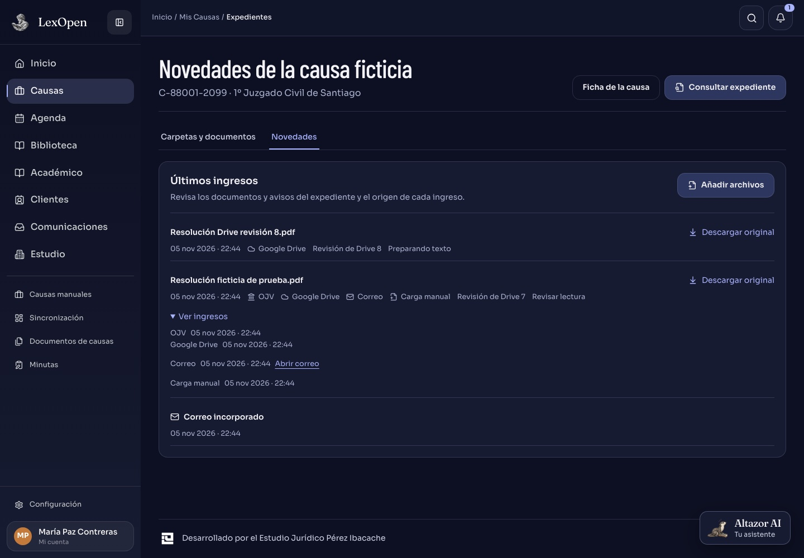
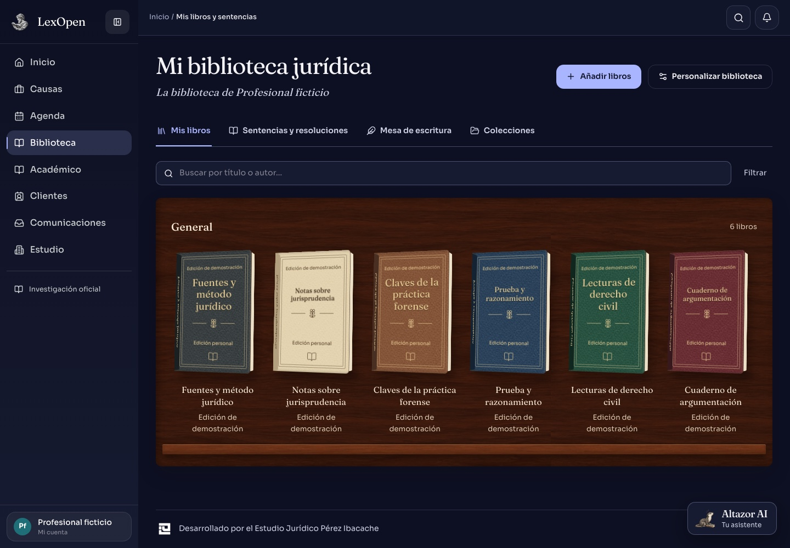
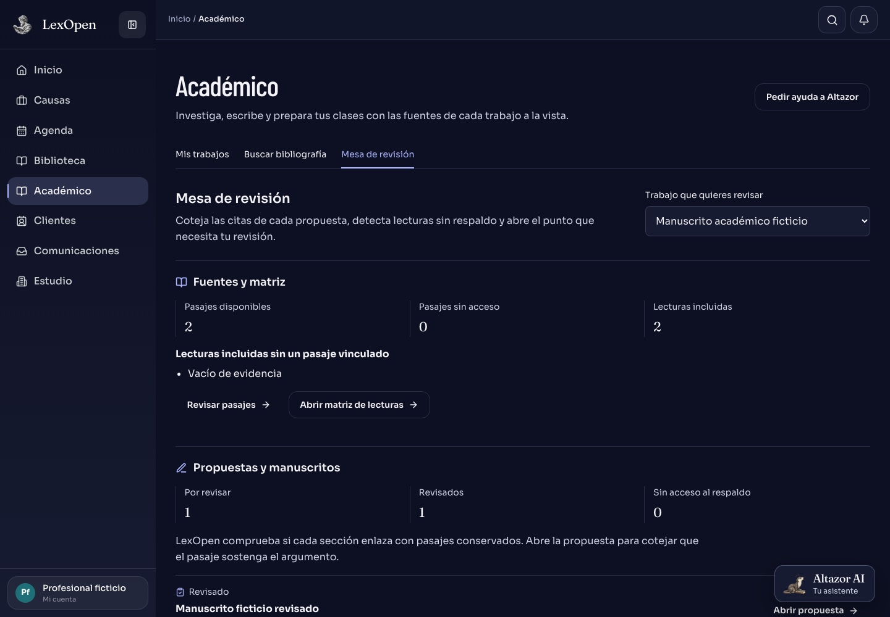

  <h1>
    <picture>
      <source media="(prefers-color-scheme: dark)" srcset="public/icons/lexopen-logo.png">
      
    </picture>
  </h1>
  
<strong>Causas, audiencias y escritos con sus fuentes a la vista.</strong>

  
Un espacio de trabajo para abogados, estudios jurídicos, investigadores y docentes.

  
<a href="#descargar-lexopen"><strong>Descargar LexOpen</strong></a> · <a href="#primeros-pasos">Primeros pasos</a> · <a href="#recorrido-por-la-aplicación">Ver la aplicación</a> · <a href="#ayuda-y-privacidad">Ayuda</a>

LexOpen reúne los documentos de cada causa, tus plazos, la preparación de audiencias y los borradores de escritos. Puedes volver desde una cita al pasaje que la respalda. **Altazor AI** te acompaña desde una conversación que conserva tus encargos, respuestas y avisos.

*Las capturas muestran LexOpen con expedientes y conversaciones ficticios. La galería muestra las herramientas de esta versión.*

## OJV y Buscador Unificado de Jurisprudencia

En la investigación jurídica puedes incorporar un fallo civil del Buscador Unificado del Poder Judicial por su identificador numérico. Introduce el ID en **Incorporar una fuente jurídica**, revisa la referencia preparada y pulsa **Recuperar fuente oficial**. LexOpen abre una sesión pública independiente de ClaveÚnica, exige el ID exacto y conserva la respuesta JSON y su texto en el corpus con versiones y hashes. Los previews y marcadores de anonimización sin texto no se incorporan como fallos íntegros.

La integración es experimental: no ofrece búsqueda remota por palabras, cobertura exhaustiva ni páginas de un PDF. Las fuentes incorporadas quedan disponibles para el equipo autorizado. En OJV, una respuesta que devuelve al inicio por sesión vencida produce un error explícito; no confirma que la causa esté sin novedades. [Alcance, pruebas y pendientes de la integración](docs/INTEGRACION-OJV-JURISPRUDENCIA-2026-11-09.md).

## Descargar LexOpen

Elige el archivo para tu equipo en la versión **1.1.0-preview.8**. [Ver la versión y todos sus archivos](https://github.com/gabrielperezibacache/lexopen/releases/tag/v1.1.0-preview.8)

| Tu equipo | Descarga |
| --- | --- |
| Windows de 64 bits, Intel o AMD | [Instalador EXE](https://github.com/gabrielperezibacache/lexopen/releases/download/v1.1.0-preview.8/LexOpen-1.1.0-preview.8-win-x64.exe) |
| Mac con chip Apple | [Instalador DMG](https://github.com/gabrielperezibacache/lexopen/releases/download/v1.1.0-preview.8/LexOpen-1.1.0-preview.8-mac-arm64.dmg) |
| Mac con procesador Intel | [Instalador DMG](https://github.com/gabrielperezibacache/lexopen/releases/download/v1.1.0-preview.8/LexOpen-1.1.0-preview.8-mac-x64.dmg) |
| Linux de 64 bits, Intel o AMD | [DEB](https://github.com/gabrielperezibacache/lexopen/releases/download/v1.1.0-preview.8/LexOpen-1.1.0-preview.8-linux-amd64.deb) · [AppImage](https://github.com/gabrielperezibacache/lexopen/releases/download/v1.1.0-preview.8/LexOpen-1.1.0-preview.8-linux-x86_64.AppImage) |

Esta versión es **preliminar**. Los instaladores de Windows y macOS carecen de firma de editor y macOS puede mostrar avisos. [Guía de instalación y requisitos](docs/INSTALADORES.md)

## Primeros pasos

1. **Abre LexOpen.** Si vas a guardar el trabajo en este equipo, elige **Este PC es el servidor** y crea la primera cuenta de administración. Si el estudio ya tiene un servidor, elige **Conectar a un servidor** y escribe la dirección que te indique el equipo.
2. **Entra en Mis Causas.** Crea una causa y añade una resolución o un documento. Puedes organizar expedientes manualmente en cualquier país.
3. **Prepara tu próximo trabajo.** Abre el documento, consulta su fuente, prepara la pauta de una audiencia o empieza un borrador. Desde **Inicio** puedes pedirle ayuda a Altazor.

Google Drive, correo y la integración judicial chilena se activan cuando el estudio los necesita. Altazor, su escritorio, la transcripción y los modelos locales tienen su propia preparación. [Conectar archivos y causas](docs/SINCRONIZACION.md) · [Preparar el escritorio de Altazor](docs/ESCRITORIO-ALTAZOR.md)

En **Configuración** se reúnen tus preferencias y los ajustes del estudio. **Comunicaciones** aparece allí al elegir Chile como país de trabajo o al activar las herramientas del PJUD.

En **Mi cuenta → Mi rol y permisos** puedes consultar el alcance de tu rol y los permisos adicionales o revocados. La administración técnica del Host y las atribuciones jurídicas del socio son responsabilidades distintas. Un permiso explícito de administración permite delegar los ajustes compartidos a otro integrante del equipo; las cuentas de cliente y externo siguen limitadas al portal. Nadie puede ampliar sus propios permisos ni dejar el Host sin un administrador efectivo.

Las preferencias, conexiones de Codex y autorizaciones personales pertenecen a cada usuario. La política de IA del estudio se aplica también a las conexiones personales. **Cuenta conectada** indica autorización; **Probar conexión** comprueba una respuesta del modelo seleccionado.

La **campanita** muestra los avisos recientes y los que quedan por leer. Desde allí puedes revisar un aviso o abrir el historial. Los avisos críticos mantienen su confirmación de recepción por separado.

## Recorrido por la aplicación

### Mis Causas

Cada expediente reúne carpetas, documentos, hechos, cronología, minutas y encargos del equipo. En **Novedades** puedes ver de dónde llegó un archivo y volver al original. Novedades agrupa ingresos idénticos verificados de carga manual, correo, Google Drive y OJV. Las revisiones de Drive con identidad propia conservan su copia.

### Audiencias y escritos

Prepara una pauta con tus documentos y notas. Durante la audiencia puedes registrar audio y revisar la transcripción si configuraste esa herramienta. Desde la causa, convierte lo revisado en hechos o borradores, continúa con guardado automático e historial y exporta a Word con referencias. [Audiencias en vivo](docs/ENTREGA-AUDIENCIAS-EN-VIVO-2026-11-02.md) · [Escritos](docs/ENTREGA-ESCRITOS-2026-11-02.md)

### Tu biblioteca

Organiza libros, sentencias y otros documentos en estantes que puedes personalizar. Añade PDF, EPUB y texto, entre otros formatos. Al importar puedes conservar el original o preparar una copia de texto, con reconocimiento de páginas escaneadas cuando corresponda. Comparte las colecciones que elijas y vuelve al pasaje usado al citar.

### Académico

Crea un trabajo para investigar, escribir o enseñar. Reúne bibliografía y pasajes, contrasta lecturas en la matriz y revisa tu manuscrito. La **Mesa de revisión** señala qué lecturas y secciones necesitan un pasaje vinculado. Desde allí puedes volver a la propuesta y cotejar el argumento antes de exportarlo.

### Altazor AI

Habla con Altazor desde **Inicio** o desde el acompañante lateral. Comparte el archivo de la causa que quieres revisar y retoma el trabajo desde el mismo hilo. Altazor recupera el contexto al que tienes acceso y te pide revisar los cambios que prepara. Debajo del chat puedes observar el escritorio cuando haya una sesión activa. [Guía de Altazor](docs/ALTAZOR.md) · [Conexiones y secretos](docs/ALTAZOR-CONEXIONES.md)

Puedes pegar un documento directamente en el chat, abrir una solicitud de ayuda del escritorio y activar desde **Mi cuenta** un resumen privado de plazos y correo judicial recibido.

Altazor resume el plan y cuenta sus acciones, con los detalles bajo demanda. El escritorio puede leer texto del navegador y documentos antes de recurrir a capturas. **Ícaros** permite delegar análisis a especialistas con modelo y memoria propios; **Ayuda a distancia** conserva las esperas y recibe respuestas por ntfy o WhatsApp conectado. Consulta la preparación del perfil de escritorio, los canales y el worker en la [guía de Altazor](docs/ALTAZOR.md).

Más capturas de la aplicación

| Pantalla | Escritorio | Móvil |
| --- | --- | --- |
| Portada | [Ver](docs/readme/portada-escritorio.jpg) | [Ver](docs/readme/portada-movil.jpg) |
| Iniciar sesión | [Ver](docs/readme/ingreso-escritorio.jpg) | [Ver](docs/readme/ingreso-movil.jpg) |
| Inicio con Altazor | [Ver](docs/readme/inicio-escritorio.jpg) | [Ver](docs/readme/inicio-movil.jpg) |
| Novedades | [Ver](docs/readme/novedades-escritorio.jpg) | [Ver](docs/readme/novedades-movil.jpg) |
| Biblioteca | [Ver](docs/readme/biblioteca-escritorio.jpg) | [Ver](docs/readme/biblioteca-movil.jpg) |
| Académico | [Ver](docs/readme/academico-escritorio.jpg) | [Ver](docs/readme/academico-movil.jpg) |

## Ayuda y privacidad

Los expedientes se guardan en el servidor del estudio y se comparten según los permisos de cada causa. Las conexiones externas y el proveedor de IA dependen de tu configuración. Revisa las propuestas y sus fuentes antes de incorporarlas a un escrito o compartirlas.

- **Instalación o actualización.** [Instaladores](docs/INSTALADORES.md) · [Respaldos y recuperación](docs/ACTUALIZACIONES.md)
- **Sincronización.** [Google Drive](docs/SINCRONIZACION.md) · [Poder Judicial de Chile](docs/PJUD.md)
- **Sugerencias o fallos.** En **Mi cuenta → Feedback** puedes escribirle a la administración de tu estudio y seguir el estado del comentario. Si reportas un problema públicamente, usa ejemplos ficticios e indica la versión de LexOpen. [Abrir un reporte en GitHub](https://github.com/gabrielperezibacache/lexopen/issues)

## Desarrollo y licencia

Guías para contribuir o ejecutar el código

- [Guía de contribución](CONTRIBUTING.md) y [configuración de ejemplo](.env.example).
- [Preparar el servidor desde el código](docs/WEB-HOST.md) y [comprobaciones automáticas](https://github.com/gabrielperezibacache/lexopen/actions/workflows/ci.yml).
- [Plan de desarrollo](docs/PLAN-DESARROLLO-2026-11-05.md) e [identidad visual](docs/REFERENCIAS-GRAFICAS-2026-11-05.md).
- [Correcciones de auditoría y pendientes vigentes](docs/CORRECCIONES-AUDITORIA-2026-11-07.md).
- [Activar WhatsApp](docs/WHATSAPP-Y-OFFLINE.md).
- [Trabajo sin conexión: escritos, Clientes y tareas](docs/TRABAJO-SIN-CONEXION.md).
- [Cobertura funcional de Altazor](docs/COBERTURA-ALTAZOR.md).

LexOpen se desarrolla en el **Estudio Jurídico Pérez Ibacache** y se publica bajo la licencia **GNU AGPL v3**. [Estudio Jurídico Pérez Ibacache](https://perezibacache.cl/) · [Licencia](LICENSE)
