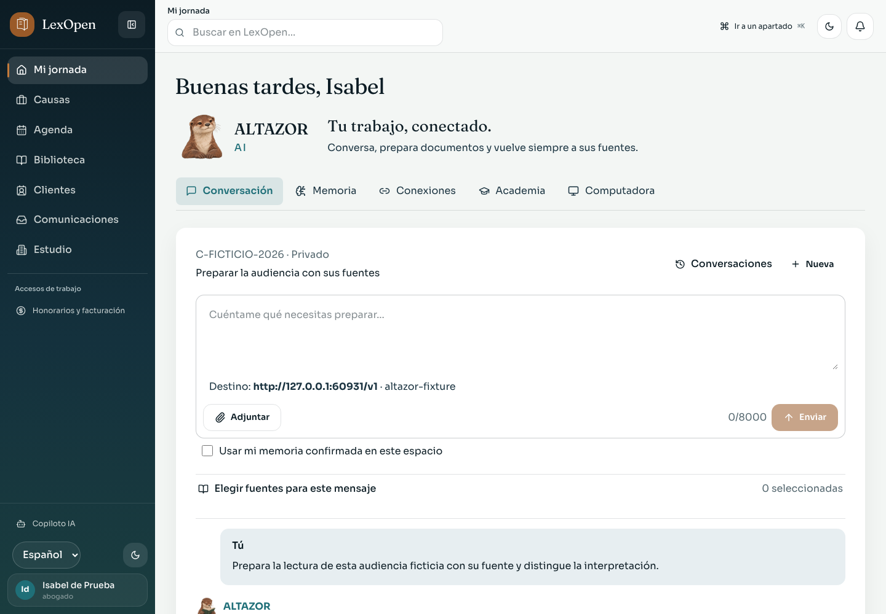
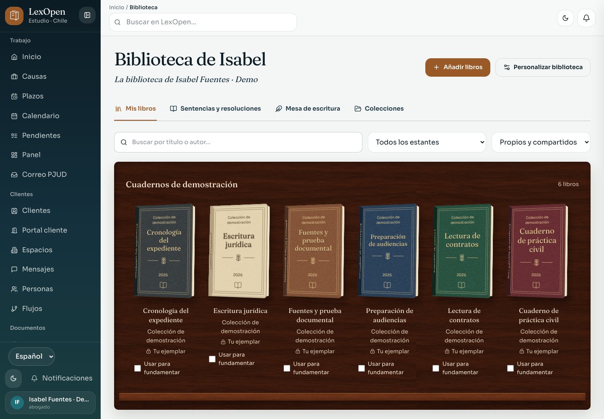
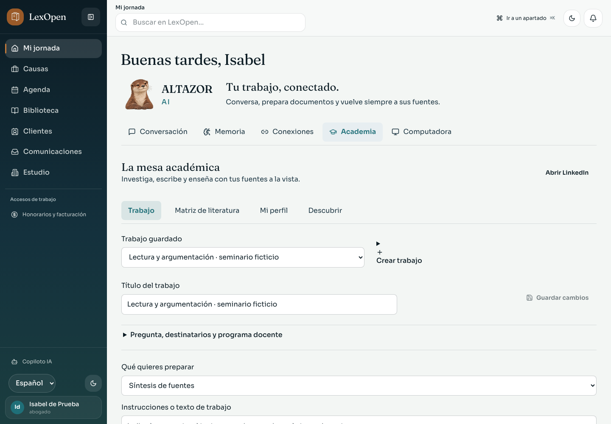
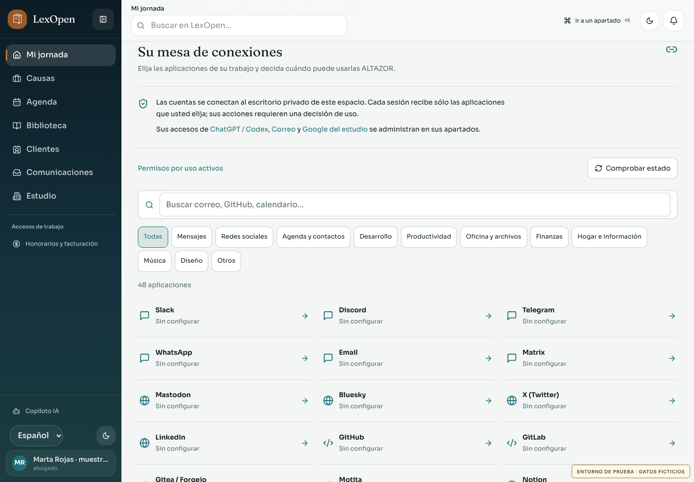
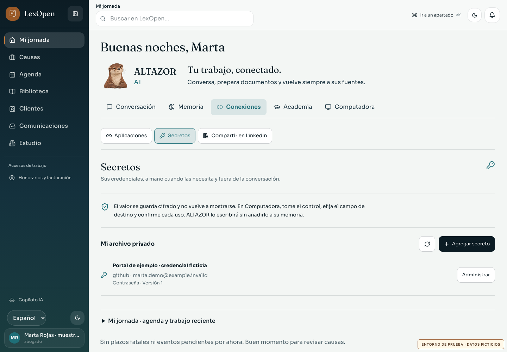

<div align="center">
  
  <h1>LexOpen</h1>
  <p><strong>De los antecedentes al escrito, con sus fuentes a la vista.</strong></p>
  <p>Una aplicación abierta para profesionales y estudios jurídicos en Chile.</p>
  <p>
    <a href="https://github.com/gabrielperezibacache/lexopen/actions/workflows/ci.yml"></a>
    <a href="LICENSE"></a>
  </p>
  <p><a href="#el-trabajo-de-una-causa">Recorrido</a> · <a href="#altazor-ai">ALTAZOR AI</a> · <a href="#instalar">Instalar</a> · <a href="#desarrollo-y-comprobaciones">Desarrollo</a> · <a href="#guías">Guías</a></p>
</div>



LexOpen reúne causas, biblioteca, investigación, audiencias y escritos con la agenda y la operación del estudio. ALTAZOR AI acompaña ese recorrido desde el inicio: recibe un encargo, trabaja con los documentos elegidos y presenta resultados que la persona puede revisar e incorporar.

**Versión del código: `1.1.0-preview.4`.** Consulte los archivos efectivamente publicados y su revisión en [GitHub Releases](https://github.com/gabrielperezibacache/lexopen/releases). El catálogo nuevo, las autorizaciones por operación y Secretos requieren esta revisión del código; los instaladores anteriores `preview.3` (`c878fc5`) no los incluyen. Una versión en el repositorio no acredita por sí sola que sus instaladores estén publicados.

El inicio de sesión simplificado, la renovación del escritorio y las mejoras de navegación descritas aquí corresponden al desarrollo posterior a `preview.4`; requieren una compilación que incluya esos cambios.

Las imágenes son **capturas de la aplicación con datos ficticios**. Las respuestas de IA de las galerías usan servicios de prueba; una captura no acredita cuentas conectadas ni ejecución de Docker. Consulte [procedencia de ALTAZOR](docs/altazor-2026-11-04/README.md), [conexiones y Secretos](docs/altazor-conexiones-2026-11-04/README.md), [navegación](docs/interfaz-2026-11-04/README.md) y [biblioteca](docs/assets/screenshots/README.md).

## El trabajo de una causa

| Paso | Qué puede hacer |
| --- | --- |
| **1. Reunir antecedentes** | Abra una causa, organice su expediente y vincule personas, documentos, tareas y plazos. Busque en OJV por RIT/ROL y tribunal o ingrese manualmente con ClaveÚnica para consultar Mis Causas e importar a su cartera. |
| **2. Preparar con fuentes** | Incorpore documentos propios o archivos elegidos de espacios y Drive. Registre hechos, cronología y contradicciones con sus pasajes de respaldo. Consulte las fuentes oficiales admitidas por los importadores. |
| **3. Acompañar la audiencia** | Abra una mesa privada por causa con guion, reloj, lector, notas y conversación con fuentes. Active expresamente la captura y revise los registros que convierta en hechos, notas o borradores. |
| **4. Escribir y revisar** | Continúe en el editor de la causa, con guardado automático e historial. Incorpore hechos, notas y citas; vuelva al respaldo y exporte el escrito en Markdown o TXT. |

Las referencias vuelven a comprobar acceso, versión y pasaje conservado. El cotejo literal ayuda a localizar un respaldo; la pertinencia jurídica, la vigencia de la fuente y el cómputo de los plazos requieren revisión profesional.

### Una biblioteca que se siente propia

Organice libros en estantes, elija encuadernaciones y personalice su biblioteca. La colección personal es privada y puede compartir colecciones con personas elegidas. Incorpore PDF, EPUB, DOC/DOCX, ODT, RTF y texto, entre otros formatos; las sentencias y resoluciones admiten ficha de tribunal, rol y fecha.



Puede conservar el original o retener sólo el texto convertido, con OCR cuando sea necesario y esté disponible. El lector muestra el PDF conservado o el texto disponible y distingue extracción parcial, OCR y ubicación de los pasajes. La recuperación utiliza búsqueda léxica BM25; el análisis de IA trabaja con los pasajes elegidos. [Biblioteca, formatos y citas](docs/BIBLIOTECA-PERSONAL-2026-11-01.md).

### La mesa de audiencia

El reloj y el capturador permanecen montados al consultar herramientas. Abrir la mesa no activa el micrófono: la persona autoriza la captura. La transcripción se incorpora por tramos de unos quince segundos, después del procesamiento; conserva los originales privados y permite revisar o reintentar fallos.


Los registros se convierten en propuestas revisables antes de incorporarse a la causa o a un escrito. [Audiencias](docs/ENTREGA-AUDIENCIAS-EN-VIVO-2026-11-02.md) · [Audio, transcripción y recuperación](docs/ENTREGA-TRANSCRIPCION-EN-VIVO-2026-11-02.md).

### El escrito conserva su recorrido

La hoja ocupa el espacio principal; fuentes, referencias, historial y exportación se consultan en un panel contextual. El editor permite recuperar versiones y comprobar sus respaldos al consultar o exportar.


## ALTAZOR AI

**Mi jornada** abre una conversación privada, personal o vinculada a una causa accesible. Adjunte archivos, seleccione fuentes y revise el destino de IA antes de autorizar un envío remoto. Las acciones sobre herramientas se presentan como un plan revisable; conversaciones y trabajos guardados permiten continuar después.

| Herramienta | Para qué sirve |
| --- | --- |
| **Memoria** | Recuerdos y relaciones en grafo y lista. Separa propuestas de recuerdos confirmados; permite editar u olvidar y revalida sus respaldos. La memoria confirmada se utiliza al autorizar su incorporación a la consulta. |
| **Academia** | Investigación y docencia: pregunta, perfil, fuentes, matriz de literatura, bibliografía, programas, rúbricas y textos editables. Exporta Word o Markdown y permite incorporar un resultado revisado a una causa. |
| **Descubrir** | Metadatos de Crossref, OpenAlex y ORCID público. Las alertas temáticas se actualizan manualmente. Un registro bibliográfico no implica lectura ni cotejo de su texto completo. |
| **Conexiones** | Catálogo de 48 aplicaciones y servicios, búsqueda por categoría, configuración y estados. Elija las conexiones de cada escritorio y revise cada operación que solicite el asistente. |
| **Secretos** | Credenciales privadas cifradas, introducidas en un formulario reservado. Su valor no vuelve a la interfaz ni se incorpora al chat o a la memoria. Cada escritura requiere control manual y confirmación de un uso concreto. |
| **Computadora** | Escritorio opcional en contenedor: encargos con archivos elegidos, captura, control manual, cancelación y cierre. Requiere un gateway preparado por el administrador y está desactivado por defecto. |



Desde la conversación también puede pedir un encargo para un escritorio ya abierto: ALTAZOR presenta el texto completo, el proveedor y las aplicaciones elegidas antes de confirmar. La tarjeta del resultado abre esa misma sesión; sus operaciones de conexión se autorizan allí por separado. No se copian adjuntos, memoria ni secretos automáticamente.

El recorrido recupera causas y escritorios anteriores aunque hayan salido de las listas recientes. Una conversación archivada conserva los resultados consultables, con acceso vigente a sus fuentes. Para continuar un ingreso manual, la persona puede mantener el mismo escritorio durante 20 minutos más, con un máximo de dos horas desde su apertura y una nueva comprobación de permisos.

Las conexiones abarcan mensajería, oficina, calendarios, repositorios, productividad, redes sociales, diagramas y otros servicios. Su disponibilidad depende de la cuenta, los permisos, la plataforma del gateway y la configuración del proveedor. OAuth suele requerir una aplicación registrada; una tarjeta del catálogo no conecta una cuenta.



Los trabajos académicos pueden preparar borradores para LinkedIn. La publicación personal exige revisar texto y cuenta y confirmar el envío; una respuesta incierta no se reenvía automáticamente. Las interacciones sociales permanecen en LinkedIn.

**Secretos en el escritorio.** Una autorización dura hasta 60 segundos, vincula una versión del secreto con una sesión y se consume una vez. No pulsa Enter ni envía el formulario. El sitio y el campo son declarados por la persona: ALTAZOR comprueba sesión y control, pero no acredita el DOM ni la dirección de la página. Si el campo muestra el valor, el asistente podría verlo al devolverle el control. Los ajustes del gateway tienen un almacenamiento distinto al cifrado de Secretos. [Conexiones, operación y límites](docs/ALTAZOR-CONEXIONES.md).

**Conectar una cuenta.** Google Workspace y GitHub ofrecen el recorrido **Conectar → ingreso en la página oficial → volver a LexOpen**. El administrador habilita el servicio una vez; cada profesional concede su propio acceso. Los campos de claves y tokens quedan en opciones avanzadas. La autorización de Google es temporal y se limita a metadatos de Drive; GitHub permite consultar el perfil y repositorios públicos. [Preparación y alcance](docs/ALTAZOR-CONEXIONES.md#inicio-de-sesión-sencillo).


[Vista móvil y procedencia de las capturas](docs/altazor-oauth-2026-11-05/README.md). Estas imágenes muestran pruebas controladas de la interfaz, no cuentas reales conectadas.

<details>
<summary><strong>Ver Secretos y el recorrido móvil</strong></summary>



[Catorce capturas de escritorio y móvil, con su alcance y manifiesto](docs/altazor-conexiones-2026-11-04/README.md). El escritorio de esta galería utiliza un gateway simulado; su imagen interna es sintética y no acredita Docker ni acceso a cuentas externas.

</details>

## Instalar

### Windows, macOS y Linux

Descargue una versión publicada en [Releases](https://github.com/gabrielperezibacache/lexopen/releases) y elija **Host del estudio** o **Conectar a un Host**. El Host conserva PostgreSQL y los archivos; los clientes acceden a ese equipo. Los instaladores incluyen su runtime y no necesitan Node, Git o npm externos para iniciar.

| Sistema | Arquitectura | Formatos |
| --- | --- | --- |
| Windows | x64 | `.exe`, `.zip` |
| macOS | Apple Silicon e Intel | `.dmg`, `.zip` por arquitectura |
| Linux | x64 | `.AppImage`, `.deb` |

Son versiones preliminares: compruebe el estado de firma y notarización del paquete y su manifiesto. Las pruebas de paquetes en CI no sustituyen instalar y actualizar la ventana gráfica en cada equipo. OCR, modelos, transcripción, Codex y el entorno del escritorio tienen requisitos independientes. [Instaladores y alcance](docs/INSTALADORES.md) · [Desktop](docs/DESKTOP.md).

### Host desde el código

Requiere Node.js **22.12 o posterior**, npm, Git y un directorio persistente para base y documentos:

```bash
git clone https://github.com/gabrielperezibacache/lexopen.git
cd lexopen
npm ci
npm run web:host
```

El asistente prepara PostgreSQL embebido, aplica migraciones y arranca la aplicación. Abra `http://127.0.0.1:3000/setup` y cree el primer administrador con el token de instalación de la configuración de su carpeta de datos. Una instalación nueva no carga expedientes ficticios automáticamente.

Conserve esa carpeta fuera del directorio de la aplicación. Para elegirla:

```bash
LEXOPEN_DATA_DIR=/ruta/persistente/lexopen npm run web:host
```

En PowerShell, establezca `$env:LEXOPEN_DATA_DIR="C:\LexOpenData"` antes de ejecutar `npm run web:host`. LAN o Tailscale requieren configurar la red y los orígenes permitidos; la captura del navegador necesita HTTPS o loopback. [Guía del Host](docs/WEB-HOST.md).

### Actualizaciones y respaldos

Utilice **Configuración → Actualizaciones**, cuando esté disponible. Desktop separa los canales estable y vista previa. El flujo verifica la versión tras reiniciar y utiliza las dependencias fijadas; en modo Host requiere un respaldo comprobado antes de instalar.

Conserve la carpeta de datos y su configuración segura. No sustituya ni pierda `SESSION_SECRET`: protege sesiones y datos cifrados, incluidos los secretos nuevos. No copie `pgdata` mientras PostgreSQL está en marcha. [Actualización y recuperación](docs/ACTUALIZACIONES.md) · [Respaldos](docs/WEB-HOST.md) · [Desinstalación](docs/DESINSTALAR.md).

## Otras herramientas del estudio

La navegación agrupa **Mi jornada, Causas, Agenda, Biblioteca, Clientes, Comunicaciones y Estudio**, con destinos secundarios del área abierta. Incluye espacios de trabajo con archivos y miembros, tareas, calendarios, minutas, avisos, horas, gastos, provisiones y cobros internos. El portal del cliente conserva sus permisos y recorrido propios. La facturación interna no emite DTE del SII.

Las integraciones son opcionales: Google Workspace, archivos de Drive, proveedores de IA y transcripción, cuenta personal ChatGPT/Codex, LinkedIn, PJUD/OJV y almacenamiento local o compatible con S3. OJV requiere acceso oficial vigente; los resultados parciales y cuadernos no accesibles se identifican y la automatización es una opción expresa. [PJUD e ingreso manual](docs/PJUD.md) · [Codex personal](docs/CODEX.md).

## Desarrollo y comprobaciones

Next.js 16, React 19, TypeScript, Prisma y PostgreSQL. Consulte [configuración](.env.example), [contribuciones](CONTRIBUTING.md) y `AGENTS.md`; esta versión de Next requiere revisar su documentación instalada.

Prepare una base PostgreSQL **vacía y exclusiva para desarrollo**:

```bash
cp .env.example .env
# Configure DATABASE_URL y un SESSION_SECRET fuerte antes de continuar.
npm ci
npm run db:migrate
npm run db:seed
npm run dev
```

El seed crea usuarios y datos ficticios; se reserva para desarrollo. Comprobaciones habituales:

```bash
npm run lint
npm test
npm run build
npm run test:altazor
```

Las integraciones requieren `DATABASE_URL` y `E2E_DATABASE_URL` iguales, en una base local desechable cuyo nombre incluya `test` o `e2e`. `npm run test:altazor:integration` comprueba persistencia, permisos, conectores y Secretos con servicios ficticios. Playwright utiliza su propia base dedicada y puede reinicializarla. El job separado `altazor-computer-runtime` prueba contenedores reales con un modelo de prueba; simulaciones y capturas no sustituyen ese resultado. [Operación del escritorio y pruebas](src/lib/altazor/computer/README.md).

## Guías

| Guía | Contenido |
| --- | --- |
| [ALTAZOR](docs/ALTAZOR.md) · [Conexiones y Secretos](docs/ALTAZOR-CONEXIONES.md) | Conversación, memoria, Academia, cuentas, autorizaciones y escritorio. |
| [Descubrimiento académico](docs/altazor-discovery.md) | Índices, bibliografía, formatos y límites de las referencias. |
| [Navegación](docs/NAVEGACION-Y-ESPACIOS-DE-TRABAJO.md) · [Galería](docs/interfaz-2026-11-04/README.md) | Recorridos de escritorio y móvil, capturas y procedencia. |
| [Host](docs/WEB-HOST.md) · [Desktop](docs/DESKTOP.md) · [Instaladores](docs/INSTALADORES.md) | Instalación, permisos, red y distribución por plataforma. |
| [Actualizaciones](docs/ACTUALIZACIONES.md) · [Mesa del asistente](docs/WORKBENCH.md) | Respaldo, recuperación y documentos revisables por causa. |
| [Biblioteca](docs/BIBLIOTECA-PERSONAL-2026-11-01.md) · [Audiencias](docs/ENTREGA-AUDIENCIAS-EN-VIVO-2026-11-02.md) | Lectura, citas, preparación y continuidad con escritos. |

Las contribuciones se coordinan mediante issues y pull requests, con evidencia de validación y datos de prueba separados de expedientes reales. LexOpen se distribuye bajo **AGPL-3.0-or-later**: [licencia](LICENSE).
