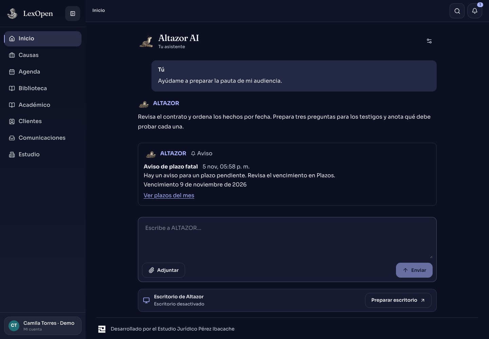
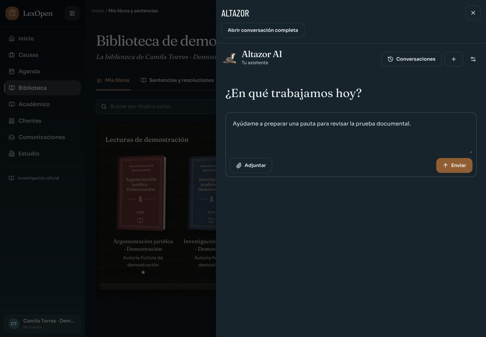
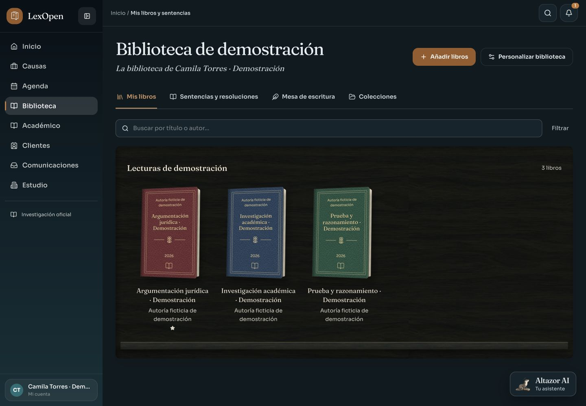
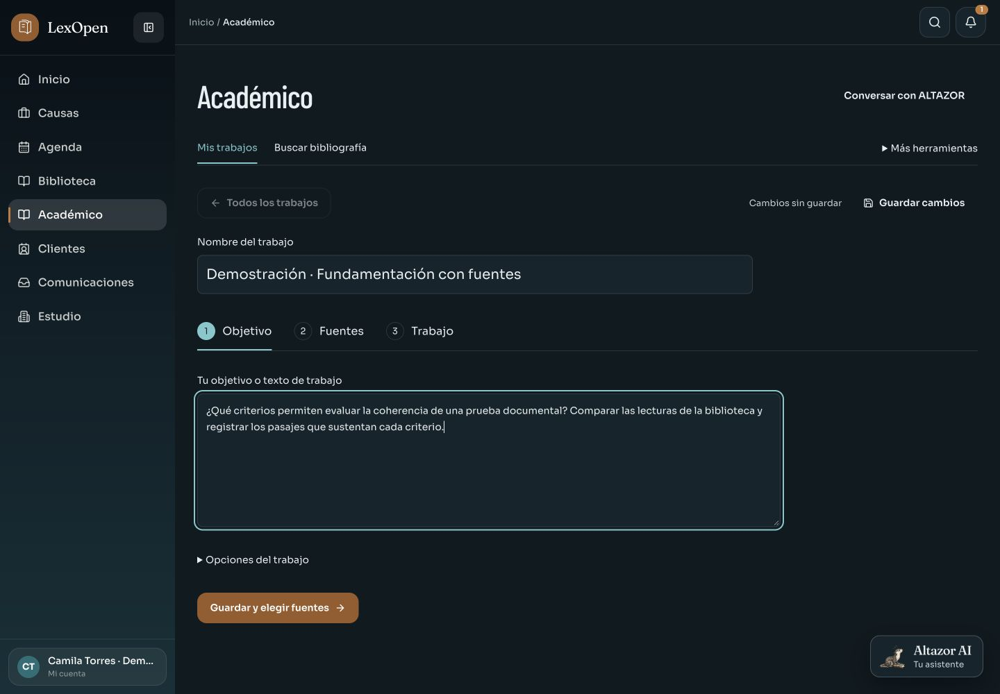
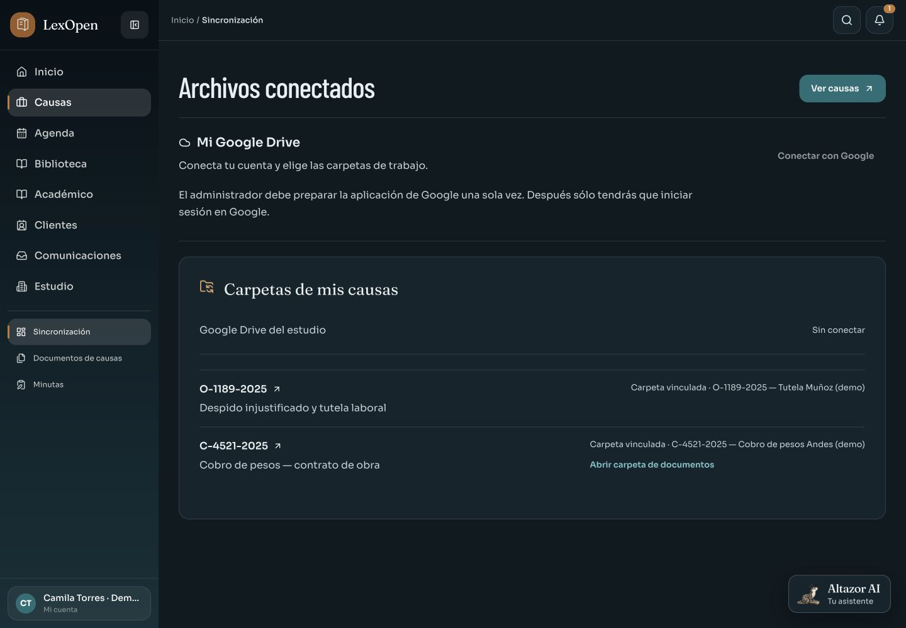

<div align="center">
  <picture>
    <source media="(prefers-color-scheme: dark)" srcset="docs/assets/lexopen-logo.png">
    
  </picture>
  <h1>LexOpen</h1>
  <p><strong>Tu estudio, con sus fuentes a la vista.</strong></p>
  <p>Causas, biblioteca, investigación, audiencias y escritos. ALTAZOR te acompaña en cada apartado.</p>
  <p>
    <a href="https://github.com/gabrielperezibacache/lexopen/actions/workflows/ci.yml"></a>
    <a href="LICENSE"></a>
  </p>
  <p><a href="#trabajar-con-lexopen">Recorrido</a> · <a href="#altazor-tu-asistente">ALTAZOR</a> · <a href="#académico">Académico</a> · <a href="#sincronización">Sincronización</a> · <a href="#instalar">Instalar</a></p>
</div>



LexOpen es una aplicación abierta para profesionales y estudios jurídicos. Reúne el expediente y sus documentos con el trabajo diario del estudio, y conserva el vínculo entre una afirmación, su cita y el pasaje que la respalda. Puedes organizar causas de cualquier país manualmente o activar la conexión con el Poder Judicial de Chile.

**Código actual: `1.1.0-preview.6`.** Descarga únicamente los paquetes efectivamente publicados en [GitHub Releases](https://github.com/gabrielperezibacache/lexopen/releases). Los instaladores anteriores no incorporan necesariamente las funciones del código actual.

La nueva identidad reúne un grabado clásico, fondos índigo y texto plateado. Las imágenes son **capturas reales de LexOpen con datos ficticios**. [Ver la portada, el ingreso, Altazor y Mis Causas en escritorio y móvil](docs/puesto-altazor-2026-11-05/README.md).

Logotipo en PNG transparente para [fondos oscuros](public/icons/lexopen-logo.png) y [fondos claros](public/icons/lexopen-logo-ink.png).

## Trabajar con LexOpen

| Paso | Tu trabajo |
| --- | --- |
| **Reunir** | Crea o importa la causa, vincula personas y organiza su expediente. Incorpora archivos locales, de espacios o de Drive. |
| **Preparar** | Construye hechos, cronología y contradicciones; elige libros, sentencias y pasajes para fundamentar. |
| **Acompañar** | Abre el panel de audiencia con guion, documentos, notas, reloj y asistencia. Activa voluntariamente audio y transcripción. |
| **Escribir** | Trabaja en borradores privados por causa, con guardado automático, historial y exportación Word con notas al pie. |
| **Revisar** | Vuelve a las fuentes antes de incorporar un resultado. La aplicación comprueba acceso y respaldos; los cambios y envíos requieren la intervención correspondiente. |

La navegación organiza **Inicio, Causas, Agenda, Biblioteca, Académico, Clientes, Comunicaciones y Estudio**. Cada área muestra sus herramientas; el portal del cliente mantiene su recorrido y permisos propios. Apariencia e idioma están en el menú de la cuenta, y las opciones de cada trabajo aparecen cuando se necesitan.

## ALTAZOR, tu asistente

Inicio y el acompañante lateral comparten **un solo hilo** con tus encargos, respuestas y avisos. Escribe, adjunta archivos y continúa al cambiar de apartado. Altazor reconoce la causa cuando puede identificarla y recupera intercambios pertinentes y fuentes con acceso vigente. «Mi asistente» reúne memoria, conexiones y computadora.

- **Continuidad privada:** conversaciones y preferencias por usuario; contexto personal o de una causa reconocida por su referencia, enlace o expediente abierto. Si la identificación es ambigua, lo pregunta en la conversación. Los enlaces del antiguo Copiloto preparan un borrador revisable y su historial se conserva como archivo privado.
- **Memoria con relaciones:** recuerdos confirmados y un grafo consultable; puedes corregir o retirar lo que conservas. También recupera intercambios anteriores relevantes del mismo ámbito. Una conversación antigua no se presenta como una cita verificada ni una inferencia del modelo se convierte por sí sola en un recuerdo confirmado.
- **Herramientas del estudio:** consulta de causas y biblioteca; tareas, agenda, notas, audiencias y preparación de escritos. Guardar una respuesta con fuentes como escrito requiere confirmación y una causa accesible.
- **Trabajo en segundo plano:** los mensajes enviados quedan guardados y el Host puede continuarlos sin su pestaña. No se repiten automáticamente operaciones interrumpidas o de resultado incierto. Un encargo que esperó más de un día pide revisión.
- **Escritorio:** debajo del chat puedes ver la pantalla del escritorio cuando está abierto, junto con el estado de su trabajo. La vista de Inicio es de lectura y se pausa durante el control manual. El escritorio separado acepta los archivos que elijas, incluidos PDF, Office, ODT, EPUB y audio compatible. [Herramientas y preparación](docs/ESCRITORIO-ALTAZOR.md).
- **Conexiones y Secretos:** catálogo de servicios, permisos por operación y Secretos cifrados. El servicio de escritorio tiene sus propios requisitos de protección de credenciales. La escritura de un secreto en el escritorio usa una autorización breve y de un solo uso; no pulsa Enter ni envía el formulario.



La continuidad de ejecución requiere que el Host y los servicios necesarios estén disponibles. La elección de modelo, el acceso a servicios externos y el uso de la computadora tienen configuración y requisitos propios. [Guía de ALTAZOR](docs/ALTAZOR.md) · [Conexiones y Secretos](docs/ALTAZOR-CONEXIONES.md) · [Cuenta personal de Codex](docs/CODEX.md).

## IA local

En **Configuración → Conexiones e IA**, el equipo principal puede comprobar Ollama, descargar y verificar un perfil ligero y probarlo antes de usarlo. Qwen3 0.6B, Qwen3 1.7B y Gemma 3 1B tienen descargas de aproximadamente 523 MB, 1,36 GB y 806 MB. Son perfiles para clasificación, extracción y borradores breves. Las citas siguen remitiendo a los pasajes comprobados.

El tamaño de descarga y la RAM son medidas distintas. Qwen3 0.6B alcanzó 1,35 GB de memoria residente en una prueba breve de llama.cpp en CPU de un Mac M4 Max. [Configuración, medición y herramientas locales](docs/IA-LOCAL.md).

## Una biblioteca propia

Libros con encuadernaciones clásicas, estantes, portadas y seis composiciones personalizables. La biblioteca es privada; puedes compartir colecciones concretas.

Añade PDF, EPUB, texto y los formatos documentales admitidos. Para archivos grandes puedes elegir preparación de texto, OCR cuando corresponda y conservación del original. Libros, sentencias y resoluciones permiten volver a la versión y al pasaje utilizados; un texto sin localizador comprobado no se presenta como cita verificada.

El lector reúne lectura, notas, organización y conversación con los materiales elegidos. Los registros de audiencia y las transcripciones revisadas pueden convertirse en hechos, notas o borradores. La captura requiere acción expresa y disponibilidad del proveedor de transcripción. [Biblioteca y evidencia visual](docs/assets/screenshots/README.md).



## Académico

Un apartado propio para **Investigar, Escribir y Enseñar**, con tres pasos: objetivo, fuentes y trabajo. Incluye síntesis, estado del arte, comparación, revisión de afirmaciones y bibliografía, escritura, abstract, traducción, revisión por pares, programas, rúbricas, materiales docentes y perfil académico.

Los proyectos conservan su selección de fuentes. El editor tiene guardado automático, historial y recuperación como nueva revisión; permite exportar Word y preparar la incorporación a una causa. La matriz organiza preguntas, dimensiones y respaldos. El descubrimiento bibliográfico consulta las fuentes y servicios admitidos; los resultados de búsqueda siguen requiriendo revisión.

Desde la conversación puedes crear el proyecto y preparar el encargo con sus fuentes; **la generación se ejecuta en Académico**. Los borradores para interacción profesional se preparan para LinkedIn, con revisión del contenido y confirmación del envío; no hay una red social interna.

**Mesa de revisión** muestra pasajes sin acceso, lecturas de la matriz sin respaldo vinculado y secciones del manuscrito sin referencias a pasajes conservados. Desde los hallazgos puedes abrir las fuentes, la matriz o la propuesta para cotejar el argumento.



## Causas manuales o conectadas

**Causas** abre siempre **Mis Causas**. Desde **Configuración → Gestión de causas**, el administrador decide si activa la integración judicial para el estudio.

| Modalidad | Recorrido |
| --- | --- |
| **Gestión manual** | Causas de cualquier país, con referencia, órgano y materia libres. Añade resoluciones, documentos y carpetas; prepara hechos, audiencias y escritos con sus fuentes. |
| **Poder Judicial de Chile** | Añade herramientas para consultar por RIT/ROL, ingresar con ClaveÚnica, importar y seguir causas. Los expedientes siguen reuniéndose en Mis Causas. |

Las instalaciones nuevas empiezan en gestión manual. Cambiar la modalidad conserva causas, archivos, preferencias y conexiones. Al desactivar PJUD se pausan las consultas y descargas judiciales pendientes; el trabajo manual y Drive siguen disponibles. Reactivarlo permite retomar la cola, con un nuevo ingreso personal cuando la sesión oficial haya vencido.

[Ver configuración](docs/conversation-first-2026-11-05/configuracion-causas.jpg) · [Causa manual de ejemplo](docs/conversation-first-2026-11-05/nueva-causa-manual.jpg) · [Vista PJUD](docs/conversation-first-2026-11-05/pjud-escritorio.jpg).

### Mis Causas

Desde **Mis Causas**, abre el expediente documental de una causa. Allí puedes crear carpetas, mover documentos dentro de la causa y volver al original o consultar a Altazor sobre un archivo. El orden del expediente conserva la procedencia, las versiones y los pasajes que respaldan citas existentes.

El expediente reúne cargas manuales y copias importadas de OJV o Drive. Puedes trabajar con archivos locales y, si hay una cuenta y carpeta del estudio autorizadas, conservar también el original en Drive. Los documentos de una carpeta vinculada se incorporan explícitamente o mediante la sincronización que hayas activado.

### Tareas y minutas

En **Tareas** puedes asignar encargos al equipo autorizado, escribir cómo resolverlos y destacar una causa para que sus pendientes suban de prioridad. El Excel reúne encargos pendientes, responsables, vencimientos, prioridades e instrucciones para compartirlo con el equipo. **Minutas** abre la selección de la causa, con acceso a los borradores recientes y las plantillas.

## Sincronización

### Google Drive

En **Causas → Sincronización**, el apartado **Archivos conectados** reúne tu Google Drive y las carpetas de las causas. Conecta tu propia cuenta mediante el ingreso oficial de Google. El administrador prepara la aplicación una sola vez; después cada profesional autoriza su acceso. No necesita copiar tokens.

Elige una carpeta por nombre y confirma qué raíz quieres utilizar. LexOpen puede revisar esa carpeta y sus subcarpetas, conservar nuevas versiones e incorporarlas al procesamiento documental. Puedes elegir frecuencia y pausar. Cambiar de cuenta, perder permisos o desconectar detiene el trabajo pendiente; borrar una copia local no hace que la misma versión se recree silenciosamente.

La cuenta personal y la cuenta de Google del estudio son conexiones distintas. La autorización personal solicita lectura de contenido y renovación del acceso; el conector de metadatos de la computadora no se amplía automáticamente. [Configuración y límites de sincronización](docs/SINCRONIZACION.md).

### OJV y ClaveÚnica

Activa **Poder Judicial de Chile** desde **Configuración → Gestión de causas**. Quienes tienen acceso pueden abrir las herramientas judiciales desde **Mis Causas** y consultar por **RIT/ROL y tribunal**, o ingresar personalmente con ClaveÚnica en la ventana oficial y elegir las causas que desean incorporar. La contraseña se escribe únicamente en el portal oficial.

Por causa puedes elegir seguimiento, frecuencia y descarga de documentos nuevos. La cola recorre los cuadernos disponibles, conserva originales y separa el estado de movimientos del de descargas. Si vence el ingreso judicial, los documentos pendientes esperan un nuevo inicio manual; no hay una sesión autenticada permanente ni se eluden desafíos del portal.



Los trabajos automáticos necesitan un Host disponible. OJV depende del acceso oficial, sus desafíos y la disponibilidad de cada documento. Los archivos inaccesibles y los resultados parciales se identifican. [Ingreso judicial y operación](docs/PJUD.md).

Conecta tu buzón en **Configuración → Configurar correo** o desde **Mi cuenta**. Si el correo judicial identifica un RIT o ROL y su tribunal sin ambigüedad, y tienes permiso para escribir en la causa, LexOpen archiva sus adjuntos en la carpeta **Correo PJUD** del expediente. Las coincidencias dudosas quedan en la bandeja para revisión. Altazor reúne los avisos de correo y los vencimientos registrados en el mismo chat.

## Instalar

Descarga una versión publicada en [Releases](https://github.com/gabrielperezibacache/lexopen/releases) y elige **Host del estudio** o **Conectar a un Host**. El Host conserva la base y los archivos; los clientes acceden a ese equipo. Los paquetes incluyen su runtime para iniciar.

| Sistema | Arquitectura | Formatos |
| --- | --- | --- |
| Windows | x64 | `.exe`, `.zip` |
| macOS | Apple Silicon e Intel | `.dmg`, `.zip` por arquitectura |
| Linux | x64 | `.AppImage`, `.deb` |

Son versiones preliminares. El manifiesto de cada publicación informa revisión, integridad y estado de firma; comprobar un paquete en CI no sustituye instalar y actualizar la aplicación gráfica en cada equipo. OCR, modelos, transcripción y computadora de ALTAZOR tienen requisitos independientes. [Instaladores](docs/INSTALADORES.md) · [Desktop](docs/DESKTOP.md).

En el primer arranque del Host, **Comprobar escritorio** indica si el motor y el perfil de herramientas están disponibles. El perfil reúne LibreOffice, OCR en español e inglés, PDF, EPUB, bibliografía, audio y búsqueda de archivos. [Preparación del escritorio](docs/ESCRITORIO-ALTAZOR.md) · [Plan del puesto de trabajo](docs/PLAN-PUESTO-DE-TRABAJO-ALTAZOR.md).

<details>
<summary><strong>Preparar un Host desde el código</strong></summary>

Requiere Node.js **22.12 o posterior**, npm, Git y un directorio persistente:

```bash
git clone https://github.com/gabrielperezibacache/lexopen.git
cd lexopen
npm ci
npm run web:host
```

El asistente prepara PostgreSQL embebido, aplica migraciones y arranca LexOpen. Abre `http://127.0.0.1:3000/setup` y crea el primer administrador con el token de instalación de la carpeta de datos. Una instalación nueva no carga expedientes ficticios.

Conserva esa carpeta fuera del directorio de la aplicación. Para elegirla:

```bash
LEXOPEN_DATA_DIR=/ruta/persistente/lexopen npm run web:host
```

En PowerShell, establece `$env:LEXOPEN_DATA_DIR="C:\LexOpenData"` antes de iniciar. LAN o Tailscale requieren preparar red y orígenes permitidos. [Guía del Host](docs/WEB-HOST.md).

</details>

### Actualizaciones y respaldos

Utiliza **Configuración → Actualizaciones**, cuando esté disponible. Desktop separa canales estable y vista previa, comprueba la versión tras reiniciar y utiliza dependencias fijadas. En modo Host exige un respaldo comprobado antes de instalar.

Conserva la carpeta de datos y su configuración segura. No sustituyas `SESSION_SECRET`, que protege sesiones y valores cifrados. No copies `pgdata` con PostgreSQL en marcha. [Actualización y recuperación](docs/ACTUALIZACIONES.md) · [Desinstalación](docs/DESINSTALAR.md).

## Otras herramientas

Agenda, plazos, tareas, clientes, correo, mensajes, espacios con archivos y miembros, minutas, flujos, notificaciones, horas, gastos y cuenta corriente. La facturación interna no emite DTE del SII. Las integraciones y el almacenamiento compatible con S3 son opcionales.

## Desarrollo y comprobaciones

Next.js 16, React 19, TypeScript, Prisma y PostgreSQL. Revisa [AGENTS.md](AGENTS.md), [la configuración de ejemplo](.env.example) y [CONTRIBUTING.md](CONTRIBUTING.md); esta versión de Next requiere consultar su documentación instalada.

Usa una base PostgreSQL **vacía y exclusiva de desarrollo**:

```bash
cp .env.example .env
# Configura DATABASE_URL y SESSION_SECRET antes de continuar.
npm ci
npm run db:migrate
npm run db:seed
npm run dev
```

Para mostrar el acceso **Demo** en la portada, define `NEXT_PUBLIC_LEXOPEN_DEMO=1` únicamente en una instalación de desarrollo con la base ficticia creada por `db:seed`.

El seed es para desarrollo y pruebas. Las suites de integración exigen `E2E_DATABASE_URL` desechable, coincidente con `DATABASE_URL`; nunca deben apuntar al Host del estudio.

```bash
npm run lint
npm test
npm run test:integration
npm run build
```

[Auditoría de 64 rutas](docs/AUDITORIA-INTERFAZ-2026-11-05.md) · [Plan por apartado](docs/PLAN-DESARROLLO-2026-11-05.md) · [Sistema gráfico y procedencia](docs/REFERENCIAS-GRAFICAS-2026-11-05.md) · [Simplificación y modalidades de causas](docs/INTERFAZ-CONVERSACION-2026-11-05.md) · [Capturas de la identidad actual](docs/puesto-altazor-2026-11-05/README.md) · [Galería anterior de flujos](docs/conversation-first-2026-11-05/README.md).

## Licencia

[AGPL-3.0-or-later](LICENSE). Consulta también los [avisos tipográficos](public/fonts/licenses/provenance.json) y la [procedencia del gráfico de ALTAZOR](public/altazor/engraving-provenance.json).
