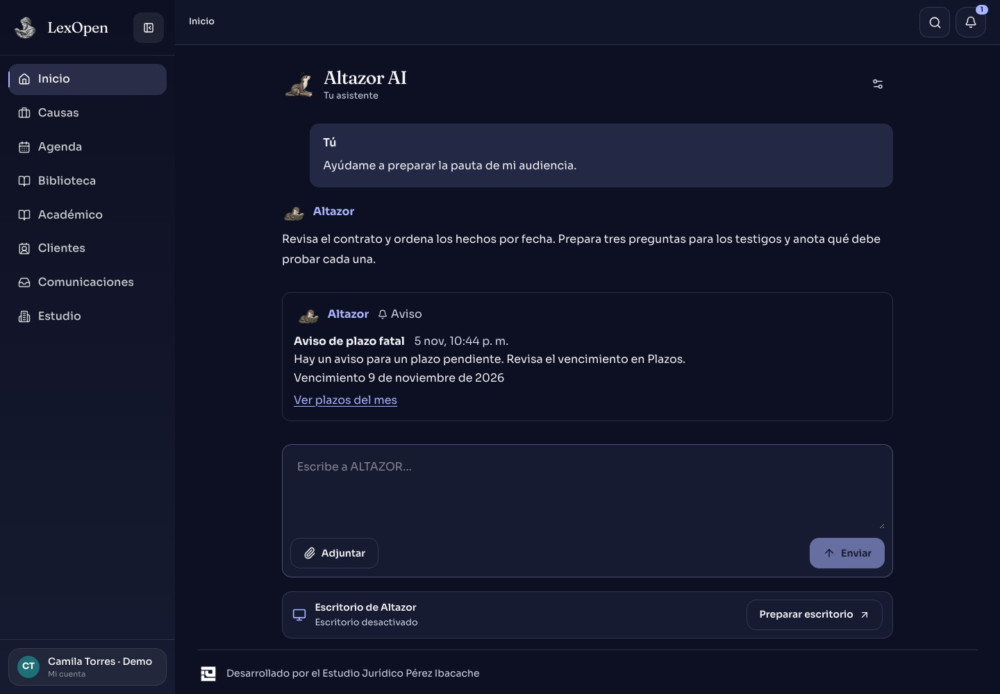

<div align="center">
  <picture>
    <source media="(prefers-color-scheme: dark)" srcset="public/icons/lexopen-logo.png">
    
  </picture>
  <h1>LexOpen</h1>
  <p><strong>El trabajo de tu estudio, organizado por cliente y causa.</strong></p>
  <p>Expedientes, plazos, fuentes jurídicas y Altazor AI en el servidor de tu estudio.</p>
  <p><a href="#descargar-e-instalar">Descargar</a> · <a href="#primeros-pasos">Primeros pasos</a> · <a href="#qué-puedes-hacer">Funciones</a> · <a href="#desarrollo">Desarrollo</a></p>
</div>

LexOpen es una aplicación de código abierto para profesionales y estudios jurídicos, con herramientas de investigación y docencia. Conserva los documentos y la base de datos en un **Host** que administras. Tu equipo accede a ese servidor con cuentas y permisos propios.

**Versión del código: 1.1.0-preview.9.** Esta entrega integra Google compartido, carpetas de Organización, una jornada con vencidos de todos los meses y búsqueda más simple de apartados y ajustes. [Historial de cambios](CHANGELOG.md) · [Revisión de PR, commits y ramas](docs/REVISION-INTEGRACION-2026-11-09.md)



*Las imágenes de la galería son ilustrativas y utilizan expedientes ficticios; algunos controles han evolucionado desde su captura.*

## Descargar e instalar

[**Publicaciones y descargas verificadas**](https://github.com/gabrielperezibacache/lexopen/releases) · [Versión 1.1.0-preview.9](https://github.com/gabrielperezibacache/lexopen/releases/tag/v1.1.0-preview.9)

La publicación ofrece estos paquetes cuando finalizan las comprobaciones de la aplicación y de las cuatro plataformas. Si la versión todavía no aparece, utiliza la última publicación disponible; un trabajo de CI pendiente no equivale a un instalador publicado.

| Equipo | Archivo que debes elegir |
| --- | --- |
| Windows Intel/AMD de 64 bits | `LexOpen-1.1.0-preview.9-win-x64.exe` |
| Mac con chip Apple | `LexOpen-1.1.0-preview.9-mac-arm64.dmg` |
| Mac Intel | `LexOpen-1.1.0-preview.9-mac-x64.dmg` |
| Linux Intel/AMD de 64 bits | `LexOpen-1.1.0-preview.9-linux-amd64.deb` o `LexOpen-1.1.0-preview.9-linux-x86_64.AppImage` |

Los paquetes incluyen el servidor, PostgreSQL y Chromium nativos. No necesitas instalar Node ni npm para abrir el programa. El escritorio de Altazor, los modelos y OCR tienen preparación adicional. Windows ARM y Linux ARM no están en esta matriz.

La serie **preview es preliminar**. Consulta `release-manifest.json` para conocer la firma del editor y `SHA256SUMS` para comprobar la integridad. Un hash no sustituye la firma. [Instalación, requisitos y límites](docs/INSTALADORES.md) · [Actualización y recuperación](docs/ACTUALIZACIONES.md)

## Primeros pasos

1. **Elige el equipo principal.** Abre LexOpen, selecciona **Este PC es el servidor** y crea la primera cuenta de administración. En los demás equipos, selecciona **Conectar a un servidor** e introduce la dirección del Host.
2. **Configura tu estudio y su equipo.** Revisa el país de trabajo, los roles y las secciones habilitadas. En **Mi cuenta → Mi rol y permisos**, cada persona puede consultar su acceso efectivo.
3. **Conecta Google una vez.** La administración autoriza la cuenta compartida del estudio y selecciona una carpeta de **Organización** en Drive. La misma conexión se utiliza para Drive, Calendar y Gmail; las cuentas antiguas pueden necesitar ampliar su autorización.
4. **Organiza un cliente y su causa.** Crea la causa en **Mis Causas** y prepara su carpeta. Añade documentos, registra plazos y revisa las fuentes antes de preparar una audiencia o un escrito.
5. **Empieza tu jornada.** Inicio muestra tus pendientes y eventos. Altazor aparece cuando tienes permiso para utilizarlo. **Ctrl+K / ⌘K** permite ir a un apartado; **Buscar un ajuste** te lleva a la configuración correspondiente.

Antes de actualizar una instalación existente, conserva un respaldo y comprueba la carpeta de datos que utiliza el Host. Las migraciones sobre datos reales se aplican con `prisma migrate deploy`; no ejecutes los reinicios de las pruebas sobre una instalación real. [Guía del Host](docs/WEB-HOST.md)

## Google y organización de documentos

Una **cuenta Google compartida para todo el estudio** evita repetir conexiones por función. La administración elige la raíz; los profesionales trabajan desde las causas y espacios a los que tienen acceso.

```text
Organización/
├── Clientes/
│   └── Cliente/
│       ├── Causas/
│       │   └── Causa/
│       └── Espacios de trabajo/
│           └── Espacio/
└── Usuarios/
    └── Usuario/
```

Puedes preparar carpetas desde Configuración, una causa o un espacio de trabajo. Se reutilizan las carpetas confirmadas y se conservan las existentes. La preparación no mueve archivos ni cambia sus permisos automáticamente. Las copias de documentos conservan su procedencia y se verifican antes de confirmarlas.

La conexión compartida **no amplía los permisos de LexOpen**: el acceso al buzón completo corresponde a la administración y cada causa mantiene su equipo autorizado. Los permisos propios de Drive se administran también en Google. No se migran conexiones ni archivos personales automáticamente. [Flujo completo, estructura exacta y permisos](docs/GOOGLE-ORGANIZACION.md)

## Qué puedes hacer

| Apartado | Flujo de trabajo |
| --- | --- |
| **Inicio y jornada** | Consulta vencidos pendientes de todos los meses, próximos siete días y eventos de hoy asignados a ti. En móvil, despliega el resumen cuando lo necesites y mantén el editor de Altazor a mano. |
| **Clientes y Mis Causas** | Organiza expedientes manuales o conectados, documentos, equipo y actividad; aplica acceso del estudio o muro ético por causa. |
| **Plazos, calendario y tareas** | Asigna responsables, registra vencimientos y sigue pendientes. Los avisos y acuses críticos tienen su propio seguimiento. |
| **Documentos, audiencias y escritos** | Conserva originales y versiones, reúne antecedentes, prepara pautas y revisa borradores con sus pasajes de respaldo. |
| **Fuentes y jurisprudencia** | Reúne material jurídico y recupera fuentes oficiales compatibles, con texto, procedencia y hashes. |
| **Biblioteca y Académico** | Organiza lecturas privadas, bibliografía, pasajes, matrices y manuscritos; revisa el respaldo antes de exportar. |
| **Correo y comunicaciones** | Vincula canales habilitados y conserva el origen de los documentos recibidos. Los canales externos requieren su configuración. |
| **Facturación** | Registra honorarios, pagos y cuenta corriente con el alcance de acceso de cada usuario. No emite DTE del SII. |
| **Configuración y Mi cuenta** | Distingue preferencias personales de ajustes compartidos; busca un ajuste sin desmontar formularios sin guardar. |

La navegación respeta los permisos efectivos y las secciones habilitadas por el estudio. [Recorridos y criterios comparativos](docs/REVISION-UX-Y-COMPETENCIA-2026-11-09.md)

### OJV y Buscador Unificado de Jurisprudencia

Las herramientas del Poder Judicial de Chile son opcionales. En OJV, una sesión vencida genera un error explícito; no se presenta como una causa sin novedades. La integración depende de las sesiones y respuestas que permita el portal.

En **Fuentes → Buscar fallos civiles en el Poder Judicial**, busca por términos o ROL y recorre páginas de diez resultados. Se utiliza una sesión pública independiente de ClaveÚnica. Sólo se envían los campos de búsqueda; la consulta local y el expediente permanecen en el Host. Seleccionar un resultado prepara su incorporación: recuperar y comprobar el texto íntegro es un paso separado. También puedes incorporar un fallo por su identificador numérico.

Se conservan la respuesta y el texto con versiones y hashes. Los previews o marcadores de anonimización sin texto no se aceptan como fallos íntegros. La integración es experimental y no acredita cobertura exhaustiva ni páginas físicas de un PDF. [Alcance y validación](docs/INTEGRACION-OJV-JURISPRUDENCIA-2026-11-09.md) · [OJV/PJUD](docs/PJUD.md)

### Altazor AI e Ícaros

Altazor conserva la conversación y sus adjuntos, propone un plan resumido y cuenta las acciones. Puedes consultar los detalles bajo demanda y revisar los cambios preparados. El visor permite seguir una sesión activa del escritorio.

El escritorio prioriza leer texto del navegador y de los documentos antes de recurrir a capturas. **Ícaros** permite delegar análisis a especialistas con modelo y memoria propios. **Ayuda a distancia** conserva una solicitud en espera y permite responder por ntfy o WhatsApp cuando el canal está conectado. Estas capacidades requieren configurar el perfil de escritorio, el worker y los canales correspondientes.

Los profesionales pueden utilizar Codex personal o la conexión compartida habilitada por el Host. La disponibilidad y las credenciales se comprueban en la configuración de esa conexión; LexOpen no incluye una suscripción a Codex. También admite proveedores de IA compatibles y modelos locales según la preparación del equipo.

[Altazor](docs/ALTAZOR.md) · [Escritorio y requisitos](docs/ESCRITORIO-ALTAZOR.md) · [Conexiones](docs/ALTAZOR-CONEXIONES.md) · [Cobertura](docs/COBERTURA-ALTAZOR.md)

## Permisos, privacidad y límites

El administrador técnico del Host y el socio del estudio tienen responsabilidades distintas. Los roles, permisos adicionales y revocados determinan las acciones efectivas; las causas pueden restringirse a su equipo. Un usuario no puede ampliar sus propios permisos ni dejar el Host sin administración efectiva. Los clientes y externos tienen acceso limitado al portal.

Los datos permanecen en el Host salvo los envíos que hagas mediante las integraciones o proveedores habilitados. Revisa el destino, el contenido y sus fuentes antes de compartir un documento o aceptar una propuesta de IA. Drive mantiene además sus propias reglas de acceso.

El trabajo sin conexión cubre recorridos concretos y exige reconciliar los cambios al volver. [Funciones disponibles sin conexión](docs/TRABAJO-SIN-CONEXION.md). Los instaladores y el escritorio tienen requisitos distintos; la validación de CI no sustituye probar instalación, restauración, audio y actualización en tus equipos.

## Desarrollo

Requiere Node **22.12 o posterior** y PostgreSQL. [Configuración de ejemplo](.env.example) · [Preparar el Host desde código](docs/WEB-HOST.md) · [Contribuir](CONTRIBUTING.md)

```sh
npm ci
npm ci --prefix desktop --ignore-scripts
npm run typecheck
npm run lint
npm test
npm run build
```

Las pruebas de integración y navegador necesitan una base **local desechable** con nombre de prueba. El runner de navegador la reinicia. Consulta `CONTRIBUTING.md` antes de ejecutarlas. En instalaciones reales utiliza las migraciones de despliegue y conserva respaldos.

[CI de la aplicación](https://github.com/gabrielperezibacache/lexopen/actions/workflows/ci.yml) · [Instaladores nativos](https://github.com/gabrielperezibacache/lexopen/actions/workflows/desktop-release.yml) · [Inventario de integración](docs/REVISION-INTEGRACION-2026-11-09.md)

## Ayuda y licencia

En **Mi cuenta → Feedback** puedes informar problemas a la administración y seguir su estado. Para un [reporte público en GitHub](https://github.com/gabrielperezibacache/lexopen/issues), indica la versión y utiliza datos ficticios.

LexOpen se desarrolla en el [Estudio Jurídico Pérez Ibacache](https://perezibacache.cl/) y se distribuye bajo **GNU AGPL-3.0-or-later**. [Licencia](LICENSE)
