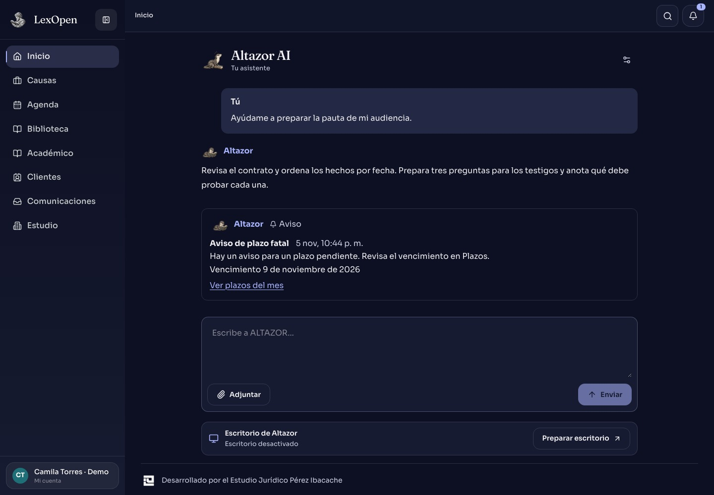

<div align="center">
  <picture>
    <source media="(prefers-color-scheme: dark)" srcset="public/icons/lexopen-logo.png">
    
  </picture>
  <h1>LexOpen</h1>
  <p><strong>El trabajo de tu estudio, organizado por cliente y causa.</strong></p>
  <p>Expedientes, plazos, fuentes jurídicas y Altazor AI en el servidor de tu estudio.</p>
  <p><a href="#descargar-e-instalar">Descargar</a> · <a href="#primeros-pasos">Primeros pasos</a> · <a href="#qué-puedes-hacer">Funciones</a> · <a href="#desarrollo">Desarrollo</a></p>
</div>

LexOpen es una aplicación de código abierto para profesionales y estudios jurídicos, con herramientas de investigación y docencia. Conserva los documentos y la base de datos en un **Host** que administras. Tu equipo accede a ese servidor con cuentas y permisos propios.

**LexOpen 1.1.0.** La aplicación y los instaladores de escritorio comparten esta versión. La disponibilidad para instalar se consulta en las publicaciones de GitHub. El estudio puede seguir las pruebas de actualización, restauración, trabajo por causa y aceptación del piloto. [Publicaciones](https://github.com/gabrielperezibacache/lexopen/releases) · [Seguimiento de producción](docs/ACEPTACION-1.1.0.md) · [Cambios](CHANGELOG.md)



*Las imágenes de la galería son ilustrativas y utilizan expedientes ficticios; algunos controles han evolucionado desde su captura.*

## Información y acciones a mano

En **Inicio → Tu jornada** aparecen los plazos vencidos, los próximos vencimientos y los eventos que requieren atención. Al pulsar un indicador se abre la lista que produce ese conteo. Si hoy está despejado, puedes pasar directamente a la agenda o trabajar con Altazor.

| Para trabajar en… | Abre |
| --- | --- |
| Un expediente | **Mis Causas → ficha de la causa**. Consulta el estado, abre la fuente de un plazo y regresa a la cartera con sus filtros. |
| Un documento | **Documentos → Añadir archivos**. Revisa el cliente, la causa y el destino antes de subirlo. Puedes descargar el original desde la lista. |
| Jurisprudencia | Elige el **Buscador Unificado**, las fuentes del estudio o una investigación guardada. |
| La conversación de Altazor | **Herramientas** reúne el escritorio, los Ícaros y las conexiones. Al volver al chat puedes continuar el borrador con su contexto. |
| Un ajuste | En **Configuración**, usa **Buscar un ajuste** o elige un apartado. Puedes cambiar de apartado y volver al formulario que estabas editando. |

**Próximos plazos** incluye los pendientes asignados a ti desde hoy hasta siete días después, incluso cuando cambia el mes. Los enlaces a un plazo individual abren su ficha con su fecha y responsable. [Inventario de pantallas y recorridos](docs/JERARQUIA-INFORMACION.md)

## Continuidad del expediente

Al crear una causa, elige si está disponible para el estudio o solo para su equipo. La elección se aplica en el primer guardado. Si se pierde la respuesta al crearla, **Reintentar creación** recupera esa misma operación; conserva los datos hasta confirmar el resultado. El servidor vuelve a comprobar los permisos y conflictos. La referencia judicial mantiene su control de duplicados; dos asuntos manuales distintos pueden tener el mismo título.

Los documentos del cliente incluyen los de sus causas accesibles, con contador y paginación coherentes. Los originales se conservan; TXT y Markdown válidos se extraen localmente, incluidos textos UTF-16 con BOM. Puedes preparar una audiencia, promover una observación revisada a hecho del expediente y citar su documento en un escrito con segundo revisor. La mesa privada conserva su acceso propio. Exportar el escrito no completa tareas ni plazos: cada cierre requiere su acción explícita. [Recorrido y comprobaciones](docs/CONTINUIDAD-TRABAJO-JURIDICO.md).

## Encargos de Altazor por causa

En una conversación de una causa puedes pedir: **«Revisa esta causa, organiza los pendientes y prepara un borrador»**. Altazor propone el equipo, los modelos y el alcance; al confirmar, conserva el encargo y sus etapas en el Host. Si hay Ícaros habilitados en ese ámbito, delega el análisis por bloques y consolida sus resultados. Si no los hay, trabaja solo.

El informe muestra fuentes cotejadas y limitaciones de lectura. Las tareas y el borrador se pueden editar y seleccionar antes de una **segunda confirmación para guardarlos**. Los reintentos recuperan los recibos de cada registro. Cerrar la ventana o reiniciar el Host conserva el encargo; para continuar sin navegador debe estar activo el worker de jornada. Una pregunta pendiente puede avisarse por los canales de ayuda configurados y su respuesta no aprueba escrituras. [Funcionamiento, actualización y pruebas](docs/ALTAZOR-ENCARGOS-DE-CAUSA.md).

## Descargar e instalar

Abre **Publicaciones y descargas** y elige la versión disponible. La edición estable lleva la etiqueta `v1.1.0` cuando está publicada. Si solo aparecen previews, revisa sus notas antes de instalar. En el Mac del estudio, busca los recibos de firma Developer ID, notarización y aceptación de Gatekeeper correspondientes a tu arquitectura. [Publicaciones y descargas](https://github.com/gabrielperezibacache/lexopen/releases) · [Antecedentes de preview 10](https://github.com/gabrielperezibacache/lexopen/releases/tag/v1.1.0-preview.10)

| Equipo | Archivo dentro de la versión elegida |
| --- | --- |
| Windows Intel/AMD de 64 bits | Instalador `win-x64.exe` |
| Mac con chip Apple | Imagen de disco `mac-arm64.dmg` |
| Mac Intel | Imagen de disco `mac-x64.dmg` |
| Linux Intel/AMD de 64 bits | Paquete `linux-amd64.deb` o `linux-x86_64.AppImage` |

Los paquetes incluyen el servidor, PostgreSQL y Chromium nativos. No necesitas instalar Node ni npm para abrir el programa. El escritorio de Altazor, los modelos y OCR tienen preparación adicional. Windows ARM y Linux ARM no están en esta matriz.

La serie **preview es preliminar**. Consulta `release-manifest.json` para conocer la firma del editor y `SHA256SUMS` para comprobar la integridad. Un hash no sustituye la firma. [Instalación, requisitos y límites](docs/INSTALADORES.md) · [Actualización y recuperación](docs/ACTUALIZACIONES.md)

## Primeros pasos

1. **Elige el equipo principal.** Abre LexOpen, selecciona **Guardar los datos del estudio** y crea la primera cuenta de administración. En los demás equipos, selecciona **Conectar a un servidor** e introduce la dirección del Host.
2. **Configura tu estudio y su equipo.** Revisa el país de trabajo, los roles y las secciones habilitadas. En **Mi cuenta → Mi rol y permisos**, cada persona puede consultar su acceso efectivo.
3. **Conecta Google una vez.** La administración autoriza la cuenta compartida del estudio y selecciona una carpeta de **Organización** en Drive. La misma conexión se utiliza para Drive, Calendar y Gmail; las cuentas antiguas pueden necesitar ampliar su autorización.
4. **Organiza un cliente y su causa.** Abre **Nueva causa** desde el cliente para conservar su selección, o búscalo en el formulario. Prepara su carpeta y añade documentos: la ficha del cliente reúne sus archivos directos y los de sus causas accesibles, sin duplicarlos. Registra plazos y revisa las fuentes antes de preparar una audiencia o un escrito.
5. **Empieza tu jornada.** Consulta tus vencimientos y eventos en Inicio. En móvil, toca el menú y el apartado que necesitas. En el teclado, **Ctrl+K / ⌘K** abre la búsqueda de apartados.

Antes de actualizar una instalación existente, conserva un respaldo y comprueba la carpeta de datos que utiliza el Host. Las migraciones sobre datos reales se aplican con `prisma migrate deploy`; no ejecutes los reinicios de las pruebas sobre una instalación real. [Guía del Host](docs/WEB-HOST.md)

En **Mi cuenta → Equipos recordados** puedes consultar el último uso y revocar la confianza de un navegador o de todos. Al completar 2FA puedes recordarlo durante 30 días; un cambio de contraseña o del segundo factor invalida esa confianza. [Gestión y alcance de los equipos recordados](docs/EQUIPOS-RECORDADOS.md)

## Actualización de causas

Las consultas **automáticas** se inician a las **08:00 y 22:00, hora de Chile** (`America/Santiago`, con cambio de hora). Cada causa y la consulta de Mis Causas tienen como máximo un intento por turno; los fallos esperan al siguiente turno. Las **actualizaciones manuales** y el ingreso personal con ClaveÚnica siguen disponibles a cualquier hora.

El Host debe estar encendido en esos horarios. Las reservas en PostgreSQL evitan repetir consultas al reiniciar o recibir llamadas simultáneas; una revisión iniciada puede terminar sus lotes durante esa hora. Un turno perdido no se recupera automáticamente fuera de horario. En un Host web, un valor positivo de `PJUD_SYNC_INTERVAL_MINUTES` o `PJUD_MIS_CAUSAS_INTERVAL_MINUTES` habilita el horario correspondiente con `CRON_SECRET`; `0` lo desactiva. Los nombres antiguos ya no fijan intervalos de minutos. Las alertas de plazos y la lectura del estado local conservan su frecuencia. [Configuración y cola](docs/PJUD.md#cron--cola)

El recorrido de pruebas nativas del Host comprueba ahora el respaldo y la restauración en una carpeta vacía, con cuenta, documento y configuración ficticios. Verifica también que el origen permanezca intacto y que una restauración fallida conserve la copia anterior. Los recibos identifican plataforma y arquitectura. [Alcance de la restauración comprobada](docs/ACTUALIZACIONES.md#restauración-comprobada-en-la-prueba-nativa)

Los nuevos respaldos incluyen un inventario SHA-256 de archivos y carpetas, comprobado antes de sustituir datos y después de copiar. Los respaldos antiguos siguen siendo compatibles, pero carecen de esa comprobación completa. El índice no cifra ni autentica al autor de la copia: conserva el respaldo y sus secretos en un destino cifrado y protegido.

## Google y organización de documentos

Una **cuenta Google compartida para todo el estudio** evita repetir conexiones por función. La administración elige la raíz; los profesionales trabajan desde las causas y espacios a los que tienen acceso.

```text
Organización/
├── Clientes/
│   └── Cliente/
│       ├── Causas/
│       │   └── Causa/
│       └── Espacios de trabajo/
│           └── Espacio/
└── Usuarios/
    └── Usuario/
```

Puedes preparar carpetas desde Configuración, una causa o un espacio de trabajo. Se reutilizan las carpetas confirmadas y se conservan las existentes. La preparación no mueve archivos ni cambia sus permisos automáticamente. Las copias de documentos conservan su procedencia y se verifican antes de confirmarlas.

La conexión compartida **no amplía los permisos de LexOpen**: el acceso al buzón completo corresponde a la administración y cada causa mantiene su equipo autorizado. Los permisos propios de Drive se administran también en Google. No se migran conexiones ni archivos personales automáticamente. [Flujo completo, estructura exacta y permisos](docs/GOOGLE-ORGANIZACION.md)

## Qué puedes hacer

| Apartado | Flujo de trabajo |
| --- | --- |
| **Inicio y jornada** | Consulta vencidos pendientes de todos los meses, próximos siete días y eventos de hoy asignados a ti. En móvil, despliega el resumen cuando lo necesites y mantén el editor de Altazor a mano. |
| **Clientes y Mis Causas** | Organiza expedientes manuales o conectados, documentos, equipo y actividad; aplica acceso del estudio o muro ético por causa. |
| **Plazos, calendario y tareas** | Asigna responsables, recorre todos los vencimientos y registra cumplimientos con documento versionado o justificación, historial y reapertura. Los avisos y acuses críticos tienen su propio seguimiento. |
| **Documentos, audiencias y escritos** | Conserva originales y versiones, reúne antecedentes, prepara pautas y revisa borradores con sus pasajes de respaldo. |
| **Fuentes y jurisprudencia** | Reúne material jurídico y recupera fuentes oficiales compatibles, con texto, procedencia y hashes. |
| **Biblioteca y Académico** | Organiza lecturas privadas, bibliografía, pasajes, matrices y manuscritos; revisa el respaldo antes de exportar. |
| **Correo y comunicaciones** | Vincula canales habilitados y conserva el origen de los documentos recibidos. Los canales externos requieren su configuración. |
| **Facturación** | Registra honorarios, pagos y cuenta corriente con el alcance de acceso de cada usuario. No emite DTE del SII. |
| **Configuración y Mi cuenta** | Distingue preferencias personales de ajustes compartidos; busca un ajuste sin desmontar formularios sin guardar. |

La navegación respeta los permisos efectivos y las secciones habilitadas por el estudio. [Recorridos y criterios comparativos](docs/REVISION-UX-Y-COMPETENCIA-2026-11-09.md)

Documentos, Clientes, Espacios, Mensajes, Flujos, Auditoría y Mi Fiscalía permiten recorrer páginas conservando sus filtros y permisos. Documentos busca por nombre y causa; Auditoría aplica los filtros sobre todo el historial, antes de limitar la página.

### OJV y Buscador Unificado de Jurisprudencia

Las herramientas del Poder Judicial de Chile son opcionales. En OJV, una sesión vencida genera un error explícito; no se presenta como una causa sin novedades. La integración depende de las sesiones y respuestas que permita el portal.

En **Fuentes → Buscar fallos civiles en el Poder Judicial**, busca por términos o ROL y recorre páginas de diez resultados. Se utiliza una sesión pública independiente de ClaveÚnica. Sólo se envían los campos de búsqueda; la consulta local y el expediente permanecen en el Host. Seleccionar un resultado prepara su incorporación: recuperar y comprobar el texto íntegro es un paso separado. También puedes incorporar un fallo por su identificador numérico.

El lector, la descarga y el índice de búsqueda usan la misma copia pública del fallo. Si falta texto anonimizado, LexOpen detiene la importación. Las versiones históricas quedan bajo custodia y las citas se pueden cotejar con una copia pública recuperada. La integración es experimental y no acredita cobertura exhaustiva ni páginas físicas de un PDF. [Alcance y validación](docs/INTEGRACION-OJV-JURISPRUDENCIA-2026-11-09.md) · [OJV/PJUD](docs/PJUD.md)

Los escritos permiten asignar una versión a un segundo profesional con acceso vigente a la causa y sus fuentes. Solo la persona asignada registra la decisión; la asignación permite revisar y mantiene la edición en manos del autor. Cambiar el texto exige una nueva asignación.

### Altazor AI e Ícaros

En **Documentos** puedes descargar el original o el texto disponible. Al importar desde OJV, LexOpen coteja el cuaderno y el folio antes de asociar el archivo. Puedes volver a la causa para consultar el progreso del lote.

Al abrir una causa, **Estado de la causa** muestra automáticamente sus plazos abiertos y vencidos, escritos pendientes de resolución, tareas en espera y gestiones actuales. Altazor genera una lectura con referencias a esos registros usando la IA configurada. El panel comprueba cambios cada minuto mientras está visible y, durante la visita, evita repetir consultas iguales al modelo mientras no cambien los datos o el día en Chile. Si el proveedor falla o está en demostración, conserva los hechos registrados sin presentar una respuesta ficticia como análisis real. Las referencias de la lectura enlazan solo registros del contexto visible; las desconocidas se señalan y las respuestas tardías no sustituyen una comprobación más reciente. [Fuentes, actualización y límites del estado automático](docs/ESTADO-CAUSA.md).

[Cumplimiento e historial de plazos](docs/PLAZOS-CUMPLIMIENTO.md): el mismo respaldo se exige en Plazos, minutas, offline y Altazor. El registro comienza con una fecha revisada. En Chile también se distingue la estimación interna del perfil civil del CPC, pendiente de aprobación profesional.

**Mi Fiscalía** reúne la preparación de solicitudes por causa, RUC, folio de presentación, respuesta e historial. Abre el portal oficial para ingresar con la misma ClaveÚnica del Registro Civil, sin pedir otra contraseña en LexOpen. La presentación se completa en el portal; cada solicitud tiene una ficha con historial, rectificaciones motivadas de folio y fecha, y acceso al comprobante o respuesta en la versión documental vinculada. [Flujo, permisos y alcance](docs/MI-FISCALIA.md). Los plazos abiertos desde una causa conservan su filtro al cambiar de mes o de vista.

El escritorio de Altazor es persistente: conserva archivos, aplicaciones y conversación sin vencimiento automático. Puede trabajar en segundo plano, detenerse y reanudarse como la misma máquina. Las conexiones disponibles se seleccionan juntas y mantienen los permisos del estudio. Los escritorios temporales anteriores pueden conservarse expresamente desde Computadora. [Persistencia, respaldo y operación](docs/ESCRITORIO-ALTAZOR.md#un-puesto-de-trabajo-persistente).

Altazor conserva la conversación y sus adjuntos, propone un plan resumido y cuenta las acciones. Puedes consultar los detalles bajo demanda y revisar los cambios preparados. El visor permite seguir una sesión activa del escritorio.

En **Computadora → Historial de descargas** puedes consultar recibos anteriores por fecha, estado y conexión, incluso con el escritorio cerrado. Se distinguen confirmaciones verificadas, fallos y resultados sin confirmar. El historial conserva los permisos actuales de cada usuario y causa, y muestra solo metadatos.

El escritorio prioriza leer texto del navegador y de los documentos antes de recurrir a capturas. **Ícaros** permite elegir el modelo y las notas concretas que recibe cada especialista. Desde el chat se puede retomar un informe de la misma causa y conversación, incluso después de cerrar el navegador. **Ayuda a distancia** conserva una solicitud en espera y permite responder por ntfy o WhatsApp cuando el canal está conectado. Estas capacidades requieren configurar el perfil de escritorio, el worker y los canales correspondientes.

Los profesionales pueden utilizar Codex personal o la conexión compartida habilitada por el Host. La disponibilidad y las credenciales se comprueban en la configuración de esa conexión; LexOpen no incluye una suscripción a Codex. También admite proveedores de IA compatibles y modelos locales según la preparación del equipo.

[Altazor](docs/ALTAZOR.md) · [Escritorio y requisitos](docs/ESCRITORIO-ALTAZOR.md) · [Conexiones](docs/ALTAZOR-CONEXIONES.md) · [Cobertura](docs/COBERTURA-ALTAZOR.md)

## Permisos, privacidad y límites

El administrador técnico del Host y el socio del estudio tienen responsabilidades distintas. Los roles, permisos adicionales y revocados determinan las acciones efectivas; las causas pueden restringirse a su equipo. Un usuario no puede ampliar sus propios permisos ni dejar el Host sin administración efectiva. Los clientes y externos tienen acceso limitado al portal.

Los datos permanecen en el Host salvo los envíos que hagas mediante las integraciones o proveedores habilitados. Revisa el destino, el contenido y sus fuentes antes de compartir un documento o aceptar una propuesta de IA. Drive mantiene además sus propias reglas de acceso.

El trabajo sin conexión incluye manuscritos académicos preparados y notas privadas de lectura con marcador; no descarga automáticamente libros ni fuentes. Cubre recorridos concretos y exige reconciliar los cambios al volver. [Funciones disponibles sin conexión](docs/TRABAJO-SIN-CONEXION.md). Los instaladores y el escritorio tienen requisitos distintos; la validación de CI no sustituye probar instalación, restauración, audio y actualización en tus equipos.

## Desarrollo

Requiere Node **22.12 o posterior** y PostgreSQL. [Configuración de ejemplo](.env.example) · [Preparar el Host desde código](docs/WEB-HOST.md) · [Contribuir](CONTRIBUTING.md)

```sh
npm ci
npm ci --prefix desktop --ignore-scripts
npm run typecheck
npm run lint
npm test
npm run build
```

Las pruebas de integración y navegador necesitan una base **local desechable** con nombre de prueba. El runner de navegador la reinicia. Consulta `CONTRIBUTING.md` antes de ejecutarlas. En instalaciones reales utiliza las migraciones de despliegue y conserva respaldos.

La búsqueda y los modelos locales tienen [evaluadores reproducibles](docs/EVALUACION-JURIDICA-IA.md) con extractos públicos y tareas ficticias. No descargan modelos ni consultan cuentas reales. El corpus inicial es provisional y todavía requiere revisión profesional y mediciones en los equipos del estudio.

[CI de la aplicación](https://github.com/gabrielperezibacache/lexopen/actions/workflows/ci.yml) · [Instaladores nativos](https://github.com/gabrielperezibacache/lexopen/actions/workflows/desktop-release.yml) · [Inventario de integración](docs/REVISION-INTEGRACION-2026-11-09.md)

## Ayuda y licencia

En **Mi cuenta → Feedback** puedes informar problemas a la administración y seguir su estado. Para un [reporte público en GitHub](https://github.com/gabrielperezibacache/lexopen/issues), indica la versión y utiliza datos ficticios.

LexOpen se desarrolla en el [Estudio Jurídico Pérez Ibacache](https://perezibacache.cl/) y se distribuye bajo **GNU AGPL-3.0-or-later**. [Licencia](LICENSE)
