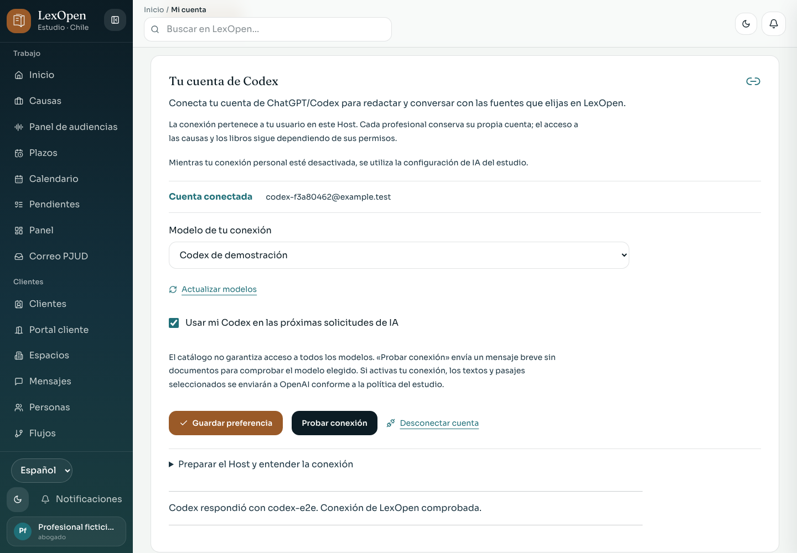

# Codex personal en LexOpen

Cada profesional puede conectar su cuenta de ChatGPT/Codex desde **Mi cuenta → Tu cuenta de Codex** (`/cuenta#codex`). La conexión es opcional, pertenece a su usuario en ese Host y respeta sus permisos sobre causas y biblioteca. Este recorrido utiliza la autorización de cuenta; no requiere una API key.



La [evidencia de la entrega](codex-audiencias-2026-11-02/README.md) incluye capturas de escritorio y móvil, pruebas y límites comprobados.

## Preparar el Host

El administrador instala o actualiza [Codex CLI según la documentación oficial de OpenAI](https://learn.chatgpt.com/docs/cli). El ejecutable debe admitir `app-server` y la autorización por código de dispositivo. LexOpen inicia y administra `codex app-server --listen stdio://`; no necesita exponer otro puerto ni iniciar ese servidor manualmente.

Configure estas variables en el entorno que arranca el Host:

| Variable | Uso |
| --- | --- |
| `CODEX_BIN` | Ruta al ejecutable de Codex. Si se omite, se busca `codex` en el `PATH` del Host. Se recomienda una ruta absoluta. |
| `CODEX_DATA_DIR` | Carpeta persistente y privada para las autorizaciones de los profesionales. Si se omite, se usa `LEXOPEN_DATA_DIR/codex`; sin esa variable, `STORAGE_PATH/codex` o `storage/codex` dentro del directorio de ejecución. |

Ejemplo para macOS o Linux, adaptando las rutas a la instalación:

```bash
LEXOPEN_DATA_DIR=/ruta/persistente/lexopen \
CODEX_BIN=/ruta/absoluta/codex \
CODEX_DATA_DIR=/ruta/persistente/lexopen/codex \
npm run web:host
```

El usuario del sistema que ejecuta el Host necesita permiso para ejecutar Codex y escribir en esa carpeta. Mantenga los datos de Codex fuera del repositorio y de los paquetes de distribución. Se recomienda **un único proceso Host** para esta integración: la coordinación de autorizaciones y consultas reside en la memoria del proceso y no está diseñada para compartir una misma carpeta entre varios servidores o workers.

## Conectar y elegir modelo

1. Entre con su usuario de LexOpen y abra **Mi cuenta → Tu cuenta de Codex**.
2. Pulse **Conectar cuenta de ChatGPT/Codex**. Abra **Continuar en OpenAI** e introduzca el código mostrado. La autorización ocurre en OpenAI; LexOpen espera su confirmación. Puede cancelar el intento desde la misma pantalla.
3. Cuando aparezca **Cuenta conectada**, elija un modelo del catálogo. **Actualizar modelos** vuelve a consultarlo; aparecer en el catálogo no garantiza acceso o cuota para su cuenta.
4. Marque **Usar mi Codex en las próximas solicitudes de IA** y pulse **Guardar preferencia**. Conectar la cuenta por sí solo no activa esta preferencia.
5. Use **Probar conexión** para comprobar el modelo elegido con un mensaje breve sin documentos. La prueba realiza una solicitud explícita a OpenAI, aunque la preferencia para las consultas habituales esté desactivada.

La autorización por dispositivo puede requerir habilitarla en la seguridad de la cuenta de ChatGPT o en los permisos de su workspace, según la [guía oficial de autenticación](https://learn.chatgpt.com/docs/auth#login-on-headless-devices). Si una carga falla, **Volver a consultar conexión** recupera el estado guardado.

Para volver al proveedor del estudio, desmarque la preferencia y guarde. **Desconectar cuenta** cierra la autorización de ese usuario y desactiva su preferencia. Si la conexión activa falla o queda bloqueada, la interfaz también permite **Volver a la configuración de IA del estudio**.

## Textos, permisos y política del estudio

Con la preferencia personal activa, las consultas de texto de IA identificadas con ese usuario envían a OpenAI la instrucción y el contexto preparados por la función utilizada, incluidos los textos o pasajes que el profesional elija incorporar. La conexión no concede acceso a otras causas o bibliotecas ni recorre sus archivos por su cuenta. LexOpen utiliza consultas efímeras, limita las herramientas de Codex y no le ofrece comandos, navegación ni lectura del expediente en disco.

La política **sólo IA local** del estudio prevalece sobre la preferencia personal: bloquea la conexión, la activación y la prueba remotas, y evita el envío de consultas a Codex. Si Codex falla mientras está seleccionado, LexOpen devuelve el error y conserva el texto; **no cambia automáticamente a otro proveedor**. El profesional puede reintentar o elegir expresamente la configuración del estudio. Las respuestas y sus citas siguen requiriendo revisión; la conexión no sustituye el cotejo de fuentes de LexOpen.

## Almacenamiento de la autorización

Codex CLI conserva sus credenciales en una carpeta privada por usuario: `CODEX_DATA_DIR/<sha256-del-id-del-usuario>`. LexOpen le asigna un `CODEX_HOME` y un directorio temporal propios, separados de las cuentas de Codex que ya existan en el equipo. Las carpetas personales se crean con permisos `0700` en los sistemas que los admiten.

La base de datos guarda únicamente la activación y el modelo elegido. Las credenciales no se entregan al navegador ni forman parte del código o de un paquete de LexOpen. No copie una autorización compartida entre usuarios; cada profesional completa su propio recorrido. Conserve el directorio persistente con la protección que corresponde a credenciales privadas.

El protocolo utilizado se describe en la [documentación oficial de Codex app-server](https://learn.chatgpt.com/docs/app-server): inicialización, consulta de cuenta, autorización por dispositivo, catálogo de modelos y ejecución de consultas. Su alcance de uso vigente distingue las aplicaciones locales o de código abierto de los servicios comerciales o alojados; esta guía describe el Host local del estudio.

## Trabajar desde el panel de audiencias

Abra **Audiencias en vivo** (`/audiencias`) para buscar sus mesas privadas por título, causa, RIT o tribunal, filtrar su estado o preparar una mesa vinculada a una causa autorizada. **Abrir panel en vivo** entra directamente a `/audiencias/<id-de-mesa>` en la herramienta **En vivo**.

El panel independiente reúne **En vivo, Fuentes, Lectura, Notas, Conversación, Guion y Agenda**, conserva el contexto de la causa y ofrece enlaces al expediente y a los escritos. Incluye los registros, el control de tiempo y el acceso a grabaciones y transcripciones de esa causa. Abrirlo no inicia la sesión ni activa el micrófono; la captura y el envío de audio tienen sus propias acciones y confirmaciones. La conexión de Codex se configura desde Mi cuenta y se aplica a las consultas de texto compatibles, sin reemplazar la configuración de transcripción.

## Validación y límites actuales

Las pruebas de navegador utilizan una CLI simulada y cuentas ficticias: cubren autorización pendiente, separación entre usuarios, modelos, guardado, recuperación de errores, prueba, desconexión y bloqueo por política local. También se comprobó la inicialización y `account/read` con **Codex CLI 0.155.1** en un entorno aislado, sin iniciar sesión ni ejecutar inferencia.

No se ha autorizado una cuenta real ni verificado una consulta real a OpenAI en esta entrega. La autorización efectiva, los modelos y sus límites dependen de la cuenta y del servicio. Este recorrido tampoco se ha verificado en Windows real.
