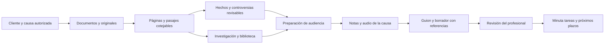

# LexOpen · plan maestro de desarrollo e integración

Fecha de revisión: **2 de noviembre de 2026**. Punto de partida: `main@8cb233ffccac2dca86db4b4333b228188c06d15b`, después del PR 215. Este documento continúa el [plan de capacidades jurídicas propias](PLAN-DESARROLLO-TRIFOLIA.md) y la [revisión visual anterior](UI-REVIEW-2026-11-01.md). La prioridad elegida por el usuario es **preparar causas, audiencias y escritos con fuentes**.

El objetivo de la siguiente etapa es recorrer un asunto completo dentro de LexOpen: incorporar sus documentos, entender hechos y controversias, investigar el derecho, preparar una audiencia, recuperar sus notas y producir un escrito cuyas referencias puedan abrirse y corroborarse. La operación del estudio acompaña ese recorrido: cliente, equipo, calendario, tareas, comunicaciones y honorarios. La independencia de TRIFOLIA se conserva en datos, búsqueda, modelos configurables e integraciones propias.

## Cómo leer el estado

- **Código presente:** se inspeccionaron rutas, componentes, servicios o esquema. Esto acredita que existe una implementación, no su calidad jurídica ni la disponibilidad de un servicio externo.
- **Prueba existente:** el repositorio contiene una prueba que describe el comportamiento. Su presencia no equivale a una ejecución nueva en esta revisión documental.
- **Evidencia anterior:** los informes de noviembre incluyen ensayos locales con datos ficticios. Sus resultados conservan la fecha y los límites de esos informes; no prueban el Host del estudio.
- **Incremento actual:** los cambios de esta etapa se documentan en su entrega y sus registros. El plan distingue esos cambios del trabajo futuro.
- **Pendiente:** trabajo propuesto con una condición de aceptación. No debe aparecer en la interfaz como servicio disponible hasta verificarse.

Esta auditoría documental no ejecuta pruebas, no consulta datos del estudio y no acredita una publicación del Host. No atribuye una equivalencia general con ningún competidor.

## Dirección del producto y del diseño

**Un expediente reconocible, desde la fuente hasta el escrito.** Cada transición debe conservar causa, alcance, versiones elegidas, permisos y avisos. Un enlace entre pantallas ayuda a orientarse, pero una integración está completa cuando los datos elegidos, la procedencia y las restricciones sobreviven al recorrido y a la recarga.

La dirección gráfica es una **edición jurídica contemporánea de tradición clásica**. Se conserva el mundo ya aprobado: Fraunces para títulos y lectura; Sora para operar; tinta, papel, cobre y verde mar; libros de cuero y estantes en los seis ambientes personales. La singularidad se expresa con composición editorial, índices de expediente, remisiones, márgenes de lectura y una familia de folios geométricos propios. El cuero y la madera permanecen en los libros y estantes, para que el trabajo cotidiano mantenga claridad.

Reglas de aplicación:

1. Una acción principal por contexto y el alcance visible antes de pedir resultados a la IA.
2. Afirmación, pasaje literal, propuesta de IA y revisión humana tienen tratamiento distinto en texto y estructura, además de color.
3. Cada cifra describe datos contados y autorizados. No usar porcentajes de preparación o verificación sin una regla explícita y demostrable.
4. La lectura tiene un ancho cómodo; el expediente puede ocupar más espacio para comparar documentos y notas.
5. Animación iniciada por el usuario: apertura de folio, cambio de fuente, localización de una cita y reordenación de un índice. El contenido está visible por defecto; no introducir vídeos de fondo en una herramienta de trabajo.
6. Móvil, teclado, modo oscuro y movimiento reducido se comprueban en cada entrega. Las animaciones no deben mover el foco, tapar un destino ni retrasar una acción.
7. Los elementos gráficos originales son símbolos, filetes y diagramas útiles. Las imágenes de libros no sustituyen títulos, controles ni referencias accesibles.

## Ruta prioritaria de extremo a extremo

Cada flecha exige comprobar acceso vigente. Revocar una fuente compartida debe impedir volver a leer sus pasajes y sus derivados en nuevas consultas o exportaciones. Un archivo descargado previamente queda fuera del control posterior de la aplicación; la interfaz debe ser precisa acerca de ese límite.

## Funciones de referencia y adaptación propia

Fuentes oficiales consultadas el 2 de noviembre de 2026 por la revisión principal. Describen capacidades publicadas por sus proveedores, sin acreditar su funcionamiento en esta auditoría. Las adaptaciones de la tercera columna son decisiones e inferencias propias para LexOpen. No se copia una interfaz ni se añade una dependencia operativa de esos servicios.

| Referencia publicada | Capacidad observada en su documentación | Adaptación a LexOpen y orden |
| --- | --- | --- |
| [vLex Vincent · Create a timeline](https://support.vlex.com/vincent-by-vlex/vincent/core-workflows/create-a-timeline) | Cronología con fecha, acontecimiento y fuente; consulta de la cita y exportación de la tabla | Exportar la cronología revisable del alcance visible, mantener fechas inciertas y citas verificables; después comparar y filtrar acontecimientos entre documentos. P0 |
| [Thomson Reuters CoCounsel · Workflows](https://www.thomsonreuters.com/en-ca/help/cocounsel/legal/skills/workflows) | Reutilizar fuentes y resultados entre revisión, resumen, preguntas y preparación | Conservar alcance y referencias al pasar de lectura a hechos, audiencia y escrito, usando una selección común y servicios propios. P0 |
| [Clio · Get Started With Matters](https://help.clio.com/hc/en-us/articles/9285920226075-Get-Started-With-Matters) | El asunto agrupa tareas, documentos, plazos, comunicaciones, notas y facturación; acceso según permisos | Expediente como centro con índice de secciones y próximos pasos, seguido de continuidad entre acuerdos, tareas y honorarios. P0/P1 |
| [Lemontech · CaseTracking Firms, página de México](https://www.lemontech.com/mx/soluciones/casetracking-firms) | Seguimiento de asuntos y avisos dentro de su oferta regional | Mejorar bitácora, antigüedad y acción derivada de novedades PJUD; ensayar la cobertura propia de Chile. La oferta mexicana no acredita disponibilidad ni equivalencia chilena. P1 |

El valor adicional de LexOpen se concentra en el control del Host, originales y versiones conservadas, bibliotecas personales y referencias que vuelven a comprobar acceso. La comparación anterior no evalúa prestaciones privadas, precios, calidad jurídica ni un catálogo exhaustivo de competidores.

## Incremento iniciado en esta etapa

Se implementa el primer corte de la iteración A. Su estado de pruebas e integración se registra en la [entrega de preparación de causas](ENTREGA-PREPARACION-2026-11-02.md); este documento no sustituye ese registro.

| Trabajo actual | Alcance y límite |
| --- | --- |
| Preparar la causa e índice del expediente | Navegación a secciones reales y estados calculados sobre material autorizado. No es un porcentaje de suficiencia probatoria ni un dictamen sobre preparación jurídica. |
| Hoja de preparación y cronología exportables | Markdown de conocimiento y CSV de cronología del **alcance y página actuales**, mediante una nueva lectura en servidor. No se promete incluir todos los hechos del expediente ni exportar contenido autorizado sólo en el pasado. |
| Guion de intervención de audiencia | Notas seleccionadas y ordenadas, con apertura y petición redactadas por el profesional; exportación que revalida las referencias. No genera hechos ni llama a IA para completar el guion. |
| Identidad editorial aplicada al recorrido | Índice, folio, margen y remisión dentro de los tokens actuales; controles legibles y movimiento reducido. No sustituye los seis ambientes aprobados de biblioteca. |

La segunda entrega une esta preparación al editor persistido de causa en `/causas/[id]/escritos`: guardado automático, versiones recuperables, hechos, notas privadas de audiencia y pasajes de biblioteca con comprobación de sus referencias. El alcance construido y su validación están en [la entrega del editor](ENTREGA-ESCRITOS-2026-11-02.md). Continúan pendientes la revisión de propuestas por bloques, las plantillas, DOCX y el complemento Word; la existencia del editor no da por terminados esos pasos.

## Orden de ejecución

Las iteraciones se cierran por aceptación, no por una fecha estimada. Se puede desarrollar en paralelo una mejora visual y un servicio de dominio cuando no cambian el mismo contrato.

| Iteración | Entrega utilizable | Dependencias | Cierre verificable |
| --- | --- | --- | --- |
| A · preparación | Índice del expediente, estados reales y camino directo entre documentos, conocimiento, audios, audiencia y minutas; primer guion reutilizable con referencias | Base integrada y permisos existentes | Un usuario localiza y recorre los destinos; los datos elegidos permanecen; un usuario excluido no ve el material |
| B · escritura | Borrador vinculado a causa, hechos, biblioteca y audiencia; registro de cambios y paquete de referencias | A y citas comunes | Editar, recargar y exportar conserva texto, localizadores, versiones y avisos; revocación bloquea derivados no autorizados |
| C · investigación | Cobertura explícita, comparación de versiones y primeras ampliaciones oficiales medidas | Evidencia y corpus de evaluación | Una consulta puede abstenerse; las referencias se abren; los conectores superan pruebas de acceso y formato |
| D · continuidad | Minuta transforma acuerdos en tareas/plazos/eventos y ofrece comunicación revisable al cliente | B; comandos idempotentes | Un reintento no duplica; queda trazabilidad; la publicación al cliente requiere selección explícita |
| E · estudio | Plantillas de proceso, gestión económica conectada y alertas accionables | D; permisos y auditoría | Dossier, tarea, hora, gasto y cobro se relacionan sin rehacer datos; roles y saldos coherentes |
| F · piloto | Ensayo de instalación, recuperación, volumen, uso jurídico y calidad visual | A–E | Restauración y actualización ensayadas; flujos críticos aprobados en el Host y dispositivos elegidos |

Prioridades por apartado: **P0** habilita el recorrido prioritario o evita pérdida/exposición; **P1** completa la continuidad diaria; **P2** amplía alcance después de medir lo anterior. No equivalen a una clasificación de defectos descubiertos.

## 1. Inicio y panel del estudio

**Rutas:** `/inicio`, `/dashboard`. **Base inspeccionada:** `src/app/(app)/inicio/page.tsx`, `src/components/inicio/*`, `src/lib/assistant/status.ts`, `src/app/(app)/dashboard/page.tsx`. Hay saludo, estado del día, plazos, eventos, actividad, causas recientes y asistente operativo. El panel general dispone de datos de actividad del estudio. Son dos usos distintos que necesitan una transición más clara.

**P1 · pasos:**

1. Diferenciar el trabajo personal de hoy y la supervisión del estudio mediante títulos y enlaces comprensibles.
2. Añadir «Continuar preparación» desde la actividad reciente autorizada; no guardar texto confidencial en historial del navegador o preferencias compartidas.
3. Abrir la causa, audiencia o borrador exactos y conservar el alcance, en vez de repetir la selección desde cero.
4. Incorporar una bandeja breve de trabajo interrumpido: extracción fallida, cita desactualizada, borrador sin revisar y transcripción pendiente; cada fila debe llevar a una acción resoluble.
5. Mostrar acciones propuestas por IA con vista previa y resultado individual, aprovechando confirmación y deshacer existentes.

**Aceptación:** una tarea iniciada se retoma tras recargar; un cambio de usuario no revela lo reciente del anterior; los conteos responden al alcance del actor. **Diseño:** apertura editorial breve, mayor jerarquía para la siguiente tarea y actividad como registro legible; animar solamente el resultado de una acción.

## 2. Causas y preparación del expediente

**Rutas:** `/causas`, `/causas/nueva`, `/causas/[id]`, `/causas/[id]/editar`. **Base:** ficha, documentos, minutas, partes, plazos, equipo, movimientos, Drive, hechos, audios y enlace a audiencias en `src/app/(app)/causas/[id]/page.tsx`; acceso común en `src/lib/auth/causa-access.ts`. La ficha concentra muchas funciones en una página larga. Un listado de documentos no prueba que sus fuentes estén preparadas o revisadas.

**P0 · pasos:**

1. Añadir un índice con destinos reales del expediente y un bloque «Preparar la causa» que muestre el siguiente paso sin ocultar la ficha existente.
2. Expresar estados observables: documentos con/sin texto, fuentes preparadas, notas, minutas y audiencias accesibles. Contar sólo registros autorizados y explicar los límites del conteo.
3. Unificar alcance para preparar prueba, investigar y redactar; permitir volver de cada herramienta al mismo expediente.
4. Crear una selección de preparación persistida que reúna documentos, hechos revisados y asuntos por resolver; conservar sus versiones y cambios.
5. Crear un resumen de situación editable a partir de esa selección; marcar cada afirmación con respaldo o como pendiente de fundamentar.
6. Añadir comparación de dos documentos del expediente y remisiones cruzadas hacia hechos/contradicciones, usando las versiones conservadas.

**Aceptación:** una causa sin material ofrece pasos útiles; una causa extensa sigue navegable a 360 px; ningún estado dice «verificado» sólo por tener texto; los accesos retirados desaparecen de conteos y selección. **Pruebas de referencia:** `e2e/causas-section.spec.ts`, `e2e/case-knowledge.spec.ts`, `e2e/roles-ethical-wall.spec.ts`. **Diseño:** índice editorial, ficha como portada del expediente y remisiones discretas; desplazamiento al destino respetando el encabezado fijo y movimiento reducido.

## 3. Monitoreo y conexión con PJUD

**Rutas:** `/causas/monitoreo`, `/causas/mis-causas`; panel de movimientos dentro de la causa. **Base:** cola, sincronización, importación y trazas en `src/lib/pjud/*`; páginas y APIs propias. El funcionamiento real depende del Host, configuración y acceso al servicio. La importación manual/CSV conserva una alternativa.

**P1 · pasos:**

1. Presentar en la ficha el último intento, resultado y antigüedad sin confundir «consultado» con «sin novedades».
2. Unir cada movimiento importado con su documento local o explicar por qué no existe una copia.
3. Ofrecer «Revisar consecuencia» para transformar un movimiento en propuesta de tarea/plazo, con cotejo humano del acto y su notificación.
4. Recuperar errores por causa y trabajo, permitiendo reintento acotado; no reiniciar todo un lote por un fallo individual.
5. Ensayar el conector con un acceso autorizado del Host elegido, incluyendo cambios de portal, límites y caída del navegador.

**Aceptación:** reintentar no duplica documentos ni movimientos; fallos y datos antiguos son visibles; no se inventa cómputo oficial ni fecha de notificación. **Pruebas:** módulos `pjud/*.test.ts`, `migration-preservation.integration.test.ts` y recorrido de monitoreo. **Diseño:** bitácora procesal con estados textuales y enlace a la actuación, separada de la cronología de hechos documentales.

## 4. Clientes y relaciones

**Rutas:** `/clientes`, `/clientes/[id]`. **Base:** relación cliente/causa, trámites, equipo y datos de contacto. **P1 · pasos:**

1. Ordenar la ficha por asuntos activos, próximas acciones y comunicaciones; mantener los datos de identidad fácilmente editables según rol.
2. Mostrar compromisos con el cliente procedentes de minutas, diferenciando interno/publicable/publicado.
3. Añadir apertura de asunto mediante checklist de antecedentes, conflicto de interés y encargo; reutilizar revisión de conflicto existente.
4. Mantener una línea de contactos vinculada a mensajes/minutas, con registro de autor y cambios.
5. Conectar encargo y honorarios al asunto antes de crear cobros; evitar duplicar el cliente al iniciar desde facturación.

**Aceptación:** dos causas del mismo cliente conservan equipos y alcances independientes; el portal sólo recibe material seleccionado. **Diseño:** ficha editorial sobria con identidad, asuntos y compromisos; ninguna decoración ocupa el espacio de contactos o fechas.

## 5. Agenda y plazos

**Rutas:** `/calendario`, `/plazos`. **Base:** eventos, responsable, cómputo civil y conexión Calendar; `src/lib/chile-time.ts`, `src/lib/plazos.ts`, `src/lib/integrations/google.ts`. El cómputo sigue siendo una estimación interna sujeta a revisión.

**P0/P1 · pasos:**

1. Abrir una audiencia desde su evento y abrir el evento desde su preparación, con identidad común cuando se implemente el vínculo.
2. Registrar la fuente y el criterio del plazo: acto, fecha relevante, tipo de cómputo y decisión del profesional.
3. Mostrar conflictos de agenda y responsables sin modificar automáticamente compromisos existentes.
4. Preparar recordatorios con destino directo, estados de entrega y acuse según la política vigente.
5. Comparar la copia local y Google antes de resolver conflictos; no duplicar eventos al reintentar.

**Aceptación:** fechas civiles de Chile permanecen estables en cambio de zona horaria; un aviso no acredita notificación judicial; editar desde un contexto no deja otra copia incoherente. **Pruebas:** `src/lib/chile-time.test.ts`, `src/lib/plazos.test.ts`, integración Calendar y notificaciones. **Diseño:** énfasis en día/hora/urgencia real; animación de selección y panel lateral sin perder posición de agenda.

## 6. Tareas, trámites y continuidad

**Rutas:** `/tareas`, trámites de causa y `/sites/[id]/tareas`. **Base:** `Tramite`, `Task`, historial, tareas espejo y acciones de minuta. **P1 · pasos:**

1. Explicar el origen de cada pendiente y ofrecer retorno a minuta, causa o espacio.
2. Proponer tareas desde acuerdos de audiencia conservando la cita o nota de origen y responsable sugerido.
3. Resolver dependencia, vencimiento y responsable en una única edición; mantener consistencia de espejos mediante servicios existentes.
4. Ofrecer plantillas de preparación por materia con pasos editables y fuentes requeridas; no introducir instrucciones jurídicas como verdades automáticas.
5. Incorporar vista de carga por responsable y detectar trabajo sin dueño, antes de automatizar asignaciones.

**Aceptación:** una acción se convierte una sola vez; completar/reabrir mantiene espejos e historial; las tareas confidenciales no aparecen al cliente. **Pruebas:** `src/lib/tasks/sync-mirrors.test.ts`, integración de comandos y prueba de portal. **Diseño:** lista de trabajo compacta con origen y siguiente acción; reordenación animada sólo después de guardar correctamente.

## 7. Documentos, importación y lectura

**Rutas:** `/documentos`, `/documentos/[id]/fuentes`, archivos de cada causa. **Base:** originales, procesamiento durable, OCR, páginas/fragmentos, `DocumentResource`, `DocumentEvidenceVersion`; servicios `src/lib/evidence/*` y procesamiento documental. Hay lector de evidencia y revisión de páginas.

**P0 · pasos:**

1. Llevar cada documento del expediente directamente a «Leer y citar» y mostrar extracción completa/parcial/fallida.
2. Unificar el recibo de importación: bytes conservados, procedencia, versión, formato y disponibilidad del original; reutilizar la política ya implementada en biblioteca cuando corresponda al dominio documental.
3. Añadir selección de pasajes para una preparación sin volver a copiar texto; mantener página física para PDF y localizador real para otros formatos.
4. Incorporar anotaciones, marcadores y última posición por profesional; distinguir anotación privada y nota del expediente.
5. Introducir comparación de versiones y nombres de cambios; conservar el original anterior.
6. Medir archivos grandes, páginas escaneadas y reintentos en el Host antes de aumentar límites. La biblioteca actual acepta hasta 25 MiB por archivo; convertir después de subir no resuelve archivos que superan el límite de admisión.

**Aceptación:** una cita vuelve al pasaje y versión exactos; no aparecen páginas PDF para un TXT; un fallo OCR no elimina el original; recargar conserva la lectura y selección autorizadas. **Pruebas:** evidencia, PDF, procesamiento e importación. **Diseño:** doble página operativa —lector y anotaciones— con márgenes cómodos; transición de página breve y estática con movimiento reducido.

## 8. Biblioteca jurídica personal

**Rutas:** `/biblioteca`, `/biblioteca/[id]`. **Base:** libros privados, seis ambientes 3D, colecciones compartibles, metadatos, conversión opcional a texto/OCR, preservación elegida del original y mesa de escritura en `src/lib/books/*` y `src/components/books/*`. Coexiste una biblioteca de versiones citables de causa/espacio (`KnowledgeCollection`): no son el mismo modelo ni tienen idéntica compartición.

**P0/P1 · pasos:**

1. Dar una entrada clara a libros, sentencias y colecciones de pasajes/versiones sin aparentar que comparten permisos idénticos.
2. Abrir desde una causa una selección de libros para preparar o escribir; explicar cuáles pertenecen al profesional y cuáles proceden de una colección compartida.
3. Guardar marcadores y notas de lectura con enlaces al fragmento, conservando posición y personalización del propietario.
4. Completar edición bibliográfica: autor, edición, fecha y localizador; registrar incertidumbre cuando no se conoce un dato.
5. Añadir deduplicación asistida entre importaciones y versiones; no eliminar ni fusionar automáticamente obras del usuario.
6. Evaluar recuperación lexical/semántica con preguntas y pasajes revisados antes de elegir embeddings. La búsqueda actual usa ranking léxico tipo BM25, hasta 20 libros, 3.000 fragmentos y 12 resultados; esos límites no prueban escalabilidad general.
7. Permitir un paquete de referencias de la selección con avisos «original no conservado»/OCR y revalidación de accesos antes de exportar.

**Aceptación:** compartir una colección no transfiere la propiedad; revocar retira acceso en consultas siguientes; cambiar ambiente no modifica libros ni lecturas; texto convertido mantiene procedencia y advertencias. **Pruebas:** `e2e/personal-library.spec.ts`, `library-conversion.spec.ts`, integraciones de libros/RAG. **Diseño:** preservar la materialidad aprobada; portada y lomo como objetos, texto y referencias como edición legible; animación 3D acotada a foco y elección.

## 9. Sentencias y resoluciones propias

**Rutas:** `/biblioteca?fuentes=judicial`, ficha del libro; enlace desde `/jurisprudencia`. **Base:** metadatos judiciales propios, resolución en PDF/texto y sus citas en `src/lib/books/judicial.ts`. Esto no equivale a un buscador nacional de fallos.

**P0 · pasos:**

1. Hacer localizable tribunal, rol, fecha, tipo de resolución, materia y origen sin ocultar los metadatos no comprobados.
2. Vincular una resolución a preparación y asuntos del expediente sin convertirla automáticamente en precedente aplicable.
3. Crear ficha de lectura con cuestión jurídica, decisión, fundamentos relevantes y comentario del profesional; cada apartado necesita fuente o etiqueta de interpretación.
4. Comparar fallos por cuestiones elegidas, con citas enfrentadas y diferencias de hechos/procedimiento/fecha.
5. Guardar «a favor», «en contra» o «por distinguir» como clasificación humana revisable, no como autoridad atribuida por un modelo.

**Aceptación:** una ficha incompleta se distingue de una validada por el profesional; el contenido citado coincide con la versión conservada; un rol parecido no fusiona resoluciones distintas. **Pruebas:** `judicial.test.ts`, `judicial.integration.test.ts`, `e2e/judicial-library.spec.ts`. **Diseño:** cabecera de repertorio judicial y bloques de fundamentos legibles, reutilizando el volumen personal sin atribuir sellos oficiales a archivos privados.

## 10. Investigación jurídica y fuentes oficiales

**Rutas:** `/jurisprudencia`, `/jurisprudencia/fuentes/[id]`; historial de investigación. **Base:** `src/lib/research/*`, consulta local extractiva y `LegalSourceVersion`; corpus heredado de jurisprudencia separado, limitado a 80 filas recientes en su listado. Los conectores automatizados inspeccionados admiten **BCN/LeyChile individual —actual XML e histórica JSON identificada—, dictámenes individuales DT y oficios HTML individuales de Renta/IVA del SII**. No hay evidencia de un conector automático general para los otros organismos del plan original.

**P0/P1 · pasos:**

1. Separar visualmente «Buscar en mis fuentes», «Incorporar fuente oficial» y «Descubrir fuentes disponibles»; listar cobertura, fecha de consulta y fallos.
2. Guardar una pregunta de investigación vinculada a causa y sus versiones elegidas. La respuesta debe informar alcance, material sin preparar y ausencia de resultados.
3. Comparar versiones legales, fechas documentales y períodos informados, preservando la advertencia de que esas fechas no acreditan por sí solas vigencia jurídica.
4. Construir un corpus pequeño de evaluación revisado por profesional: preguntas, artículos/pasajes relevantes, fuentes contrarias y casos que exigen abstención.
5. Ampliar un organismo por vez: primero verificar recursos oficiales, cobertura y condiciones; después parser, límites, almacenamiento, pruebas de cambios de formato y ensayo de acceso. Candidatos: CGR, TC, cortes públicas, TDLC, tribunales ambientales, CMF, SUSESO y FNE según la necesidad del piloto.
6. Implementar alertas de nueva versión como propuestas de revisión; no reemplazar una cita histórica usada por un escrito.
7. Medir recuperación antes de ampliar corpus o activar búsqueda semántica. La investigación actual es léxica y acotada a 200 documentos/200 fuentes legales y 20 resultados; no corresponde llamarla búsqueda exhaustiva.

**Aceptación:** un organismo no conectado figura como pendiente/importación manual; se conserva el método real de adquisición; no se inventan artículos, roles ni cobertura; una actualización no cambia silenciosamente el pasado. **Pruebas:** `sources.test.ts`, `search.test.ts`, `research.integration.test.ts`, `e2e/legal-research.spec.ts`. **Diseño:** expediente de investigación con pregunta, alcance, resultados y argumentos contrapuestos; gráficos de relación sólo sobre vínculos documentados.

## 11. Hechos, cronología y contradicciones

**Superficie:** `CaseKnowledgePanel` dentro de la causa. **Base:** `CaseFact`, revisiones, citas, `CaseConflict`, cronología con fechas inciertas e hitos procesales separados; `src/lib/knowledge/cases.ts`. La extracción no convierte un pasaje en una conclusión probada.

**P0 · pasos:**

1. Facilitar el paso lector → hecho propuesto con la misma cita y sin volver a pegar el texto.
2. Crear un esquema de teoría del caso: cuestión, hecho alegado, respaldo, objeción/contradicción y decisión humana.
3. Reunir hechos seleccionados y controversias en una preparación de audiencia o borrador, manteniendo su estado de revisión.
4. Añadir agrupación por persona/acontecimiento y búsqueda de duplicados sugeridos; exigir revisión para fusionar.
5. Mostrar cambios de la fuente y necesidades de nuevo cotejo; conservar las decisiones previas en historial.
6. Exportar una cronología con fechas exactas, rangos e incertidumbres explícitos y apéndice de referencias.

**Aceptación:** «a comienzos de año» no recibe una fecha exacta inventada; ausencia de dato no se convierte en contradicción; cada incompatibilidad identifica sus dos respaldos. **Pruebas:** conocimiento/citas/cronología y `e2e/case-knowledge.spec.ts`. **Diseño:** línea temporal editorial con intervalos y fichas de respaldo; lectura paralela de proposición y fuentes, sin presentar una puntuación como verdad.

## 12. Audiencias y acompañante de lectura

**Ruta:** `/causas/[id]/audiencias`. **Base:** mesas con agenda, dossier de documentos/libros/archivos, lector, notas citadas, conversación con IA o extractiva, cotejo y exportación en `src/lib/hearings/*`. La integración anterior ensayó una resolución y una transcripción en la misma mesa con revocación posterior.

**P0 · pasos:**

1. Hacer evidente qué se está preparando, qué se puede leer y qué falta cotejar antes de entrar a la audiencia.
2. Construir un guion reutilizable desde notas elegidas y respaldos; separar intervención, preguntas, asuntos pendientes y referencias sin añadir hechos no registrados.
3. Permitir ordenar y editar el guion, preparar copia imprimible y conservar avisos de los pasajes. Corroborar en servidor antes de copiar/exportar.
4. Vincular el resultado de la audiencia con minuta y próximos pasos mediante una propuesta revisable; conservar el borrador si falla la conversión.
5. Añadir modo de audiencia con controles de lectura grandes, acceso rápido a fuentes y notas visibles; proteger de una navegación accidental sin guardar.
6. Ensayar continuidad con conectividad intermitente. Una copia preparada para uso sin red debe ser un proyecto explícito, con alcance y retención definidos; no declarar funcionamiento offline por disponer de archivos locales.

**Aceptación:** cambiar de fuente no pierde una nota en edición; una referencia retirada no reaparece en guion ni copia; citas mixtas preservan sus advertencias; el profesional puede trabajar sin una llamada IA. **Pruebas:** `hearings.integration.test.ts`, `e2e/hearing-workspace.spec.ts`, `e2e/integrated-legal-workspace.spec.ts`. **Diseño:** mesa de lectura editorial, pestañas claras y foco en documento/notas; cambio de folio breve con alternativa estática.

## 13. Audios y transcripciones de causa

**Superficie:** `CaseAudioManager` en causa y audiencias; APIs `/api/causas/[id]/audios/*`. **Base:** original, importación idempotente, proveedor configurable, revisión de transcript, historial, segmentos temporales y publicación TXT citables (`src/lib/audio/*`). La prueba integrada anterior usa audio/transcripción ficticios y no acredita precisión de voz real.

**P0/P1 · pasos:**

1. Vincular explícitamente la grabación a su audiencia cuando proceda, conservando acceso por causa.
2. Sincronizar reproducción y segmentos revisados; permitir volver a escuchar un pasaje sin afirmar identificación de hablantes no comprobada.
3. Añadir corrección por segmento y marcas del profesional; invalidar tiempos cuando se edita un texto que deja de coincidir.
4. Publicar versiones TXT como documentos derivados con relación al audio y revisión vigente; advertir si hay una transcripción posterior.
5. Incorporar selección de pasajes a hechos, notas y borradores, manteniendo la distinción entre texto cotejado, revisión auditiva y tiempos.
6. Medir duración, memoria, fallos y recuperación con el transcriptor del Host antes de ampliar límites o prometer transcripción en vivo.

**Aceptación:** corregir no altera el audio original; publicar dos veces no duplica la misma revisión; referencias a TXT no certifican voz, identidad ni tiempo real; ningún proveedor remoto recibe material bajo política local. **Pruebas:** audio, publicación de transcript y flujo integrado. **Diseño:** lectura de transcripción tipo cuaderno de audiencia, tiempos como controles útiles y revisión visible, con animación mínima ligada a reproducción.

## 14. Escritos, minutas y revisión

**Rutas:** `/causas/[id]/escritos`, `/minutas`, `/causas/[id]/minuta/nueva`, `/causas/[id]/minutas/[minutaId]`; mesa de escritura en biblioteca y utilidad de borrador en `/agente`. **Base:** editor privado de causa con guardado automático, historial recuperable y referencias comunes para hechos, notas de audiencia y biblioteca; minutas, acciones, plantillas, borradores con libros y utilidades AI. Las utilidades y minutas conservan sus funciones propias; la incorporación de propuestas de investigación y su revisión por bloques siguen pendientes.

**P0 · pasos:**

1. Definir un borrador común de causa con autor, versión esperada, texto, estructura, hechos elegidos y referencias; migración aditiva si exige modelo nuevo.
2. Importar a ese borrador notas de audiencia, selección de biblioteca e investigación con vista previa; conservar el texto existente y resolver conflictos de edición.
3. Separar revisión de literalidad, respaldo de afirmaciones y evaluación jurídica. Mostrar afirmaciones sin respaldo y citas que necesitan cotejo, sin prometer aprobación jurídica automática.
4. Añadir comparación entre versión previa y propuesta; aceptar/rechazar cambios por bloque y conservar historial.
5. Crear plantillas por tipo de escrito con campos pendientes explícitos y anexos seleccionados; no insertar firmas o datos inventados.
6. Exportar primero un documento utilizable y su paquete de referencias; probar Word/DOCX con texto, notas y enlaces reales antes de un complemento.
7. Desarrollar un complemento Word propio sobre los mismos servicios, con lectura autorizada, versión esperada y cambios revisables. No debe introducir acceso directo a base/archivos ni una identidad paralela.

**Aceptación:** recargar conserva el borrador; fallos de generación no borran texto; aceptar una propuesta respeta cambios posteriores; todas las referencias exportadas conservan procedencia y alcance; el archivo generado abre correctamente en el lector objetivo. **Pruebas:** minutas, borradores/RAG, exportación y regresión de permiso revocado. **Diseño:** página de trabajo editorial con margen de referencias y control de versiones; animar el cambio de bloque aceptado, evitando escribir letra por letra un texto largo.

## 15. IA, búsqueda y herramientas compartidas

**Rutas:** `/agente`, `/buscar` y asistente de `/inicio`. **Base:** siete utilidades de Agente (copiloto, briefing, preguntas documentales, borrador, plazos, investigación y similares); Inicio tiene herramientas operativas; búsqueda global en diez familias de datos. La búsqueda global inspeccionada no incluye como clases propias libros, hechos, mesas de audiencia o audios.

**P0/P1 · pasos:**

1. Mantener causa/espacio/fuentes elegidos al pasar de operación a consulta documental o redacción.
2. Usar el mismo contrato de cita y política de salida en las tres superficies; inventariar los adaptadores heredados antes de retirar rutas duplicadas.
3. Ampliar búsqueda global a libros y preparaciones autorizados, con filtros y destinos exactos; evaluar por separado buscar dentro de transcripciones y hechos.
4. Mostrar cobertura, progreso, cancelación y razón de abstención; el usuario debe poder conservar un borrador aunque una herramienta falle.
5. Añadir historial con origen de fuentes y repetición consciente sobre una versión nueva, en lugar de reescribir un resultado histórico.
6. Preparar pruebas de calidad contra preguntas jurídicas revisadas y ataques contenidos en documentos, sin permitir que un PDF cambie instrucciones o ejecute herramientas.
7. Exponer MCP propio sólo después de estabilizar identidad, permisos, confirmaciones e idempotencia de los servicios internos.

**Aceptación:** el modo local no realiza intentos a modelos externos; un resultado guardado se reautoriza al abrirlo; no hay búsqueda que amplíe permiso por haber indexado texto; las propuestas de escritura siguen siendo revisables. **Pruebas:** `assistant/egress.test.ts`, contratos AI, comandos y muros éticos. **Diseño:** panel de trabajo que muestra pregunta, alcance y respaldos; progreso útil por etapa y sin falsas barras de precisión.

## 16. Espacios, archivos y colaboración

**Rutas:** `/sites`, `/sites/[id]` y subapartados de personas, tareas, archivos, wiki, blog, Q&A, iSheets y flujos. **Base:** equipo, archivo/versiones, lector de evidencia para `SiteFile`, contenido colaborativo y aprobaciones. Los espacios ligados a causa deben conservar el mismo muro ético.

**P1 · pasos:**

1. Explicar la relación espacio/causa/cliente y quién puede leer o escribir cada superficie.
2. Llevar desde un archivo al lector, hecho, investigación y preparación de audiencia con la misma versión elegida.
3. Separar colección personal, material del expediente y publicación de equipo; compartir exige un alcance visible.
4. Añadir plantillas de espacio para causa y proyecto, con contenidos reales iniciales y checklist editable, sin documentos de demostración en una carpeta real.
5. Completar revisión/publicación en wiki/blog/archivos antes de enviarlos a portal; conservar autor, fecha y versión.
6. Añadir seguimiento de cambios y menciones con permisos actuales, sin enviar contenido privado en avisos.

**Aceptación:** retirar un miembro bloquea también citas y derivados; un cliente no obtiene el lector interno por conocer el enlace; la versión usada permanece identificable. **Pruebas:** `sites-workflow`, `site-file-evidence`, TOTP/wiki y muros éticos. **Diseño:** navegación editorial horizontal existente, título de espacio y contexto del asunto; contenido de equipo legible con edición claramente separada.

## 17. Correo, mensajes y notificaciones

**Rutas:** `/correo`, `/mensajes`, `/notificaciones`, `/cuenta/notificaciones`. **Base:** ingestión de mensajes/adjuntos, aplicación a carpetas, notificaciones multicanal, preferencias, outbox e hitos. **P1 · pasos:**

1. Abrir cada aviso en el objeto exacto: plazo, documento, tarea, aprobación o causa.
2. Proponer archivo de correo en causa mediante vista previa; conservar mensaje y adjunto como procedencia, evitando doble incorporación al reintentar.
3. Convertir acuerdos del mensaje en acciones propuestas y revisables, con origen rastreable.
4. Distinguir leído, entregado, fallido y pendiente; no usar recepción de un canal como evidencia de notificación judicial.
5. Permitir digest útil por asunto/responsable y revisión de la política del estudio; los avisos fuera de la aplicación contienen información mínima.

**Aceptación:** varios dispositivos no duplican hitos; adjuntos no ejecutan instrucciones; el cliente sólo recibe información publicada; no hay envío automático nuevo sin una función solicitada/configurada y selección pertinente. **Pruebas:** mail, notification-pipeline y `e2e/notify-reconciliation.spec.ts`. **Diseño:** bandeja editorial por contexto, con lectura cómoda y estado textual; evitar animaciones continuas en avisos.

## 18. Honorarios, horas, gastos y cuenta corriente

**Rutas:** ocho vistas de `/facturacion`: resumen, horas, gastos, tarifas, facturas, detalle, UF y cuenta corriente. **Base:** acuerdos, tiempo, gastos, pagos, exportación CSV/XML e impresión. La aplicación declara que **no emite DTE del SII**; ese límite debe mantenerse visible. Parámetros tributarios requieren revisión especializada antes de presentarse como vigentes.

**P1/P2 · pasos:**

1. Registrar tiempo o gasto desde causa/audiencia/tarea, con dato de origen y edición humana; no facturar automáticamente por abrir una pantalla.
2. Proponer entradas desde actividad sin crear cobros hasta aceptación explícita.
3. Vincular presupuesto/encargo, consumido y saldo con las mismas relaciones de cliente/causa.
4. Agregar alertas de trabajo pendiente de registrar/aprobar/facturar y saldos con filtros coherentes entre pantalla/exportación.
5. Ensayar integración con un facturador externo elegido, preservando identidad e idempotencia y sin atribuir a LexOpen certificación no implementada.
6. Añadir proyección y rentabilidad sólo sobre datos suficientes, con definiciones accesibles y exclusión de información sin permisos.

**Aceptación:** reintentar un pago no duplica; saldo coincide con movimientos y exportación; roles restringen importes; el documento interno no aparece como tributario emitido. **Pruebas:** billing, exportación, pagos y concurrencia. **Diseño:** registro económico de cifras alineadas y agrupaciones claras, sin ornamento que compita con montos o estado del cobro.

## 19. Portal del cliente

**Ruta:** `/portal`, con navegación cliente a espacios, mensajes, búsqueda y cuenta. **Base:** selección explícita de visibilidad y filtros de confidencialidad. **P1 · pasos:**

1. Traducir actividad publicable a una actualización entendible: qué ocurrió, próximo paso, documento compartido y responsable.
2. Crear desde minuta una propuesta de actualización con vista previa exacta de lo que verá el cliente.
3. Incorporar solicitudes de antecedentes con estado y archivo aportado, sin exponer notas/IA/equipo internos.
4. Distinguir acuse de lectura de una aprobación o firma; definir un flujo específico antes de añadir consentimiento vinculante.
5. Ensayar experiencia de persona con varias causas/espacios, datos largos y móvil.

**Aceptación:** vista previa y publicación coinciden; retirar publicación corta acceso en búsqueda y descargas siguientes; el cliente no puede descubrir material interno por IDs o citas. **Diseño:** lenguaje claro, identidad de LexOpen y lectura breve; la materialidad clásica se expresa con tipografía y remisiones, manteniendo una interfaz sencilla.

## 20. Equipo, configuración, integraciones y operación del Host

**Rutas:** `/personas`, `/cuenta`, `/configuracion`, `/integraciones`, `/auditoria`, `/login`, `/setup`, `/recovery`, portada `/`. **Base:** roles, equipo de causa, permisos, 2FA, configuración, Google/Obsidian/modelos/transcriptor, auditoría, respaldo/actualización y Host local opcional de escritorio.

**P0/P1 · pasos:**

1. Añadir diagnóstico entendible de «configurado», «autorizado», «probado» y «fallido» por integración; una credencial guardada no prueba acceso.
2. Conectar errores de OCR, transcripción, IA, Drive y PJUD con un destino de configuración y una acción concreta, conservando el material ya ingresado.
3. Completar permisos por función y expediente, delegación temporal y aprobación, reutilizando los servicios de dominio.
4. Mostrar uso de almacenamiento y trabajos; proponer retención/exportación sin borrar originales automáticamente.
5. Ensayar Google con cuenta autorizada del Host: carpeta accesible bajo `drive.file`, revisión elegida, importación y reintento; las respuestas controladas de tests no prueban OAuth real.
6. Repetir respaldo, restauración y actualización con datos ficticios representativos de documentos, biblioteca, audios, citas e índices; comprobar hashes, relaciones y acceso tras restaurar.
7. Validar sesiones, recuperación y 2FA en la instalación objetivo, y publicar una guía operativa precisa para el estudio.

**Aceptación:** una instalación sin proveedor externo explica qué funciones locales siguen disponibles; un permiso retirado afecta búsqueda, lectura, contexto y exportación; recuperar no pierde originales ni historial; ninguna publicación se da por terminada sin comprobar el Host. **Diseño:** configuración por objetivos y diagnóstico legible, preservando los controles seguros; animaciones sólo para revelar resultados y cambios guardados.

## Mapa completo de rutas de interfaz

Inventario de **57 plantillas internas** tras añadir el editor de causa. `[id]`, `[fileId]`, `[sheetId]` y `[minutaId]` representan parámetros, no rutas literales navegables. Audios, hechos y varias herramientas son paneles dentro de estas rutas; no necesitan una página nueva para aparecer en el mapa.

| Apartado | Plantillas presentes |
| --- | --- |
| Inicio y supervisión | `/inicio`, `/dashboard` |
| Causas | `/causas`, `/causas/nueva`, `/causas/[id]`, `/causas/[id]/editar`, `/causas/monitoreo`, `/causas/mis-causas` |
| Audiencia y minutas de causa | `/causas/[id]/audiencias`, `/causas/[id]/minuta/nueva`, `/causas/[id]/minutas/[minutaId]` |
| Escritos de causa | `/causas/[id]/escritos` |
| Clientes | `/clientes`, `/clientes/[id]` |
| Agenda y tareas | `/calendario`, `/plazos`, `/tareas` |
| Documentos | `/documentos`, `/documentos/[id]/fuentes` |
| Biblioteca | `/biblioteca`, `/biblioteca/[id]` |
| Investigación | `/jurisprudencia`, `/jurisprudencia/fuentes/[id]` |
| IA y búsqueda | `/agente`, `/buscar` |
| Minutas y procesos globales | `/minutas`, `/flujos` |
| Espacios | `/sites`, `/sites/[id]`, `/sites/[id]/personas`, `/sites/[id]/tareas`, `/sites/[id]/archivos`, `/sites/[id]/archivos/[fileId]/fuentes`, `/sites/[id]/wiki`, `/sites/[id]/blog`, `/sites/[id]/qa`, `/sites/[id]/isheets`, `/sites/[id]/isheets/[sheetId]`, `/sites/[id]/flujos` |
| Comunicaciones | `/correo`, `/mensajes`, `/notificaciones` |
| Facturación | `/facturacion`, `/facturacion/horas`, `/facturacion/gastos`, `/facturacion/tarifas`, `/facturacion/facturas`, `/facturacion/facturas/[id]`, `/facturacion/uf`, `/facturacion/cuenta-corriente` |
| Portal | `/portal` |
| Cuenta y equipo | `/personas`, `/cuenta`, `/cuenta/notificaciones` |
| Administración | `/configuracion`, `/integraciones`, `/auditoria` |

Superficies públicas adicionales: `/`, `/login`, `/setup` y `/recovery`. Las rutas API y documentos generados no se contabilizan como páginas de interfaz.

## Dependencias compartidas que evitan rehacer trabajo

1. **Cita común:** primero adaptar cada dominio a un contrato versionado con localizador, procedencia, permisos y avisos; después ofrecer una selección común. Mantener compatibilidad de las citas históricas y pruebas negativas.
2. **Borrador y preparación:** usar identidad de causa y versión esperada; evitar una copia independiente por herramienta que pierda su vínculo al ser editada.
3. **Trabajo durable:** reutilizar cola/leases/recibos; describir qué se confirmó y qué falló cuando una acción incluye más de un servicio.
4. **Índice reconstruible:** los originales y localizadores persisten sin depender del ranking; toda búsqueda reautoriza al materializar resultados.
5. **Publicación consciente:** interno → revisado → seleccionado para cliente; retirar un permiso no borra la historia, pero restringe su lectura posterior.
6. **Evaluación jurídica:** separar calidad de extracción, recuperación y razonamiento. Cada mejora de modelo o búsqueda necesita comparaciones sobre un conjunto revisado y casos de abstención.

## Prueba de aceptación integrada para cada incremento

Usar una base desechable, nombres ficticios y materiales identificados como prueba. El recorrido mínimo de esta prioridad incluye:

1. Crear causa y asignar equipo; preparar un PDF textual, un escaneado y un TXT sin página física.
2. Incorporar una sentencia privada y una obra compartida; seleccionar versiones para la preparación.
3. Registrar hechos con fecha exacta/rango/sin fecha y una posible contradicción de dos respaldos; revisar humanamente.
4. Investigar con corpus local y guardar una pregunta con un resultado y una abstención.
5. Preparar audiencia, seleccionar pasajes y notas; recargar y cambiar de fuente sin perder texto no guardado.
6. Incorporar audio ficticio y transcripción manual claramente identificada, revisar y publicar una versión TXT.
7. Producir guion/borrador y exportación con referencias revalidadas; abrir sus destinos y verificar texto/localización/avisos.
8. Convertir acuerdos elegidos en minuta, tarea/plazo/evento mediante vista previa; reintentar y comprobar que no se duplica.
9. Revocar una colección y excluir un miembro; repetir consulta, lectura, copia y exportación. El material autorizado restante debe seguir funcionando.
10. Comprobar escritorio y móvil, claro/oscuro, teclado, movimiento reducido, errores, vacío y contenido largo. Verificar por lo menos el flujo principal sobre servidor compilado con seguridad normal.

La suite previa contiene pruebas relevantes en `e2e/integrated-legal-workspace.spec.ts`, `hearing-workspace.spec.ts`, `case-audio.spec.ts`, `judicial-library.spec.ts`, `case-knowledge.spec.ts`, `personal-library.spec.ts`, `document-evidence.spec.ts`, `legal-research.spec.ts`, `roles-ethical-wall.spec.ts` y `ui-refinement.spec.ts`, entre otras. Se deben ejecutar las afectadas sobre el mismo commit de entrega. Los resultados de CI, compilación y arranque se registran con su alcance; una compilación correcta no prueba una integración externa real.

## Criterio de entrega visual

Para cada incremento: implementar completo, inspeccionar en un lote escritorio/móvil y claro/oscuro, corregir hallazgos materiales en un lote y confirmar los destinos afectados. El informe conserva capturas y límites. No convertir el refinamiento en una sucesión de cambios ornamentales sin avance del recorrido.

La siguiente mejora de identidad debe ayudar a reconocer **expediente, fuente, preparación y escrito** mediante un vocabulario gráfico común. Sus cuatro gestos son índice, remisión, folio y margen de anotaciones. Se mantiene una sola familia tipográfica de interfaz y lectura y la paleta existente. La belleza se evalúa junto a la facilidad para localizar, leer, comprobar y continuar trabajo real.

## Trabajo posterior que requiere proyecto propio

Complemento Word, servidor MCP, cartografía/inmuebles, transcripción en vivo, operación sin red y despliegue multiempresa permanecen como ampliaciones separadas. Cada una exige viabilidad, modelo de autorización y prueba en su entorno. No deben desplazar la prioridad elegida ni aparecer como terminadas por añadir una entrada de menú.
