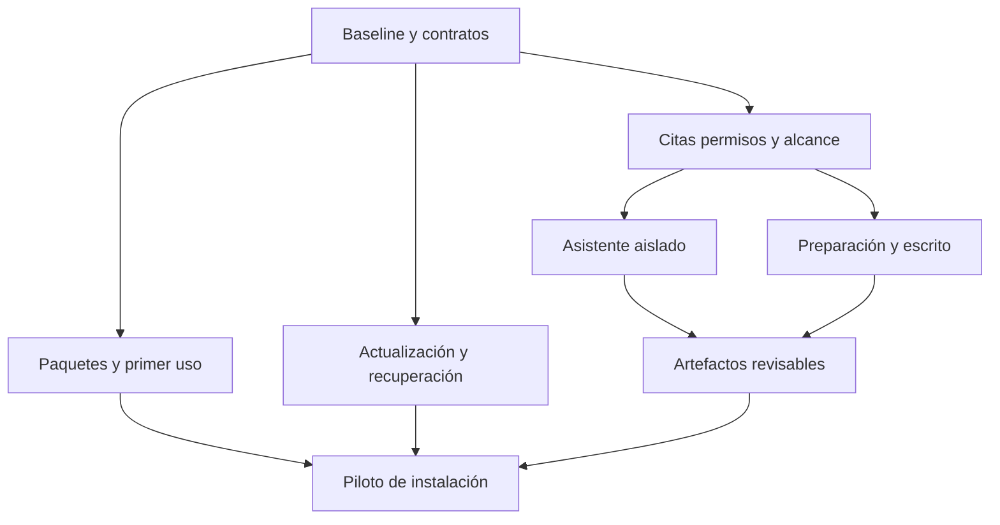

# LexOpen · mejora de la aplicación, distribución y asistente de trabajo

Fecha: **4 de noviembre de 2026**. Documento de ejecución y aceptación. Continúa el [plan maestro del 2 de noviembre](PLAN-MAESTRO-LEXOPEN-2026-11-02.md), incorporando las entregas posteriores de audiencias, transcripción, continuidad, Codex personal y OJV. La prioridad del producto sigue siendo preparar causas, audiencias y escritos con fuentes conservadas y permisos vigentes.

## 1. Alcance, estados y decisiones

Este documento distingue tres estados:

- **Base comprobada en fuente:** existe código o documentación pública inspeccionada. No acredita una instalación nueva ni la disponibilidad de una integración externa.
- **Implementar o verificar en esta etapa:** distribución para cuatro destinos, primer uso, actualización de aplicación y dependencias, y primer corte del asistente con entorno propio. Cada entrega debe cerrar sus criterios antes de marcarse disponible.
- **Continuación priorizada:** mejoras por módulo que se ejecutan en incrementos posteriores; no se consideran construidas por figurar en el plan.

La revisión inicial que origina este plan fue de archivos públicos del repositorio. No consultó expedientes, credenciales, carpetas de almacenamiento ni informes privados. El inventario y los bloqueantes siguientes describen esa base anterior a la implementación; el avance de esta entrega se registra por separado. La presencia de una prueba no equivale a su ejecución.

### Avance de esta entrega

- **Mesa del asistente construida:** objetivo por causa, fuentes elegidas con versión y hash, destino de IA explícito, cancelación, resultados Markdown/DOCX conservados e incorporación revisada e idempotente a un escrito privado con sus referencias. La receta Docker es acotada: no ofrece aún escritorio, navegador ni programas arbitrarios. [Recorrido y preparación](WORKBENCH.md).
- **Distribución construida con verificación en cada ejecución nativa:** matriz Windows x64, macOS x64/arm64 y Linux x64; recursos públicos filtrados, comprobación de binarios, Chromium incluido, prueba de primer administrador y persistencia, feeds unidos y hashes. Los artefactos sólo se publican tras completar los jobs; firma/notarización y piloto de instalación/actualización siguen siendo puertas de versión estable. [Guía](INSTALADORES.md).
- **Actualizador reforzado:** canales explícitos, reintentos limitados, bloqueo de retrocesos, respaldo comprobado y confirmación de compilación/revisión al reiniciar. Dependencias desde ambos locks y cambios futuros mediante PR revisable; herramientas opcionales con diagnóstico. [Operación y recuperación](ACTUALIZACIONES.md).
- **B03 corregido:** el launcher destructivo de E2E y las pruebas usan un único guard de base local desechable. Rechaza desvíos por opciones de conexión y nombres ambiguos antes de reinicializar.
- **Verificación local:** suite principal e integraciones completas pasaron con bases temporales ficticias; tipos y lint pasaron. UI de la Mesa probada en escritorio/móvil y DOCX ficticio abierto/renderizado en LibreOffice. Las pruebas locales del servicio usan una receta de prueba; Docker real y los cuatro paquetes deben acreditarse con sus jobs de CI, sin inferir éxito de una configuración.

El paquete candidato declara `1.1.0-preview.1`. No se trasladan automáticamente a «completo» los hitos H/V de alcance mayor por haber entregado este primer corte. Las mejoras de búsqueda, recuperación de biblioteca, acceso oficial y continuidad por módulo siguen priorizadas en las tablas siguientes.

### Decisiones de producto

1. Mantener la aplicación web y el shell Electron existentes. Evitar otra aplicación que replique expedientes, permisos y actualizaciones.
2. Distribuir para **Windows x64, macOS Intel, macOS Apple Silicon y Linux x64**. Los sistemas mínimos, distribuciones Linux y requisitos de virtualización se fijan en H0 y se verifican en equipos concretos.
3. Conservar un **Host del estudio** y clientes conectados a ese Host. Un cliente nuevo no crea otra copia de la base ni sincroniza expedientes por su cuenta.
4. Los datos, originales, versiones, citas y configuración permanecen fuera de la instalación reemplazable. Actualizar código no autoriza limpiar ni reinicializar datos.
5. Aplicación, dependencias administradas, motores de modelos y servicios externos tienen ciclos distintos. Mostrar qué se actualiza y qué requiere una decisión del administrador.
6. El asistente de trabajo usa servicios de LexOpen, material seleccionado y un entorno de ejecución aislado. Sus resultados vuelven como artefactos revisables. No obtiene acceso general al computador del profesional.
7. La ejecución local y el proveedor del modelo son decisiones separadas: un programa local puede enviar datos a un modelo remoto. La política del estudio prevalece en ambas fronteras.
8. Conservar la identidad visual existente, las bibliotecas personales y la navegación aprobada. Añadir estados, diagnósticos y controles dentro de esos patrones.

## 2. Punto de partida real

El manifiesto inicial de archivos públicos inspeccionado contenía **59 páginas internas, 63 páginas totales, 196 rutas API, 200 archivos de pruebas y 36 archivos de recorridos de navegador**. Son cantidades del inventario anterior a esta entrega, no resultados de pruebas ni medidas de cobertura. La base declaraba `1.0.0`; ese número no acreditaba un instalador publicado o una instalación actualizada.

| Apartado | Base existente | Límite que debe conservarse visible |
| --- | --- | --- |
| Causas y operación | Clientes, partes, equipos, documentos, movimientos, tareas, trámites, minutas, agenda y plazos | Un estado de preparación no acredita suficiencia probatoria ni cómputo judicial correcto |
| Fuentes | Originales, versiones, páginas PDF, fragmentos, huellas, OCR y procesamiento recuperable | Texto extraído, cita literal, fidelidad del OCR y pertinencia jurídica son comprobaciones diferentes |
| Conocimiento | Hechos propuestos, revisión, cronología, incertidumbre y contradicciones con respaldo | Las propuestas no son hechos probados; las fechas inciertas se conservan |
| Biblioteca | Libros personales, colecciones, seis ambientes, conversiones y recuperación BM25 | La selección está acotada; conservar texto no equivale a conservar el original |
| Investigación | Consulta local extractiva, versiones legales, importadores individuales BCN/DT/SII | No es descubrimiento general ni corpus nacional exhaustivo |
| Audiencias | Mesas privadas, lector, notas, conversación, guion, registro, audio y transcripción por clips | La transcripción llega después del procesamiento; integración probada con proveedor simulado no acredita precisión de voz real |
| Escritos | Borradores privados por causa, guardado, historial, restauración y fuentes de hechos/notas/libros | Exportación actual Markdown/TXT; revisión de propuestas por bloques y DOCX requieren desarrollo |
| Asistentes | Herramientas operativas, confirmación, recibos, deshacer con comprobaciones, utilidades documentales y Codex personal opcional | Codex personal actual no recibe navegación, comandos ni lectura general del expediente en disco |
| Equipo y comunicaciones | Roles/capacidades, muros, portal, espacios, correo, mensajes, notificaciones y auditoría | Un aviso entregado no acredita notificación judicial; compartir exige selección y acceso actual |
| Economía | Horas, gastos, acuerdos, documentos internos de cobro, pagos, cuenta corriente y exportaciones | No emite DTE del SII |
| Host y Desktop | Runtime PostgreSQL, migraciones, setup, respaldo/restauración, diagnóstico y actualización; configuración de paquetes Electron | El canal documentado soportado sigue siendo el clon; la configuración de empaquetado no prueba binarios instalables |

Referencias de base: [README](../README.md), [Desktop](DESKTOP.md), [Host](WEB-HOST.md), [escritos](ENTREGA-ESCRITOS-2026-11-02.md), [continuidad](ENTREGA-CONTINUIDAD-2026-11-02.md), [transcripción](ENTREGA-TRANSCRIPCION-EN-VIVO-2026-11-02.md), [Codex personal](CODEX.md) e [ingreso manual OJV](ojv-interfaz-2026-11-03/README.md).

### Hallazgos que cambian el orden de trabajo

| ID | Evidencia inspeccionada | Consecuencia y cierre |
| --- | --- | --- |
| B01 | `desktop/electron-builder.yml` configura DMG/ZIP, NSIS/ZIP y AppImage; `docs/DESKTOP.md` aún declara que no se distribuyen instaladores | Terminar esa cadena y probar los paquetes. No declarar soporte por haber generado un archivo |
| B02 | CI usa Ubuntu; Playwright configura Chromium; `scripts/e2e-server.mjs` inicia `next dev` con opciones de prueba | Añadir aceptación sobre aplicación compilada con seguridad normal y sobre cada paquete instalado |
| B03 | El servidor E2E mantiene un guard de base independiente antes de reinicializarla | Unificar el guard de base desechable, incluidas las opciones de conexión, antes de ampliar automatización |
| B04 | `src/lib/search.ts` aplica `LIMIT` global antes del filtro de acceso en `/api/search` | Coincidencias inaccesibles pueden desplazar las visibles. Filtrar el conjunto autorizado antes del límite y probar ese caso |
| B05 | Documentos obtiene los 100 recientes sin cursor; el listado heredado de jurisprudencia limita recientes | Incorporar búsqueda/filtros y páginas estables que permitan llegar al material antiguo |
| B06 | `src/lib/books/rag.ts` ordena por libro/ordinal y después corta a 3.000 fragmentos antes del ranking | El aviso de cobertura es correcto; mejorar candidatos por consulta e índice antes de ampliar el volumen |
| B07 | `src/lib/writings/schemas.ts` admite hecho, nota de audiencia y libro; la exportación admite Markdown/TXT | Añadir investigación versionada como fuente, revisión por bloques y DOCX sin perder los contratos actuales |
| B08 | `askLlm` usa `stream:false` y timeout propio, sin señal del usuario | Añadir cancelación y progreso reales, sin confundir animación con ejecución por etapas |
| B09 | Política IA predeterminada `remote_allowed` | El primer uso debe explicar y registrar la elección local/remota. No cambiar instalaciones anteriores silenciosamente |
| B10 | PDF/OCR, Chromium OJV y Codex tienen preparación externa o requisitos del Host | Diagnóstico, versiones compatibles y reparación guiada; ausencia de una herramienta opcional no bloquea el producto básico |
| B11 | El actualizador Desktop pide descarga/instalación y detiene el Host; el del clon instala dependencias, migra y compila sobre el checkout | Añadir preparación verificable, backup previo, compatibilidad y recuperación; un estado “compilado” no equivale a “Host actualizado y saludable” |

Las referencias anteriores describen el punto de partida de esta etapa. Si se modifica su implementación, la entrega debe registrar qué hallazgo quedó cerrado y con qué prueba.

## 3. Prioridades y dependencias compartidas

**P0** bloquea distribuir o ejecutar la nueva capacidad con datos del estudio. **P1** completa el recorrido principal y la operación cotidiana. **P2** amplía cobertura después de medir las bases. Estas etiquetas ordenan trabajo; no atribuyen severidad de seguridad a todas las mejoras.

Contratos que deben compartirse:

- **Identidad y permisos:** actor actual, causa, capacidad, propietario y acceso a cada fuente; revalidación antes de leer, ejecutar, importar o exportar.
- **Fuente/cita:** identificador, versión, huella, localizador y advertencias. Una respuesta histórica no se reescribe al actualizar una fuente.
- **Alcance de preparación:** selección persistida, revisión esperada y referencias a las versiones elegidas; no otra copia descontextualizada en cada herramienta.
- **Ejecución durable:** recibos, claves de operación, leases, resultados parciales y errores recuperables. Reusar los servicios de dominio antes de añadir otra escritura.
- **Artefacto:** origen de tarea, entradas, herramientas/modelo, archivos producidos, huellas, revisión y destino aprobado.
- **Instalación:** versión de aplicación, arquitectura, versiones administradas, versión de datos/migraciones y capacidad de restauración. Compatibilidad significa una combinación probada.

## 4. Distribución e instalación — P0

### D01. Contrato de paquete

1. Fijar los cuatro destinos y sus sistemas mínimos. Publicar qué distribución Linux y biblioteca de sistema se ensayan; “Linux x64” por sí solo no define compatibilidad.
2. Construir el runtime de cada arquitectura en un entorno correspondiente. Comprobar PostgreSQL embebido, Prisma y ejecutables auxiliares; no asumir que el empaquetado cruzado incluye binarios compatibles.
3. Enumerar archivos que pueden entrar al paquete. Excluir datos del usuario, credenciales, capturas de sesiones, cachés y resultados privados. Mantener un manifiesto de componentes, licencias y huellas.
4. Separar recursos reemplazables y directorio persistente. Probar nombres de usuario y rutas con espacios/acentos, permisos insuficientes y poco espacio.
5. Definir formatos por destino: DMG/ZIP en macOS, instalador NSIS en Windows y AppImage en Linux como base actual. Un paquete adicional requiere su propia prueba de instalación/retirada.
6. Generar metadatos de actualización, firma y procedencia. Los certificados, notarización y publicación son dependencias externas de la entrega; sin ellos un paquete puede ser de ensayo y debe identificarse así.

**Aceptación:** instalar, abrir, cerrar y volver a abrir en cada destino sin Git ni Node previamente instalado por el usuario; crear una causa ficticia e incorporar/leer un archivo; verificar runtime y arquitectura. Guardar versión, sistema, artefacto y huellas de cada ensayo. No sustituir este ensayo por `electron-builder --dir`.

### D02. Primer uso para Host y Cliente

1. Presentar las dos funciones: “Este equipo guarda los datos del estudio” y “Conectarme al Host”. Explicar que no hay sincronización multimaestro.
2. En Host: elegir ubicación de datos, comprobar escritura/espacio, detectar instalación anterior y bloquear la creación accidental sobre datos incompatibles.
3. Comprobar puerto, base y almacenamiento; distinguir proceso ocupado de base dañada. No ofrecer reinicialización como reparación genérica.
4. Crear administrador mediante el setup existente; verificar sesiones, recuperación y política 2FA antes de finalizar.
5. Elegir explícitamente procesamiento local/remoto y configurar sólo las integraciones deseadas. Mostrar qué funciones están disponibles sin proveedor externo.
6. Ofrecer un documento de prueba ficticio y un diagnóstico de lectura, sin seed de demostración sobre la instalación del estudio.
7. En Cliente: validar URL, conexión, certificado/origen y sesión; no preparar una base local. Explicar requisitos de HTTPS/loopback para captura.
8. Dar un recibo de instalación sin secretos: versión, modo, capacidades verificadas y pasos pendientes.

**Aceptación:** equipo limpio, instalación previa, puerto ocupado, ruta sin permisos y red caída producen acciones entendibles. Salir a mitad del setup y volver no duplica usuarios ni sobrescribe datos. Las funciones opcionales pendientes no se muestran como probadas.

### D03. Dependencias opcionales

Crear un catálogo por plataforma con componente, finalidad, versión compatible, procedencia, licencia, huella, ubicación y política de actualización. Primer catálogo: render PDF/Poppler, OCR/Tesseract e idiomas, Chromium para OJV, Codex CLI opcional, transcriptor configurado y backend del entorno aislado.

- Una dependencia **incluida** se actualiza con el paquete o un componente verificado compatible.
- Una dependencia **administrada por LexOpen** se descarga/prepara con procedencia y huella verificadas, en una ubicación controlada y sin permisos globales innecesarios.
- Una dependencia **del sistema** se detecta y diagnostica. No se reemplaza automáticamente un ejecutable ajeno.
- Un **servicio remoto** se comprueba con una operación explícita mínima; no se presenta como actualización local.
- Un **modelo/pesos** requiere tamaño, licencia, versión, recursos y decisión propios; no se descarga silenciosamente como corrección menor.

**Aceptación:** probar ausencia, incompatibilidad, fallo de descarga e integridad incorrecta. El original permanece accesible; la función afectada explica su límite. Una comprobación de Codex no conecta cuentas ni envía documentos por sí sola.

## 5. Actualización de aplicación y dependencias — P0

### U01. Coordinador común de actualización

Conservar adaptadores separados para Desktop empaquetado y Host desde clon, compartiendo una máquina de estados observable:

`disponible → descargando/preparando → verificado → esperando mantenimiento → respaldo → aplicando → migrando → comprobando → terminado`.

Los estados de fallo deben identificar si se conservó la versión anterior, si hay restauración disponible o si hace falta intervención. No emitir “terminado” antes del arranque y comprobación funcional de la nueva instalación.

Pasos:

1. Consultar un canal explícito y obtener manifiesto con versión, arquitectura, huella, firma/procedencia, compatibilidad de datos y componentes afectados.
2. Preparar la actualización sin detener el trabajo. Validar espacio suficiente para descarga, instalación y respaldo.
3. Mostrar cambios y dependencias afectadas; conservar la posibilidad de posponer. Definir una ventana de mantenimiento del Host y avisar a clientes conectados.
4. Antes de instalar: detectar trabajos, grabaciones y texto sin guardar; impedir nuevas mutaciones, finalizar o suspender con recibo los trabajos permitidos y detener captura.
5. Crear o verificar un respaldo consistente conforme a la política. Si falta el respaldo necesario para una migración, bloquear el paso y explicar cómo resolverlo.
6. Aplicar binarios y migraciones en el orden declarado. Mantener un registro local durable con fase y versión; recuperar locks de procesos muertos sin lanzar dos actualizadores.
7. Arrancar y comprobar base, almacenamiento, versión, recursos estáticos y un recorrido mínimo autenticado. Reanudar los trabajos compatibles después de la comprobación.
8. Publicar resultado a Host y clientes con instrucciones de recuperación si corresponde.

**Aceptación:** descarga incompleta, huella inválida, disco lleno, cierre durante preparación, migración fallida, fallo de arranque y dos peticiones simultáneas. Ningún caso reinicializa datos ni declara éxito falso.

### U02. Recuperación y compatibilidad

Revertir ejecutables y restaurar datos son operaciones distintas. Una migración puede impedir ejecutar una versión anterior sobre la misma base.

- Declarar si una actualización permite volver sólo los binarios o exige restaurar el respaldo compatible.
- Conservar versión anterior hasta completar el periodo de aceptación definido en H0; no borrar automáticamente la única recuperación disponible.
- Verificar el respaldo mediante hashes/manifiesto y ensayo de restauración, no sólo por existencia del directorio.
- Evitar downgrade automático sobre un esquema incompatible. Ofrecer restauración consciente de datos, indicando el trabajo posterior que se perdería.
- Probar interrupciones de energía/proceso en puntos identificados y documentar el siguiente arranque.

**Aceptación:** actualización desde la versión anterior soportada con documentos, biblioteca, audio, citas, usuarios y configuración ficticia; restauración en instalación limpia; consultas y exportaciones vuelven a sus fuentes. Registrar duración y espacio observados sin convertirlos en objetivos generales antes del piloto.

### U03. Actualización de dependencias

1. Sustituir “actualizar todo a lo último” por un conjunto de versiones compatibles probado con una versión de LexOpen.
2. Evaluar impacto: seguridad, licencia, API, binario, formato de datos y tamaño. Publicar qué cambió y qué funciones dependen de ello.
3. Preparar herramientas auxiliares en una ubicación nueva, probarlas con fixtures y activar de forma atómica. Conservar el componente anterior mientras sea compatible.
4. Chromium, OCR y Codex se prueban con los contratos correspondientes. No reemplazar una versión requerida por una sesión activa sin coordinar su cierre.
5. Los cambios mayores de PostgreSQL necesitan un plan específico de migración/backup compatible; no se tratan como reemplazar una biblioteca JavaScript.
6. Los cambios de transcriptor o modelo conservan proveedor y versión de resultados previos; no recalculan ni sustituyen textos históricos automáticamente.

**Aceptación:** una actualización opcional fallida deja funcional la aplicación básica; el diagnóstico identifica versión activa y fallida; la reversión de componente no cambia originales ni credenciales del usuario.

## 6. Matriz de mejora por apartado

Los siguientes incrementos reutilizan la base existente. La primera entrega de cada fila debe ser una capacidad utilizable con prueba propia, no un menú adicional.

| ID / prioridad | Apartado y primer incremento | Dependencias | Criterio de aceptación / prueba |
| --- | --- | --- | --- |
| M01 · P1 | **Inicio y dashboard:** bandeja de trabajo interrumpido y continuación al borrador, audiencia o fallo concreto | Alcance/identidad comunes y estados de jobs | Recarga conserva destinos autorizados; otro usuario no ve recientes ajenos; cada fallo conduce a una reparación |
| M02 · P1 | **Causas/preparación:** selección persistida de fuentes versionadas, hechos revisados y controversias; resumen editable | Citas, versión esperada, permisos | Ida/vuelta entre lectura, biblioteca, audiencia y escrito mantiene causa/selección; revocar retira elementos y conteos |
| M03 · P1 | **Clientes:** compromisos y asuntos por causa, con acceso y equipo independientes | M02 y portal | Dos causas de un cliente no mezclan fuentes; lo interno no se publica por estar en la ficha del cliente |
| M04 · P1 | **PJUD/OJV:** diagnóstico de sesión/programador/cobertura y próxima acción ante resultados parciales | Canal opt-in, cola y sesiones existentes | Lectura separada de registro; repetir no duplica movimientos; vencimiento conserva recibo y ofrece recuperación; ensayos privados sólo autorizados |
| M05 · P1 | **Agenda/plazos:** vínculo audiencia-evento y criterio/fuente del plazo; resolución explícita de conflictos Calendar | Identidad común, cómputo y permisos | Fecha civil estable en Chile; edición no deja copias incoherentes; aviso no se presenta como notificación judicial |
| M06 · P1 | **Tareas/trámites:** acuerdos elegidos a tareas/plazos/eventos con origen y responsable | Minutas y comandos idempotentes | Reintento crea una sola acción; completar/reabrir mantiene espejos/historial; fuente confidencial no llega al portal |
| M07 · P1 | **Documentos:** filtros/paginación y recibo de importación; selección de pasaje sin copiar de nuevo | Evidencia y procesamiento | Documento antiguo fuera de los primeros 100 es localizable; original/versiones conservados; OCR fallido recuperable |
| M08 · P1 | **Biblioteca:** marcadores/notas y edición bibliográfica; después candidatos por consulta que sustituyan corte por ordinal | Libro/colección y contrato de cita | Pasaje al final de libro extenso recuperable; revocar bloquea nuevas lecturas; cambio de ambiente no modifica datos |
| M09 · P1 | **Resoluciones propias:** ficha de lectura con cuestión, decisión, fundamentos y comentario humano | M08 y citas | Cada fundamento tiene pasaje; faltantes distinguibles; rol similar no fusiona fallos; clasificación favorable/contraria es revisable |
| M10 · P1/P2 | **Investigación:** problema jurídico guardado, versiones elegidas, comparación e incorporación al escrito | Fuentes legales y evaluación | Resultado/abstención explican alcance; cambios de fuente no reescriben pasado; parser cambiado falla de forma recuperable |
| M11 · P1 | **Hechos/cronología:** teoría del caso cuestión-hecho-respaldo-objeción-decisión | Revisión y citas | Fecha incierta sigue incierta; contradicción abre dos respaldos; reanálisis conserva revisión humana; exportación expresa su alcance |
| M12 · P1 | **Audiencias:** mesa/evento/guion conectados, fuentes seleccionadas y siguiente actuación | M02, M05 y notas existentes | Abrir no inicia reloj/micrófono; guion recuperable; salida y retorno conservan el trabajo confirmado |
| M13 · P1 | **Audio/transcripción:** diagnóstico por sistema y recuperación de clips ante interrupción | Captura explícita, originales y transcriptor | Salir detiene dispositivos; error conserva original; reenvío no duplica publicaciones; prueba real de audio separada de precisión del modelo |
| M14 · P1 | **Escritos/minutas:** investigación como fuente, revisión por bloques, plantillas de escrito con faltantes y DOCX | M10, referencias y control de revisión | Edición concurrente no se pisa; rechazo conserva texto; DOCX abre con tablas/notas/enlaces; permiso retirado impide exportar derivados |
| M15 · P1 | **Búsqueda/IA:** ACL antes del top de FTS, filtros/páginas, nuevas clases por etapas, progreso/cancelación | Índice reconstruible y política común | Hits ocultos no desplazan visibles; cancelar corta nuevas operaciones; `local_only` sin intentos remotos; resultado histórico reautorizado |
| M16 · P1/P2 | **Espacios:** incorporar fuentes y acuerdos con origen, versiones y permisos coherentes | Citas, miembros y aprobaciones existentes | Archivo/wiki/tarea no amplían permiso al vincularse; aprobación y reintento conservan trazabilidad |
| M17 · P1 | **Correo/mensajes/avisos:** distinguir pendiente/entregado/leído/fallido y mostrar origen resoluble | Outbox, preferencias y permisos | Reconciliar no duplica; destinatario y enlaces respetan acceso; bundle de diagnóstico minimizado |
| M18 · P1 | **Honorarios/cuenta:** actuación a hora/gasto/borrador de cobro; pendientes de aprobación y filtros coherentes | Servicios económicos y auditoría | Pantalla/exportación/KPI coinciden para actor y filtro; reintento no duplica cobro; mantener límite de no emitir DTE |
| M19 · P1 | **Portal:** actualización al cliente desde acuerdos seleccionados con vista previa exacta | M06, M17 y publicación explícita | Sólo aparece lo aprobado; retiro de permiso bloquea lectura posterior; una notificación no publica contenido adicional |
| M20 · P0/P1 | **Equipo/configuración/Host:** diagnóstico instalado-configurado-autorizado-probado, permisos y soporte | Distribución, actualización y contratos de acceso | Configurar no equivale a probar; técnico y profesional mantienen alcances; soporte no contiene secretos/documentos por defecto |

### Secuencia de revisión jurídica y QA

Para M02/M10/M11/M14 usar una muestra inicial revisada por un profesional: documento textual, escaneado, sentencia, fuente histórica y material sin fecha. Registrar respuesta esperada, respaldo exacto, incertidumbre y caso de abstención. Las cifras de recuperación y fidelidad se obtienen de esa muestra; no se inventa un porcentaje productivo ni se llama exactitud jurídica a una coincidencia literal.

Antes de aumentar corpus o cambiar ranking/modelo, comparar contra la línea base con los mismos permisos y fuentes. Informar errores graves individualmente, además del promedio. Una regresión de acceso o de citas bloquea habilitar la mejora aunque aumente la recuperación global.

## 7. Asistente con computadora y entorno propio — P0 para su habilitación

### Referencias investigadas y adaptación propia

La revisión de fuentes públicas del 4 de noviembre identifica dos referencias con alcances distintos. Sus descripciones no acreditan ejecución ni compatibilidad en LexOpen:

| Referencia | Capacidad documentada | Decisión para LexOpen |
| --- | --- | --- |
| [Dots](https://learn.chatgpt.com/docs/dots) y [guía de administración](https://learn.chatgpt.com/docs/enterprise/dots-admin-guide) | Computadora y navegador en la nube, tareas y toma de control; acceso local sujeto a configuración | Adoptar el flujo objetivo-entradas-progreso-revisión. La documentación consultada no establece una API pública para embeber o controlar Dots; no inventar ese conector ni exportar el expediente a un servicio remoto por defecto |
| [Kitties · referencia facilitada](https://madkoding.github.io/kitties/es/#download), [arquitectura](https://github.com/madkoding/kitties/blob/main/docs/ARCHITECTURE.md), [API](https://github.com/madkoding/kitties/blob/main/docs/API.md) y [Desktop](https://github.com/madkoding/kitties/blob/main/docs/DESKTOP.es.md) | Gateway, orquestador, proveedor de modelo y entorno Docker/Podman por asistente, con escritorio, navegador y herramientas; API de conversaciones, eventos, cancelación, archivos, artefactos y aprobaciones | Adaptador local opcional detrás del broker LexOpen. Fijar versión y comprobar contrato, licencias, límites y aislamiento. No usar una demostración simulada como prueba de computadora operativa |

El código público de [contenedores](https://github.com/madkoding/kitties/blob/main/internal/container/container.go) y [gateway](https://github.com/madkoding/kitties/blob/main/internal/gateway/gateway.go) muestra puntos que requieren revisión en el ensayo: workspace montado desde el Host, límites de recursos configurables, visor en loopback y un bearer para la API. La biblioteca de artefactos documentada se comparte por flota; no equivale a los permisos por causa/propietario de LexOpen. Hay diferencias entre documentos acerca de límites y puertos, por lo que prevalece el contrato de la versión fijada y probada, con límites propios conservadores. El token nunca llega al navegador ni al contenido de un documento.

No depender de Kitties para conservar datos, citas, trabajos o artefactos. El adaptador puede sustituirse; el orquestador de LexOpen sigue resolviendo autorización, políticas, revisión e incorporación. Una flota compartida no se habilita si no se demuestra aislamiento de entradas, herramientas, conversaciones y artefactos entre usuarios/causas; el primer ensayo debe preferir una frontera dedicada por ejecución o por propietario y causa.

### 7.1 Objetivo y límite de la primera versión

El usuario encarga una gestión, análisis o documento desde una causa o un espacio de trabajo. LexOpen prepara un entorno separado con las entradas elegidas; el asistente puede usar las herramientas autorizadas de ese entorno y devuelve archivos, resultados y un recibo de ejecución. El profesional revisa antes de incorporarlos al expediente o realizar una acción externa.

La conexión personal Codex existente sólo completa consultas de texto; no demuestra que haya computadora, navegador o ejecución aislada. No convertir esa conexión en un permiso implícito para leer el disco, usar cuentas del Host o transmitir el expediente.

**Primer corte nativo, implementable antes del runtime:** análisis con los proveedores ya admitidos y producción de borradores/tablas/artefactos durables a partir de entradas seleccionadas, sin shell arbitrario ni navegador. Este corte no se presenta como computadora virtual. **Corte con entorno:** lectura, conversiones y ejecución limitada de herramientas preinstaladas después de superar V0. La escritura en LexOpen se realiza mediante una propuesta revisable. Envíos, publicación, firma, pagos y otras acciones externas necesitan autorización explícita de esa acción y un adaptador específico; no forman parte del permiso genérico de analizar.

### 7.2 Qué se puede llamar entorno aislado

Una carpeta separada sólo organiza archivos. Un proceso con otro directorio de trabajo no es una máquina virtual. Un contenedor tiene un aislamiento distinto de una VM con kernel propio; cada backend debe declarar sus límites y las capacidades del sistema necesarias.

El ensayo debe elegir un backend de ejecución local disponible en los destinos objetivo, evaluar aislamiento de procesos/archivos/red, navegador, consumo y recuperación, y documentar sus diferencias por sistema. Si el equipo no puede iniciarlo, la interfaz ofrece diagnóstico o el corte nativo sin ejecución, sin simular una computadora operativa.

Para un contenedor, comprobar ejecución sin privilegios innecesarios, usuario no root, entradas de sólo lectura, salida separada, raíz de sólo lectura cuando las herramientas lo permitan, capacidades retiradas, límites de memoria/CPU/PIDs/tiempo y ausencia de acceso al socket del motor. La [documentación de seguridad de Docker](https://docs.docker.com/engine/security/) explica que namespaces, cgroups, capacidades y montajes condicionan la separación; no prometer aislamiento absoluto. La [red `none`](https://docs.docker.com/engine/network/drivers/none/) es una base de prueba sin conectividad externa. Un [contexto de navegador Playwright](https://playwright.dev/docs/browser-contexts) separa cookies y almacenamiento; no es una VM ni una frontera general de ejecución.

El broker de permisos y la base de LexOpen permanecen fuera del entorno ejecutado. El asistente no recibe acceso directo a PostgreSQL, a la carpeta completa de datos, al socket de administración del backend, a credenciales del Host ni a carpetas personales.

### 7.3 Flujo integrado y registros

1. **Encargo:** causa, objetivo, artefactos esperados y alcance. Mostrar las fuentes seleccionadas, el proveedor/modelo si aplica y si habrá conexión de red.
2. **Preflight:** revalidar actor, fuentes, versiones y política; calcular presupuesto de archivos/bytes/tiempo; comprobar disponibilidad del backend.
3. **Manifiesto de entradas:** identificadores, versiones, huellas y operaciones permitidas. Copiar sólo los bytes necesarios, con nombres controlados. Una entrada no autorizada cancela la preparación.
4. **Sesión:** entorno efímero por ejecución/propietario, recursos acotados y red cerrada por defecto. Una reanudación verifica otra vez permisos y estado, no hereda autoridad indefinida.
5. **Herramientas:** catálogo pequeño de operaciones tipadas y ejecutables aprobados. La lectura de un PDF o una página web es material no confiable, no una nueva instrucción del sistema.
6. **Ejecución:** estado y progreso por etapa, límites y detención. El registro conserva operaciones y resultados necesarios para revisar, evitando volcar texto/secretos por defecto.
7. **Artefactos en cuarentena:** listar archivos producidos con tipo, tamaño y huella; comprobar rutas, enlaces, archivo comprimido y contenido activo antes de mostrar o importar.
8. **Revisión:** vista previa, fuentes, advertencias, diferencias y destino. El usuario puede descargar, rechazar o proponer incorporación.
9. **Aplicación:** reautorizar causa/fuentes y comprobar versión esperada; reutilizar comandos/recibos para no duplicar. No sobrescribir un escrito editado durante la ejecución.
10. **Cierre:** conservar sólo recibo y artefactos aprobados según política; borrar el entorno temporal y revocar capacidades/sesiones. Registrar interrupciones recuperables.

Los conceptos de ejecución, entrada, capacidad y artefacto necesitan persistencia durable. Propuesta a revisar: ejecución con propietario/causa/petición/estado/versión de política/proveedor/runtime; snapshot de entradas; eventos; artefactos; recibo único de incorporación. No colocar blobs privados ni credenciales en el payload del job o sus logs. Estos conceptos no afirman que existan modelos actuales con esos nombres.

Estados mínimos propuestos: `queued → running → awaiting_review → imported`, con salidas `failed`, `cancelled` y `blocked`. El lease y la revisión del estado se reclaman de forma condicional para evitar dos ejecutores. Cancelar registra la petición, detiene el runner y revoca capacidades; un trabajo cancelado no permite incorporar sus salidas como resultado aprobado. Una nueva ejecución exige nueva revisión de entradas. El proceso web no ejecuta comandos generados por el modelo.

### 7.4 Red, modelos y cuentas

- Aplicar `local_only` también al nuevo recorrido: no basta con que el navegador o proceso se ejecuten localmente. El broker controla modelos, herramientas y subida de archivos.
- Red denegada por defecto. Una consulta pública puede autorizar destinos y finalidad concretos; no concede acceso general al Host o la red del estudio.
- No subir documentos privados a un servicio SaaS para convertirlos, analizarlos o ejecutarlos sin selección y permiso explícitos. Mostrar qué datos salen y a qué servicio.
- Una autenticación en una web requiere flujo autorizado y sesión separada. No copiar cookies ni credenciales del navegador habitual del profesional.
- El modelo local/remoto es un adaptador independiente del backend de ejecución. Cambiarlo no amplía archivos, red ni herramientas autorizadas.
- La revocación corta nuevos accesos y aplicación de resultados; si bytes ya se enviaron a un tercero, no prometer su recuperación mediante revocación local.

### 7.5 Etapas y aceptación

| Corte | Entrega utilizable | Prueba decisiva |
| --- | --- | --- |
| Vn · flujo nativo | Análisis con servicios existentes, entradas elegidas, tarea/artefactos durables, revisión e incorporación, sin shell ni computadora | Datos ajenos denegados; fallo conserva borrador; reintento no duplica artefacto/incorporación; interfaz identifica exactamente las herramientas usadas |
| V0 · viabilidad | Backend real identificado, preflight y tarea local sintética de lectura/conversión; comparación de límites por sistema | Intento de leer fuera de entradas, acceder a credenciales/red local o agotar recursos queda bloqueado; diagnóstico si falta soporte |
| V1 · análisis y artefactos | Encargo por causa, manifiesto, ejecución acotada, resultado en cuarentena, vista previa y rechazo | Documento seleccionado a tabla/borrador; fuentes y huellas conservadas; cierre limpia entorno; ningún cambio automático en expediente |
| V2 · navegador autorizado | Navegador del entorno con destinos permitidos y sesiones específicas; progreso/pausa/detención | Prompt injection de página/documento no amplía permisos; salida privada y acción externa requieren autorización; parada corta nuevas acciones |
| V3 · aplicación al flujo | Propuestas a nota/hecho/escrito/tarea por los servicios de LexOpen | Reintento no duplica; ACL revocado o versión posterior bloquea aplicación; revisión y auditoría permiten explicar qué se incorporó |

Vn y el ensayo V0 pueden empezar durante esta etapa. V1 espera a que V0 esté aprobado en el destino correspondiente. V2/V3 no se marcan completos por disponer de una ventana o una conversación. La compatibilidad del backend y el modelo de amenazas condicionan su calendario.

Si se usa un motor de agentes con herramientas, contrastar su contrato de permisos, interrupción y credenciales: [ciclo de ejecución e interrupción de app-server](https://learn.chatgpt.com/docs/app-server) y [separación de red, credenciales y aprobaciones](https://developers.openai.com/api/docs/guides/agents-api/environments/security). Esas APIs son referencias de adaptadores y no sustituyen el broker, la política del estudio o la revisión de artefactos de LexOpen.

## 8. Hitos H0–H5 y capacidad de trabajo

Hipótesis para planificar el alcance amplio: **dos desarrolladores a tiempo completo, QA parcial, revisión jurídica recurrente y acceso a los cuatro destinos de escritorio**. No es una fecha comprometida. Un equipo distinto o la falta de certificados/equipos exige recalibrar. No es realista terminar todas las mejoras M01–M20, el navegador autónomo y proyectos Word/MCP/cartografía en la misma ventana.

| Hito | Ventana orientativa | Entregas y dependencias | Puerta de salida |
| --- | --- | --- | --- |
| **H0 · baseline** | Semana 1 | Actualizar inventario/estados; fijar sistemas mínimos, formatos, versiones administradas y contratos; guards de pruebas; seleccionar backend V0 y modelo de amenazas | Matriz con responsable, alcance y prueba por requisito; build reproducible y entorno de prueba seguro. Ningún resultado heredado presentado como ensayo nuevo |
| **H1 · alfa instalable** | Semanas 2–4 | D01/D02, diagnóstico D03, primer U01; FTS/paginación acotados; V0 en plataforma inicial | Instalar/arrancar/reabrir en los cuatro destinos; causa y archivo ficticios; fallo de dependencia entendible; backend real identificado sin acceso general al Host |
| **H2 · recorrido de trabajo** | Semanas 4–7 | M02/M10/M14 como corte vertical; fuente de investigación, revisión por bloques y DOCX inicial; V1 de análisis local | Fuente a preparación a escrito conserva versión/permiso; edición concurrente no se pisa; artefacto revisado entra una vez; DOCX renderizado y revisado |
| **H3 · continuidad y actualizaciones** | Semanas 7–10 | Corte M05/M06/M12/M13; U01–U03 con recuperación; V2 sólo si supera aislamiento y red | Acuerdo a tarea/plazo/evento sin duplicados; actualización/interrupción/rollback probados; audio real por destino. Ningún navegador habilitado si falla el aislamiento |
| **H4 · candidato de distribución** | Semanas 9–12 | Firmas/notarización/publicación según disponibilidad; respaldo restaurable; smokes de producción; soporte y manual; V3 si sus puertas anteriores están cerradas | Paquetes instalados y actualización desde versión soportada; restauración en limpio con fuentes/relaciones; versión/canal comprobables y resultados completos |
| **H5 · piloto y decisión** | Semanas 13–16 | Volumen, dispositivos, accesibilidad, calidad de recuperación y uso profesional; priorizar resto de M01–M20 con medidas | Hallazgos críticos cerrados, recuperación repetida, límites publicados y backlog ajustado con evidencia. Ampliaciones sólo por aceptación propia |

Las ventanas se solapan cuando trabajan sobre contratos estables y archivos distintos. El backend aislado puede exceder estas ventanas si no existe soporte local adecuado en un destino; en ese caso se distribuye la aplicación sin anunciar esa capacidad en esa plataforma.

### Primera lista de trabajo implementable

1. Congelar sólo los contratos de paquete, datos persistentes, dependencia y actualización; no congelar la aplicación completa durante meses.
2. Crear pruebas de manifiesto/recursos y luego construir un paquete por arquitectura. Probar primero Host básico sin integraciones.
3. Implementar primer uso sobre el setup y diagnósticos existentes. Añadir reparación de dependencias sin instalar servicios no elegidos.
4. Unificar estado del actualizador y exigir comprobación de arranque; preparar backup y compatibilidad antes de ampliar actualización automática.
5. Corregir FTS/top autorizado y páginas antiguas con una regresión que contenga coincidencias ocultas y visibles.
6. Entregar un corte de escrito con resultado de investigación versionado y una propuesta por bloques; después DOCX.
7. Ejecutar V0 con datos sintéticos, límites y ataques de archivos/red; aprobar el backend antes de añadir una interfaz de computadora.
8. Integrar V1 con el mismo contrato de artefactos y revisión del escrito, sin otra ruta de permisos o publicación.
9. Preparar un único recorrido de aceptación que atraviese instalación, trabajo, actualización y restauración.

## 9. Matriz de verificación

| Dimensión | Datos y procedimiento | Evidencia para cerrar |
| --- | --- | --- |
| Instalación | Equipo/VM limpio por destino, usuario normal, ruta con espacios/acentos, sin Git/Node externos | Artefacto y huella, SO/arquitectura, logs minimizados, arranque y reapertura |
| Seguridad normal | Servidor compilado, sin atajos E2E/demostración | Login/2FA/CSRF, muro, fuente revocada, descargas y exportación negativas |
| Actualización | Versión anterior soportada y fixture con fuentes/audio/configuración | Estados, backup, migración, nuevo arranque y recorrido; fallo/reanudación/restauración |
| Dependencias | Ausente, incompatible, descarga truncada/alterada y versión válida | Diagnóstico, bloqueo de activación incorrecta y funcionamiento básico conservado |
| Fuentes y escritos | PDF textual/escaneado, TXT, libro, fuente legal y nota personal | Citas/localizadores/avisos; conflicto de versión; DOCX renderizado y abierto |
| Recuperación | Reiniciar durante job, aplicación, actualización y sesión del asistente | Recibos durables, ausencia de duplicados, trabajo confirmado recuperado |
| Entorno aislado | Archivos con rutas adversas/symlinks, documentos con instrucciones, URLs privadas y cargas excesivas | Límites efectivos de archivos/procesos/red; parada; entorno y capacidades revocados |
| Audio | Dispositivo real y caso sintético controlado por sistema | Permiso explícito, micrófono detenido al salir, original reproducible, límites observados |
| Calidad jurídica | Preguntas y pasajes esperados revisados por profesional | Recuperación/abstención medidas, errores graves descritos, decisiones humanas conservadas |
| Accesibilidad | Teclado, foco, 360 px, oscuro, movimiento reducido y texto largo | Recorrido principal usable y errores anunciados; sin rediseño no solicitado |
| Soporte | Exportar diagnóstico de instalación ficticia | Sin credenciales, textos del expediente, cookies ni autorizaciones personales por defecto |

Las suites existentes son base de regresión. Añadir un trabajo de CI sobre producción normal y una matriz de empaquetado/instalación. No hacer equivaler Ubuntu/Chromium a Windows/macOS instalados; tampoco una prueba con proveedor simulado a OAuth, voz o portal externo reales.

## 10. Riesgos y decisiones pendientes

| Riesgo | Tratamiento | Impide cerrar |
| --- | --- | --- |
| Firma, notarización o permisos de publicación no disponibles | Separar artefacto de ensayo y distribución; preparar el paquete y la evidencia antes de pedir la habilitación final necesaria | H4 como distribución verificada |
| Binario nativo equivocado o dependencia omitida por tracing | Build por arquitectura, inventario de recursos y ensayo instalado | H1 del destino afectado |
| Cambio mayor de PostgreSQL o esquema incompatible | Ruta específica de migración y respaldo/restauración compatible | U02/U03, no el análisis básico |
| Reinicio con captura o cambios pendientes | Mantenimiento coordinado y recuperación con recibos | Instalación de actualización |
| Entorno no disponible o débil por plataforma | V0 real, diagnóstico y capacidad deshabilitada de forma explícita | V1/V2 de esa plataforma |
| Fuente no autorizada o prompt injection | Broker fuera del entorno, entradas seleccionadas, red cerrada y reautorización | Habilitar asistente con datos del estudio |
| Red o servicio oficial variable | Canal opt-in, estados parciales, recibos e importación alternativa | La función externa afectada; no toda la aplicación |
| Recuperación/ranking no medidos | Corpus revisado y comparación con línea base antes de ampliar | Afirmaciones de mejora de calidad/escala |
| Entregas ya hechas aún descritas como futuras | Reconciliar plan, README, ayuda y recibos de entrega | Publicar una matriz de estado confiable |

## 11. Continuaciones que requieren proyecto propio

Complemento Word con cambios revisables, servidor MCP con scopes y revocación, cartografía/inmuebles, operación sin red con conflictos y despliegue multiempresa conservan backlog propio. Los ensayos pueden adelantarse para descubrir límites, pero no sustituyen sus modelos de autorización ni sus pruebas de plataforma.

La prioridad inmediata es distribuir y actualizar con recuperación, completar un recorrido jurídico utilizable y habilitar el asistente aislado sólo donde la separación y los permisos estén demostrados. No marcar ningún requisito completo sin una entrega identificada y una prueba que corresponda a su alcance.
