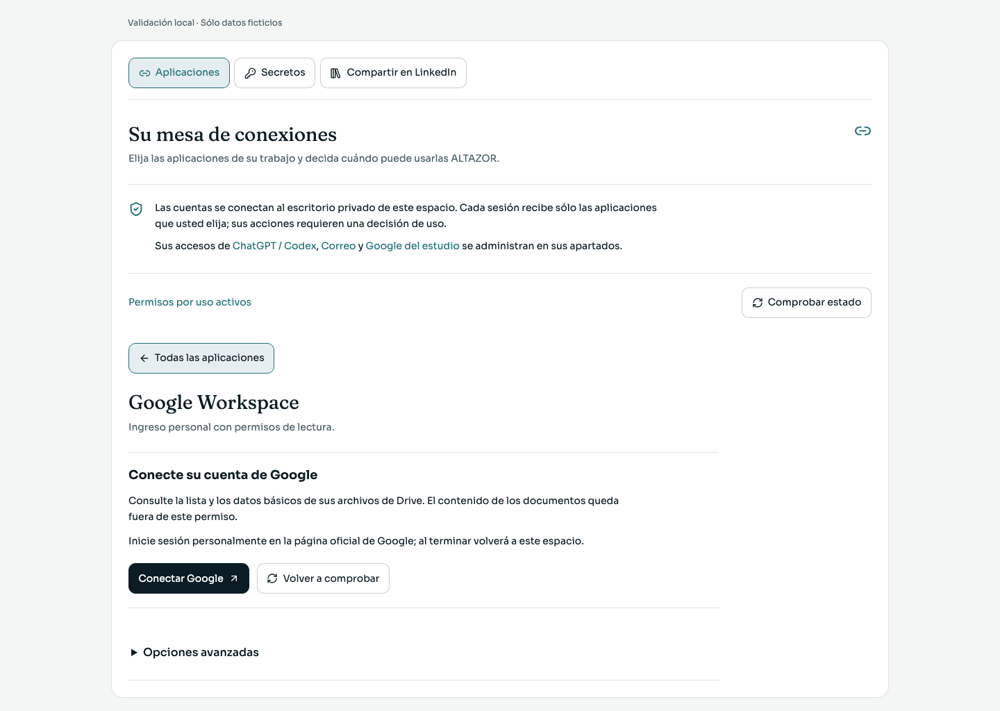
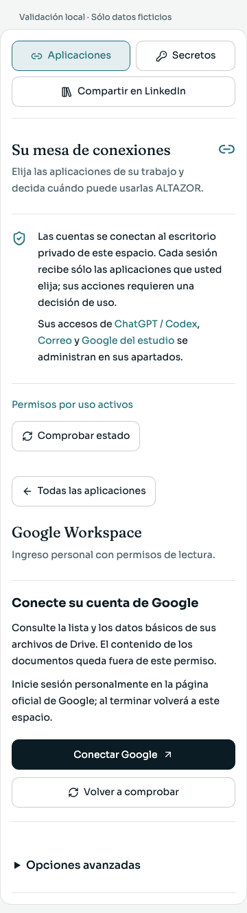
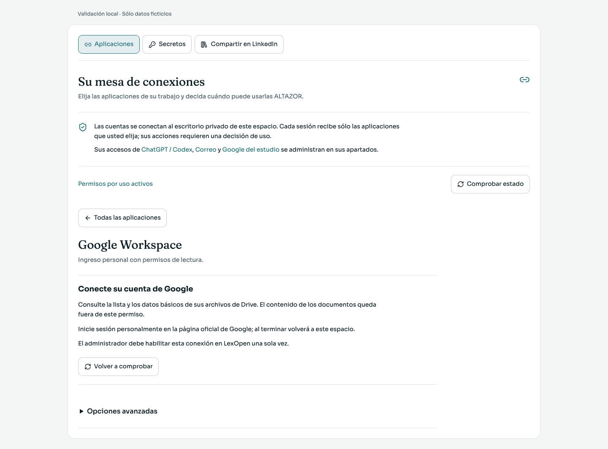
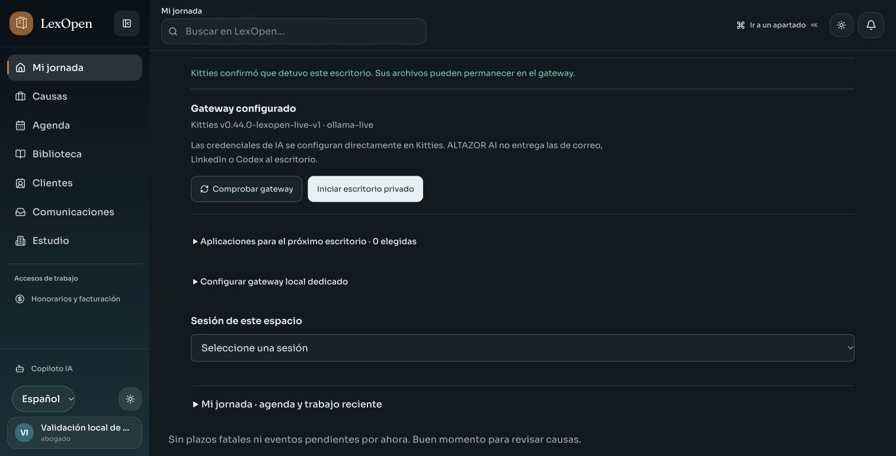
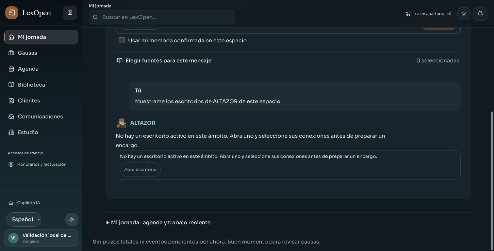

# Ingreso sencillo de cuentas

Las tres primeras imágenes muestran el componente real de LexOpen, con sus estilos y fuentes, dentro de un entorno de validación local con **APIs y datos ficticios**. No muestran cuentas personales conectadas ni un consentimiento real.

La vista habitual ofrece **Conectar → ingreso oficial → volver a LexOpen**. Los datos técnicos se encuentran en Opciones avanzadas. La preparación inicial queda reservada al administrador.

Si el administrador aún no habilitó el proveedor, la vista explica ese requisito y no presenta una conexión exitosa:

La revisión funcional utiliza 26 estados controlados, a 1440 × 1000 y 360 × 800. Comprueba permisos visibles, estados pendientes y fallidos, retorno ajeno, preparación administrativa, limpieza de campos reservados y controles de cierre del escritorio. Las métricas de esa ronda no detectaron desbordamiento horizontal; los botones tienen al menos 44 px y los campos de texto al menos 16 px.

Una captura no sustituye la validación de autorización frente a Google o GitHub. Para habilitar esos accesos reales, consulte [la preparación del administrador](../ALTAZOR-CONEXIONES.md#inicio-de-sesión-sencillo).

## Escritorio real

Esta captura adicional pertenece a la aplicación completa, con PostgreSQL dedicado, un gateway reforzado real y un contenedor Linux oficial ejecutado dentro de una VM aislada. Se creó la sesión desde la interfaz, se obtuvo su pantalla, se tomó el control manual y el gateway confirmó su detención. El usuario, la causa y la credencial de Secretos son ficticios; no se conectaron cuentas de Google o GitHub ni se enviaron documentos del estudio. No se acredita autonomía visual del modelo ni escritura de una contraseña real.

El guardado y la recarga de una credencial ficticia en Secretos se comprobaron también en esta aplicación completa: la lista devolvió sólo metadatos. Las pruebas de escritura de un solo uso y sus carreras siguen siendo comprobaciones automatizadas con gateway ficticio.

También se comprobó la consulta «Muéstrame los escritorios de ALTAZOR de este espacio» y su enlace a Computadora. Esta lectura clara se resuelve por una regla local antes de la clasificación del modelo; conserva las comprobaciones de propietario y ámbito. La captura muestra el estado correcto después de detener el único escritorio de prueba. La tarjeta y su enlace se verificaron en temas claro y oscuro.

