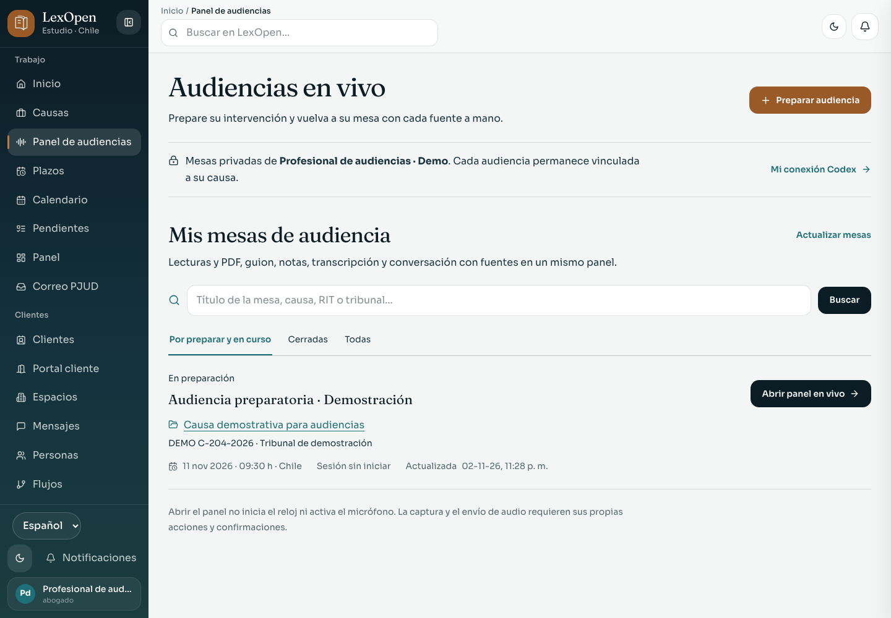

# Codex personal y panel independiente de audiencias

Entrega sobre `main@f49eb0be9815e2a22dd9a6079e9ff1afe7555e4f`. Las capturas son pantallas reales de Chromium con información ficticia; el [manifiesto](manifest.json) conserva dimensiones y huellas del código y las imágenes.

## Uso

**Panel de audiencias** en la navegación abre `/audiencias`: búsqueda por mesa, causa, RIT o tribunal; estados; creación de una mesa en una causa autorizada. Cada profesional consulta sus propias mesas. Abrir una entra directamente a En vivo y conserva su causa y el escrito de origen. La fecha y hora se editan en Agenda.

La mesa reúne En vivo, Fuentes, Lectura, Notas, Conversación, Guion y Agenda. La hora de Chile y el tiempo de sesión son controles distintos. Abrir la página no inicia tiempo ni micrófono. Se mantienen la lectura, la transcripción por tramos, los registros y su conversión revisable a hechos propuestos, notas y escritos con fuentes comprobadas.

**Mi cuenta → Tu cuenta de Codex** permite autorizar la cuenta personal, elegir un modelo, guardar su uso, probar y desconectar. La conexión utiliza un directorio privado por profesional y respeta la política de IA local y los permisos actuales. Consulte [preparación del Host y funcionamiento](../CODEX.md).

## Capturas

| Superficie | Escritorio | Móvil, 360 px |
| --- | --- | --- |
| Mesas de audiencia | [Ver](audience-hub-desktop.png) | [Ver](audience-hub-mobile.png) |
| Autorización personal | [Ver](codex-authorization-desktop.png) | [Ver](codex-authorization-mobile.png) |
| Modelo y preferencia | [Ver](codex-connected-desktop.png) | [Ver](codex-connected-mobile.png) |
| Herramientas en vivo | [Ver](live-desktop.png) | [Ver](live-mobile.png) |

## Verificación

- [14 recorridos distintos de navegador aprobados](browser.log): catálogo privado, autorización de Codex, biblioteca, transcripción, registros, hechos, notas y escritos. Las pruebas usan PostgreSQL y archivos desechables, separados del estudio.
- [Confirmación del ajuste móvil aprobada](confirmation.log): las siete herramientas quedan dentro del ancho de 360 px y conservan controles de al menos 44 px; el registro y el foco siguen funcionando.
- `npm test` completo aprobado, incluidos 17 ensayos de proceso Codex y el ensayo de despacho personal. Se comprueban aislamiento, rechazo de herramientas, límites, política local, revocación y ausencia de cambio automático de proveedor tras un error.
- [Lint](lint.log), [tipos](types.log) y [compilación standalone](build.log) aprobados. Permanecen cuatro avisos previos de rastreo de archivos dinámicos en `rate-limit.ts` y `storage.ts`.
- [Paquete verificado](package-check.json): una marca ficticia colocada en el directorio privado de Codex quedó fuera del paquete y de las trazas. No se empaquetan archivos `.env`, el directorio `.codex` ni el almacenamiento privado configurado dentro del proyecto.
- [Comprobación HTTP del paquete compilado](production-check.json): páginas y catálogo privado disponibles, cuenta aislada sin autorización, rechazo de acceso anónimo y protección CSRF normal. Se ejecutó por loopback con una cuenta ficticia; no es una publicación.

La revisión visual independiente cerró con **disposition: ship**:

| Hallazgo material | Resultado final |
| --- | --- |
| P2: herramientas ocultas en móvil | Resuelto: siete herramientas visibles en tres filas; escritorio conservado. |

No se autorizó una cuenta real ni se hizo una consulta real a OpenAI. La inicialización y `account/read` se comprobaron con Codex CLI 0.155.1 en un entorno aislado; la autorización y las respuestas del recorrido de navegador proceden de un simulador local. Los modelos y la calidad de respuesta reales requieren la autorización del profesional. Windows real no se verificó.
