# Interfaz del estudio · 4 de noviembre de 2026

Quince capturas de la aplicación real con datos ficticios muestran la reorganización de navegación y espacios de trabajo para `1.1.0-preview.2`. Las capturas se registraron durante la validación local. Consulte los instaladores disponibles en [Releases](https://github.com/gabrielperezibacache/lexopen/releases) y el recorrido en la [guía de navegación](../NAVEGACION-Y-ESPACIOS-DE-TRABAJO.md).

Las personas, causas, documentos y perfiles son de demostración. No se usaron expedientes reales ni sesiones OJV. Las capturas de **Mesa del asistente** utilizan la interfaz real con proveedor, eventos y resultado simulados para revisar su presentación; no prueban una ejecución de Docker.

## Procedencia y comprobación

El [manifiesto](manifest.json) registra fecha, versión, revisión base, dimensiones y SHA-256 de cada PNG, además de las huellas de los componentes principales en el momento de la captura. La base es `0640d82498bcb19848c7b480458636277cfb5fc7`; el manifiesto identifica expresamente los cambios de interfaz todavía sin commit.

La revisión visual independiente concluyó que la interfaz era apta para entrega tras resolver la jerarquía de la causa en móvil y la carga de la audiencia al consultar Notas. Se verificó ausencia de desbordamiento horizontal en los recorridos capturados a 1440 y 360 píxeles. Las capturas acreditan esos estados visibles; no certifican producción, precisión del micrófono físico ni conformidad completa de accesibilidad.

La [comprobación complementaria de adaptación](adaptation.json) cubre 768 y 1024 píxeles, y una vista equivalente al 200 % (720 píxeles CSS con densidad 2). El panel conserva el mismo nodo al pasar entre diálogo y lateral; Escape y la devolución de foco también se verificaron.

| Hallazgo de la revisión visual | Veredicto final |
| --- | --- |
| Recorrido de causa antes de acciones y etiquetas en móvil | Resuelto |
| Audiencia cargada junto al acompañante de Notas | Resuelto |

Disposición del revisor independiente: **ship**. El avance del reloj y la continuidad de la captura se comprobaron mediante pruebas funcionales adicionales, no mediante una imagen estática.

## Mi jornada y navegación

**Demostración con datos ficticios · escritorio, 1440 × 1000.** Siete áreas y los destinos secundarios de Mi jornada.

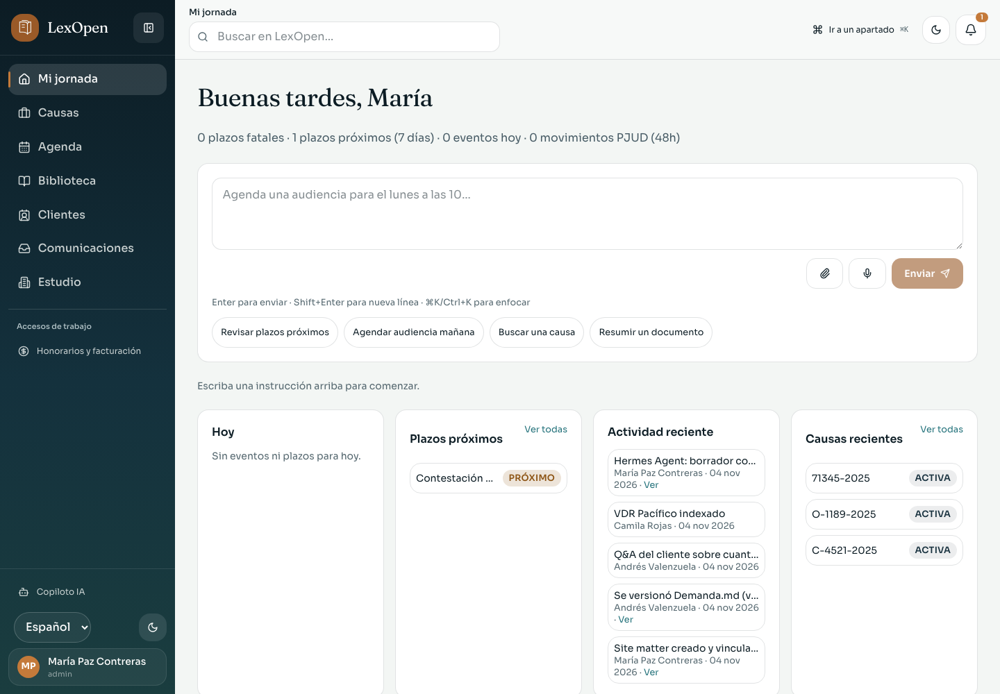

**Demostración con datos ficticios · móvil, 360 × 900.** Entrada cotidiana y búsqueda en la cabecera.

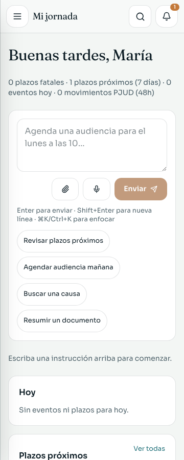

**Demostración con datos ficticios · móvil, 360 × 900.** Menú con áreas, destinos del área activa y cuenta de sesión.

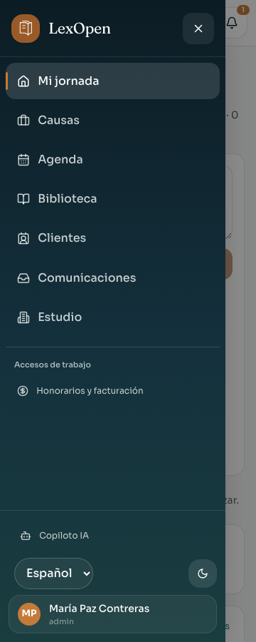

## Recorrido de la causa

**Demostración con datos ficticios · escritorio, 1440 × 1000.** Resumen, Expediente, Preparación, Audiencias y Escritos, con recursos de preparación y acciones secundarias.

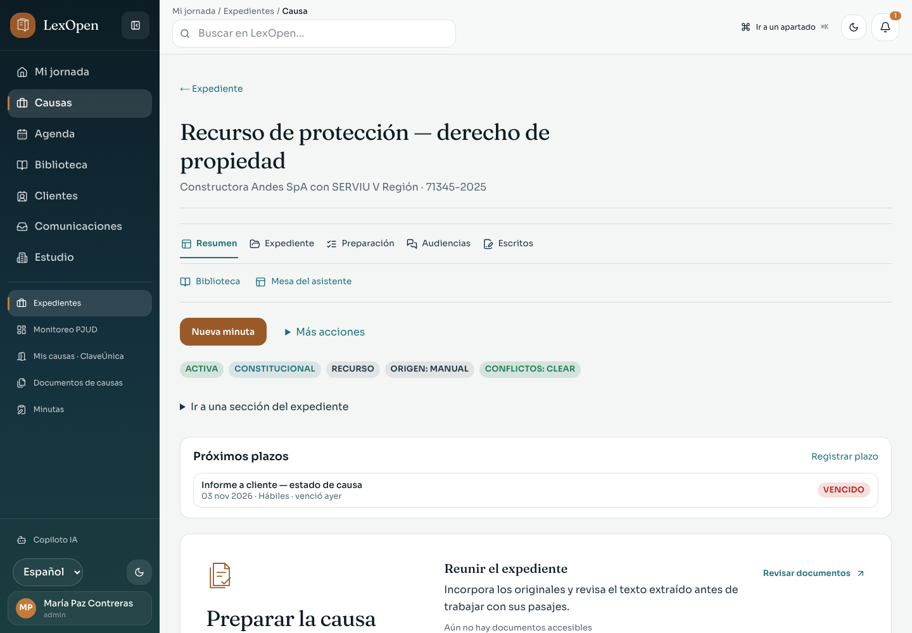

**Demostración con datos ficticios · móvil, 360 × 900.** Los cinco destinos aparecen bajo el título y antes de las acciones de la causa.

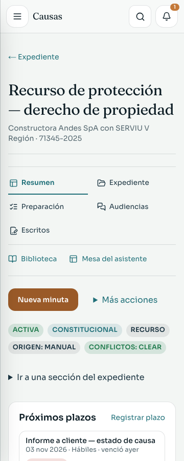

## Configuración

**Demostración con datos ficticios · escritorio, 1440 × 1000.** Categorías y navegación por las secciones existentes.

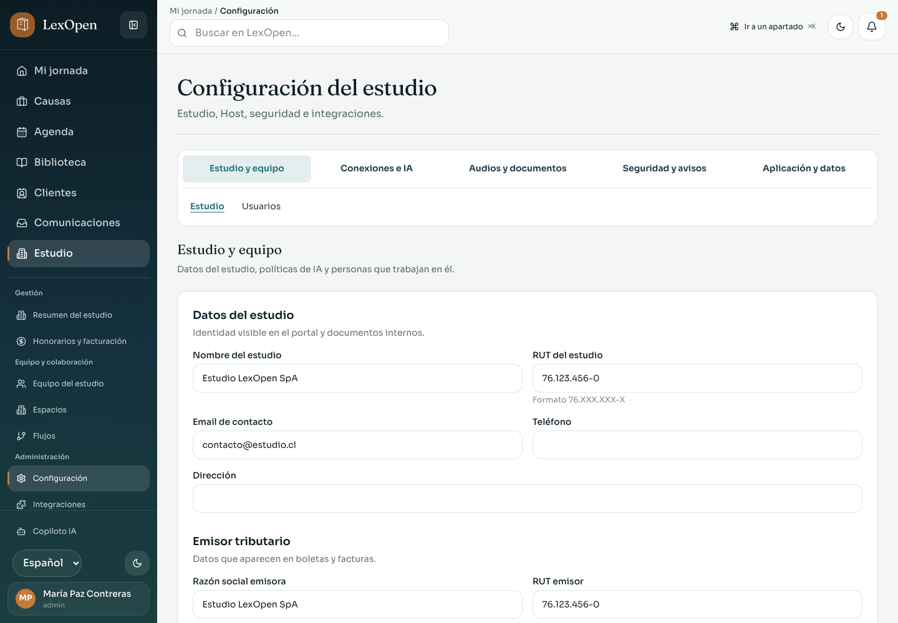

**Demostración con datos ficticios · móvil, 360 × 900.** Selector de categoría y enlaces de sección.

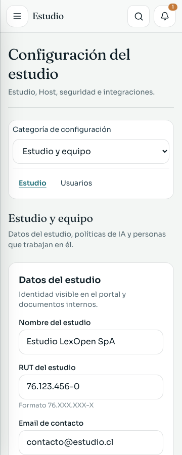

## Audiencia y notas

**Demostración con datos ficticios · escritorio, 1440 × 1000.** Audiencia cargada junto al cuaderno de notas; reloj y configuración de captura permanecen en la mesa.

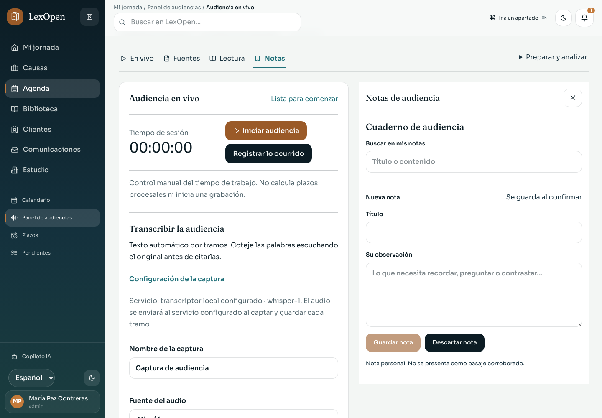

**Demostración con datos ficticios · móvil, 360 × 900.** El cuaderno se abre en el diálogo contextual.

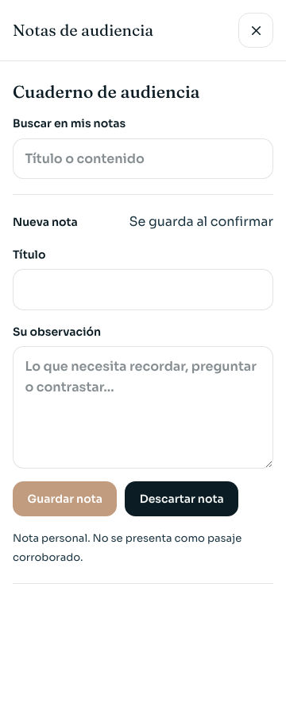

## Lectura

**Demostración con datos ficticios · escritorio, 1440 × 1000.** El PDF original ocupa el lienzo y los pasajes se consultan en el acompañante.

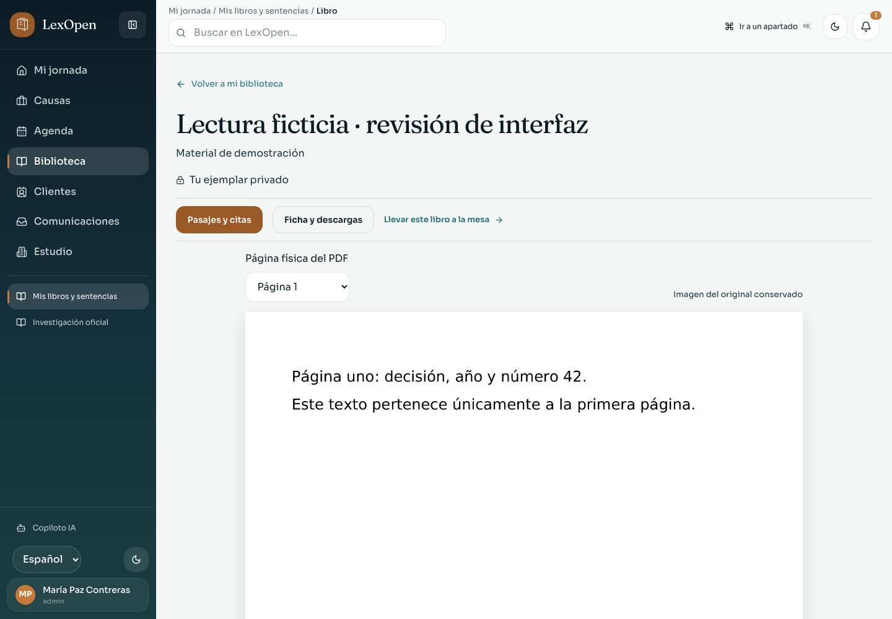

**Demostración con datos ficticios · móvil, 360 × 900.** Pasajes y citas en el diálogo de herramientas de lectura.

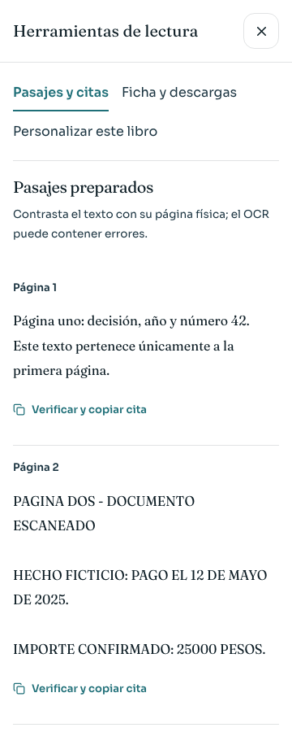

## Escritos

**Demostración con datos ficticios · escritorio, 1440 × 1000.** Hoja de borrador, acceso a fuentes y estado de guardado.

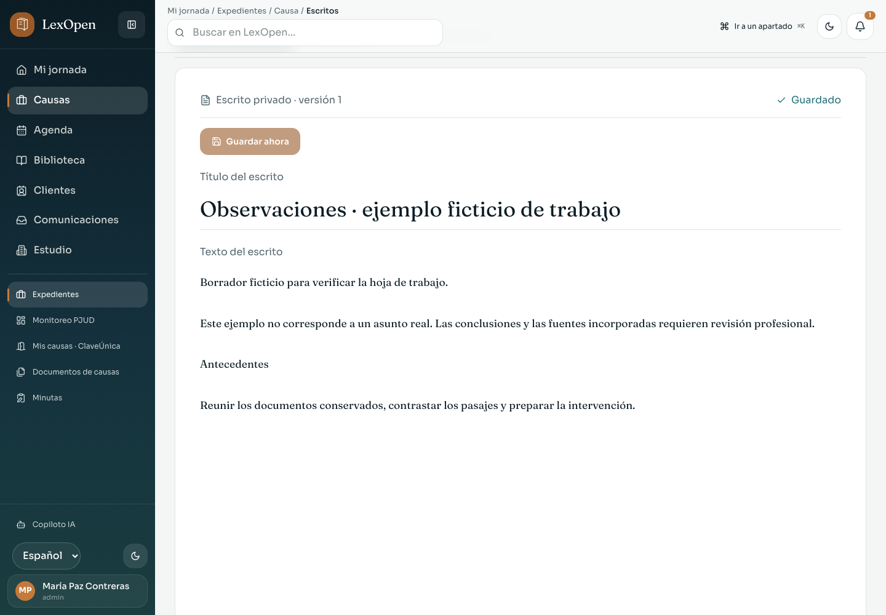

**Demostración con datos ficticios · móvil, 360 × 900.** Hoja editable y estado de guardado adaptados al ancho móvil.

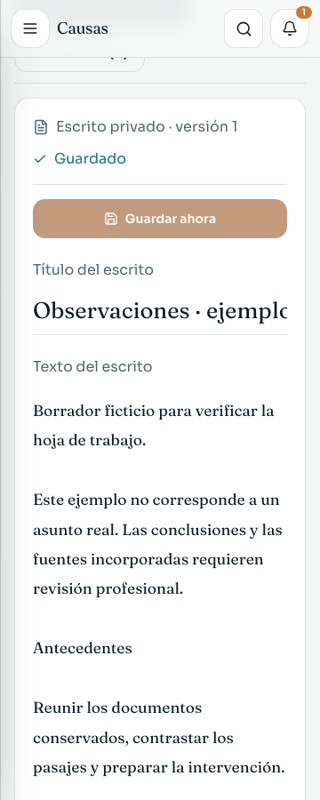

## Mesa del asistente

**Demostración con datos ficticios y ejecución simulada · escritorio, 1440 × 1167.** Interfaz real de Preparar, Ejecutar y Revisar. Proveedor, eventos y resultado simulados; no es prueba de Docker.

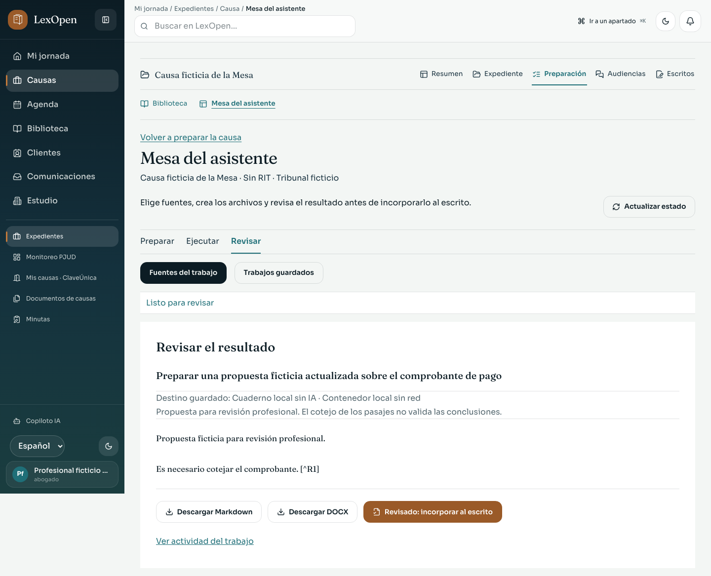

**Demostración con datos ficticios y ejecución simulada · móvil, 360 × 1730.** Resultado y acciones de revisión de la misma simulación.

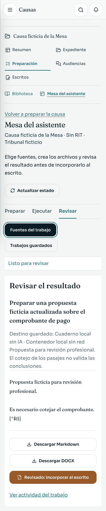

La evidencia del ejecutor y de la generación de documentos corresponde a su validación funcional propia; esta galería registra sólo la interfaz. [Funcionamiento y preparación de la Mesa](../WORKBENCH.md).
