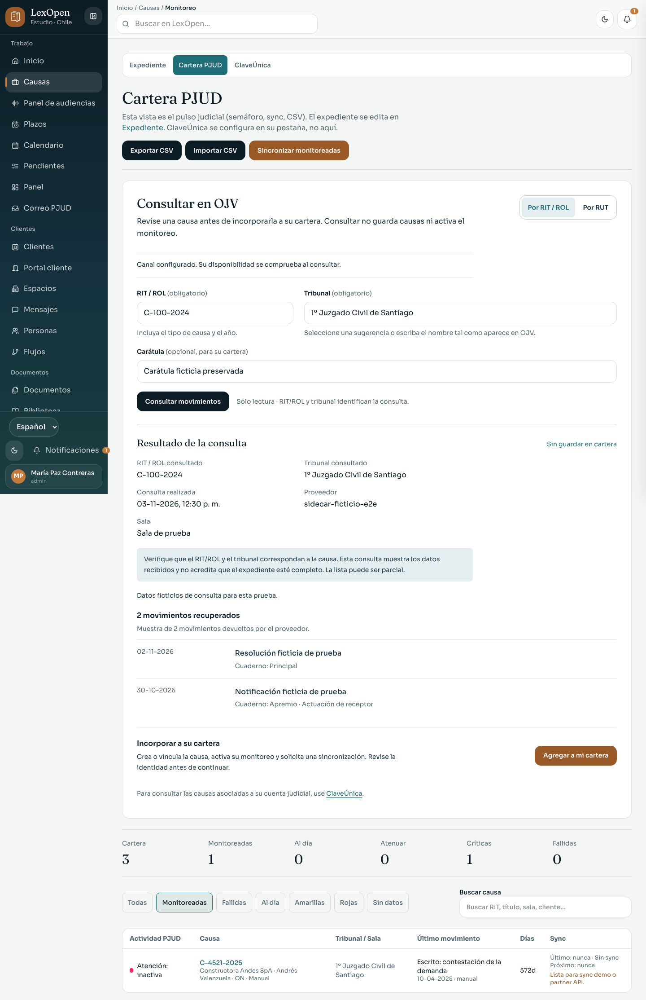

# Consulta pública OJV y Mis Causas

Base de la entrega: `main@5109ccf830bb6eaefbeee142224d9130ef0d9f9f`. Se mejoran ambos flujos con la identidad visual de LexOpen. Las capturas son pantallas reales de la aplicación con usuarios, respuestas y causas ficticios.

## Qué cambia

| Apartado | Mejora |
| --- | --- |
| Consulta pública | Lectura separada del registro; identidad, fecha, proveedor, cuaderno y muestra parcial visibles. Campos conservados, resultados retirados al editar, errores recuperables, cancelación y registro explícito. |
| Selección del expediente | RIT completo y tribunal concreto; no acepta números parecidos, ordinales distintos, filas ambiguas ni datos de un resultado anterior. Paginación con detección de repetición y límites. |
| Historial | Se elimina la fabricación de movimientos a partir del listado de causas. Un historial vacío exige una señal explícita; un DOM no reconocido produce un error. |
| Mis Causas | Permisos de la interfaz alineados con la API, carga recuperable, guardado diferenciado de acceso comprobado y resultados vacíos o parciales sin falsos avisos de éxito. |
| ClaveÚnica | El apagado explícito del Host se comprueba antes de leer o transmitir credenciales. Hostname de autenticación HTTPS exacto; errores sin parámetros OIDC ni título de página autenticada. |
| Trabajo en curso | Finalización condicionada al claim; fallos de persistencia y cola dejan estado fallido o parcial. Limpiar avisos no borra un trabajo que comenzó concurrentemente. Todas las causas recuperadas se encolan por tandas. |
| Documentos | Identidad por cuaderno y folio compatible, sin adivinar PDF por título o folio parcial. Los pendientes continúan después de los documentos ya importados. |
| Conservación | Identificadores por cuaderno con compatibilidad histórica: se conserva el movimiento, su nota y su referencia documental cuando la identidad es inequívoca. Cuadernos desconocidos permanecen sin atribuir. |
| API | JSON estricto y acotado, límites por profesional, permisos actuales y respuestas privadas sin caché. Altas simultáneas se resuelven mediante transacciones sin duplicar la misma identidad. |

## Pantallas

| Superficie | Escritorio | Móvil, 360 px |
| --- | --- | --- |
| Consulta de una causa | [Ver](ojv-lookup-desktop.png) | [Ver](ojv-lookup-mobile.png) |
| ClaveÚnica y resultado parcial | [Ver](claveunica-partial-desktop.png) | [Ver](claveunica-partial-mobile.png) |

## Verificación

Se conservan pruebas y huellas en el [manifiesto](manifest.json). La guía de uso y preparación del Host está en [PJUD](../PJUD.md).

- Diez escenas de interfaz con respuestas ficticias: lectura/registro, cambios de criterio, fallos, vacíos, cancelación, permisos, guardado de acceso y resultados parciales.
- Siete pruebas de las rutas reales de LexOpen con PostgreSQL desechable: privacidad, cuerpos inválidos, permisos, identidad, muro ético y altas concurrentes. Ninguna consulta real a la OJV ni sincronización válida de ClaveÚnica.
- Fixtures Chromium locales para selección exacta, paginación y rechazo de páginas estancadas.
- PostgreSQL real desechable para comprobar promoción histórica en su misma fila, conservación de nota y referencia documental, cuadernos separados y repetición concurrente.
- Regresiones de apagado de ClaveÚnica, estado de sincronización, cola de más de cien causas, PDF, cuerpos JSON, permisos e identificadores.
- Suite completa de pruebas generales y de integración: aprobadas. La suite de integración utiliza una base vacía y separada de la base con datos de demostración de las pruebas de navegador.
- Lint, TypeScript y compilación de producción: aprobados. Permanecen cuatro avisos previos de rastreo dinámico de archivos en `rate-limit.ts` y `storage.ts`.
- Comprobación HTTP de la versión compilada con seguridad normal: ambas páginas, metadatos privados, JSON inválido, protección CSRF y canal OJV apagado. No es una publicación ni una consulta al portal.

La revisión visual independiente finalizó con **disposition: ship**, sin correcciones materiales pendientes. La revisión de backend detectó una colisión entre cuadernos; se corrigió y su veredicto final fue **resolved**.

## Acceso real y límites

Se consultó la [entrada oficial de OJV](https://oficinajudicialvirtual.pjud.cl/home/index.php) el 3 de noviembre de 2026. Una sesión nueva de Chromium cargó la página y activó su entrada pública, pero no obtuvo un formulario de consulta verificable en la lectura realizada. La lectura remota con Firecrawl falló por resolución DNS de su API; la comprobación de la entrada se contrastó mediante acceso web y navegador local.

No se resolvió CAPTCHA, no se inició sesión, no se utilizaron credenciales del estudio ni se consultaron expedientes reales. Las pruebas no acreditan funcionamiento completo contra el portal vivo ni calidad de una extracción real. La consulta pública por RUT mantiene el año y los filtros disponibles; no certifica una cartera completa. La importación manual de PDFs conserva un bloqueo por proceso, apropiado para una única instancia Host.
