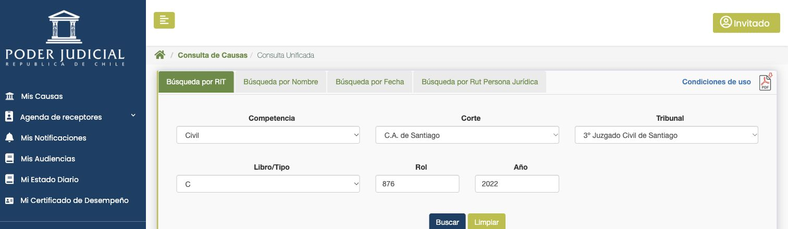
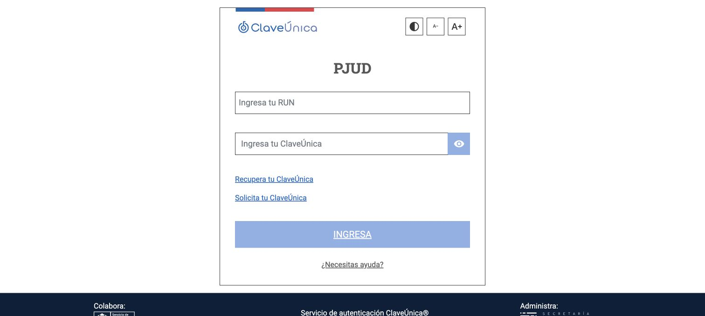

# Accesos oficiales y nueva validación real de OJV

Continuación de la [primera comprobación](../ojv-validacion-real-2026-11-03/README.md), sobre `main@8defd384156b375972901a70ae57d41b60232893`.

## Entradas verificadas

La [portada del Poder Judicial](https://www.pjud.cl/), sección Tramitación, publica accesos diferentes para consulta, servicios personales e ingreso de escritos:

| Servicio | Entrada publicada | Resultado en Chrome |
| --- | --- | --- |
| Consulta pública | [Consulta Unificada](https://oficinajudicialvirtual.pjud.cl/includes/sesion-consultaunificada.php) | Abre `indexN.php` como Invitado con el formulario de búsqueda completo. |
| Servicios personales | [Oficina Judicial Virtual](https://oficinajudicialvirtual.pjud.cl/home/) | Todos los servicios → Clave Única abre el formulario oficial de identificación con encabezado **PJUD**. |
| Presentación de escritos | [Ingreso de causas y escritos](https://ojv.pjud.cl/) | Servicio independiente; su formulario no se utiliza para acreditar Mis Causas. |

En esta comprobación no se reprodujo el error 404 al seguir la entrada general publicada. No quedó determinada la causa del fallo anterior. Se conserva la navegación oficial normal y la acción del formulario de identificación.

## Consulta por RIT/ROL

Se consultó **C-876-2022, 3º Juzgado Civil de Santiago**, cuya identificación aparece en una [publicación oficial de PJUD](https://www.pjud.cl/prensa-y-comunicaciones/noticias-del-poder-judicial/147149). Se seleccionaron Civil, C.A. de Santiago, el tribunal concreto, tipo C, número 876 y año 2022. La respuesta nueva mostró exactamente ese RIT y tribunal; se abrió su detalle.

El cuaderno seleccionado era **1.0 - Principal**, con **124 filas**. Había otros dos cuadernos disponibles, que no se consultaron. La comprobación local del lector utilizó exclusivamente el texto de las celdas del Principal, sin enlaces ni parámetros de sesión: el lector corregido produjo **124 movimientos con título y fecha válida**, sin filas omitidas. No se descargaron PDFs ni se certificó la historia completa del expediente.

## Cambios derivados de la observación real

- La consulta pública comienza en su entrada de sesión publicada; el acceso general usa `/home/`.
- Se reconocen el tab `busRit`, los campos `conRolCausa`, `conEraCausa`, `conTipoCausa` y la tabla `dtaTableDetalle`, manteniendo compatibilidad con el formulario anterior.
- En el formulario actual se selecciona primero la corte para cargar los tribunales, y después se exige coincidencia exacta del tribunal. Una corte ambigua detiene la consulta.
- Las cabeceras civiles de nueve columnas y «Fec. Trámite» se reconocen. El título usa «Desc. Trámite», con etapa y trámite en sus columnas correspondientes.
- Ocho filas reales mostraban dos fechas en una celda. En una columna de fecha reconocida se usa la primera fecha mostrada y se conserva el texto completo en el detalle. Una fecha principal vacía o inválida no se sustituye con otra celda.
- La lectura del historial Civil activo excluye las tablas de remisiones de la Corte y los paneles ocultos. La selección de carátula del listado excluye las fechas.
- Mis Causas reconoce el interruptor de filtros de la materia activa y busca mediante su botón visible, evitando botones de otras materias ocultas.

## Mis Causas: sesión manual y búsqueda verificadas

El usuario completó personalmente el ingreso en el formulario con encabezado PJUD y confirmó su regreso a Mis Causas. Se verificó una sesión identificada, se abrió el módulo y se activó el interruptor de filtros de **Corte Suprema**. La búsqueda mediante su botón Buscar reemplazó los elementos de filas anteriores y devolvió causas con ROL, fecha de ingreso y corte reconocibles.

La comprobación cubre esa materia con los filtros de la sesión; no certifica toda la cartera, otras materias ni todos los estados. No se abrieron detalles de expedientes privados, no se publican sus identificadores y el recuento exacto no se publica.

La imagen corresponde al formulario vacío anterior al ingreso. La validación autenticada registra sólo el resultado de acceso, sin copiar filas privadas, RUT, nombres, cookies o parámetros OIDC a la documentación. No se modificó la cartera del estudio ni se guardaron credenciales.

## Alcance de la verificación

Se distinguen cuatro comprobaciones: consulta y apertura del expediente público en el portal real mediante Chrome; lectura del texto real de sus celdas por el parser local; búsqueda en Mis Causas tras el ingreso manual; y pruebas del conector con páginas ficticias que reproducen los controles observados. Los fixtures no acreditan por sí solos una ejecución del conector automático contra la OJV real. La disponibilidad del portal puede variar entre sesiones.

## Comprobaciones del cambio

Las pruebas cubren la carga en cascada de corte y tribunal, la limpieza de campos al cambiar tipo, la selección exacta frente a duplicados ocultos, el rechazo de cortes ambiguas, las fechas dobles y los paneles de historial. Mis Causas tiene fixtures con el interruptor realista de filtros y dos materias: el botón oculto de una materia anterior no puede iniciar la nueva búsqueda.

Pasaron la suite general, las regresiones del parser, identidad, selectores y ClaveÚnica, los fixtures Chromium locales, ESLint, TypeScript y la compilación de producción. La revisión independiente final no dejó hallazgos accionables. La compilación conserva los cuatro avisos previos de rastreo dinámico de archivos de `rate-limit.ts` y `storage.ts`.
