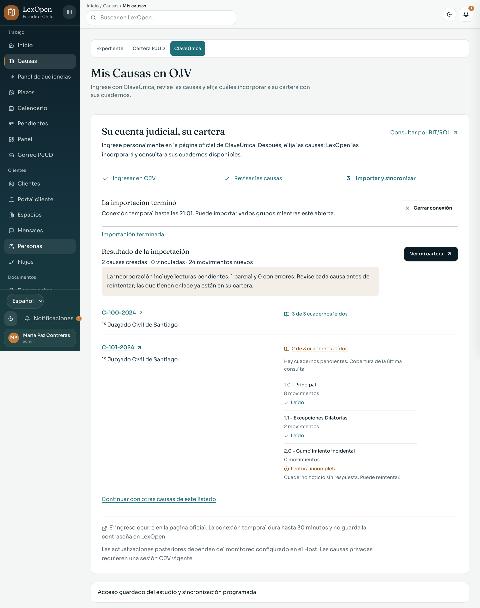

# Ingreso manual OJV y cobertura de cuadernos

Entrega del 3 de noviembre de 2026. Amplía las pantallas existentes de Mis Causas, consulta pública, cartera y expediente. Conserva la identidad de LexOpen y separa la lectura de la incorporación de causas al estudio.

## Recorrido disponible

En **Causas → ClaveÚnica**, el profesional abre el formulario oficial desde el Host local, completa personalmente el ingreso y vuelve a LexOpen para consultar Mis Causas. Puede filtrar por materia, buscar, revisar y elegir hasta veinte causas por grupo. Consultar el listado no incorpora causas. La importación comprueba de nuevo la selección, crea o vincula expedientes y consulta los cuadernos disponibles.

**Mostrar ventana oficial** activa la pestaña temporal abierta por LexOpen para distinguirla de la OJV del navegador habitual. Conserva la selección, el recibo y el plazo de la conexión; activar la pestaña no acredita un ingreso ni abre otra sesión. La acción no se ofrece durante apertura, consulta o importación. El ingreso inicial dispone de hasta quince minutos y la conexión completa de hasta treinta desde su apertura.

El resultado aparece antes del listado y recibe foco una sola vez al terminar la importación iniciada desde esa pantalla. **Continuar con otras causas** vuelve al paso de revisión y conserva el recibo anterior en un desplegable. El acceso guardado del estudio sigue en un apartado separado.

La consulta pública y la importación manual muestran cuántos cuadernos se leyeron, cuáles están incompletos y qué movimientos corresponden a cada uno. La cartera y el expediente conservan la cobertura de la última consulta. Los movimientos históricos sin cuaderno conocido permanecen separados. Una lectura parcial conserva lo recuperado y pide reintento.

La conexión manual requiere `PJUD_MANUAL_SESSION=1` en el Host web local o Desktop en modo Host, `PJUD_PUBLIC_SCRAPE=1`, navegador visible y permisos vigentes de Mis Causas. `PJUD_CLAVEUNICA_SCRAPE=0` la bloquea. Dura hasta treinta minutos y permite varios grupos. La contraseña se escribe en el formulario oficial; esta vía no envía contraseña ni cookies OJV a la interfaz ni las guarda en el vault. [Preparación, seguridad y recuperación](../PJUD.md#ingreso-manual-desde-la-interfaz).

## Capturas con datos ficticios

Las seis imágenes proceden de la interfaz local con respuestas ficticias interceptadas para las pruebas. Los nombres, RIT/ROL, tribunales y movimientos que aparecen como demostración no representan una cartera real.

| Pantalla | Escritorio | Móvil, 360 px |
| --- | --- | --- |
| Consulta por RIT/ROL y cobertura | [Ver](ojv-lookup-desktop.png) | [Ver](ojv-lookup-mobile.png) |
| Revisión y selección manual | [Ver](ojv-manual-selection-desktop.png) | [Ver](ojv-manual-selection-mobile.png) |
| Resultado y cuadernos | [Ver](ojv-manual-result-desktop.png) | [Ver](ojv-manual-result-mobile.png) |

## Verificación y alcance

**Lector público real, sólo lectura.** El [informe de consulta pública](consulta-publica-todos-cuadernos.json) registra una consulta real del conector, sin descargas de documentos ni escritura en la base del estudio. Enumeró y leyó tres cuadernos: Principal, Excepciones Dilatorias y Cumplimiento incidental, con 243, 24 y 243 movimientos, respectivamente. La repetición devolvió los mismos **510 movimientos** e identidades estables. Esta evidencia corresponde a esa causa pública y ese momento; no acredita todos los tribunales ni todas las variantes del portal.

**Interfaz pública real con persistencia.** El [informe de la interfaz pública](interfaz-publica.json) registra la consulta e importación reales desde la interfaz de LexOpen en una base aislada. Se guardaron **510 movimientos de tres cuadernos**. La repetición añadió **0 movimientos** y no generó duplicados. Esta comprobación amplía la evidencia del lector de sólo lectura; su alcance se limita a la causa pública consultada y no acredita el ingreso privado de Mis Causas.

**Interfaz con datos ficticios.** Las pruebas de `e2e/ojv-lookup.spec.ts` y `e2e/ojv-manual-session.spec.ts` recorren consulta y registro separados, estados de ingreso, selección entre páginas y filtros, límite de veinte, importación, recibo, repetición de grupos, cobertura, errores, pérdida de permisos y navegación. Las 22 pruebas dirigidas pasaron sobre PostgreSQL desechable. Las capturas verifican escritorio y 360 píxeles; no son capturas de una cuenta privada real.

**Backend y conservación.** Pasaron las pruebas de cobertura, transporte acotado, pertenencia de la sesión, solicitudes, permisos, cierre y vencimiento; las cuatro suites de navegador del conector usan fixtures locales. Las comprobaciones con PostgreSQL desechable cubren persistencia de cobertura, conservación histórica, migración e idempotencia, además de la reserva de trabajos `manual-session` frente al cron y a reintentos ordinarios. Los límites de 10.000 movimientos, 100 cuadernos y 20 MiB mantienen un resultado parcial explícito.

**Comprobaciones generales.** La suite general, lint, tipos y compilación de producción pasaron. La revisión visual independiente terminó con **disposition: ship** tras resolver la llegada al resultado con foco único, la vuelta al paso de revisión con recibo anterior y el registro durable de estas decisiones en el [brief de la superficie](../../.impeccable/surfaces/src-components-pjud-pjudquickaddpanel-tsx.md). No se reemplazó el sistema visual global.

**Identificación de la ventana temporal.** **Mostrar ventana oficial** activa una pestaña oficial del contexto propio, manteniendo la selección, el resultado y el vencimiento. Diez pruebas dirigidas de ingreso manual y navegación pasaron con respuestas ficticias, incluidos el enfoque durante la espera, la conservación del estado y un fallo recuperable al activar la ventana. Las capturas de selección y resultado se actualizaron con esos mismos datos ficticios.

El [control real del botón de ventana](control-ventana-oficial.json) abrió el formulario oficial desde LexOpen y aceptó la activación sin error, conservando el estado de espera y sin iniciar otra conexión. Esta comprobación no acredita autenticación, consulta ni importación privadas.

## Límites de esta entrega

Para comprobar una cuenta privada, conserve la evidencia localmente; no incorpore información ni resultados de su cartera a este informe público. Las pruebas con datos ficticios no acreditan por sí solas CAPTCHA, autenticación real o cobertura completa de una cartera privada. Las [pruebas anteriores del conector](../ojv-sincronizacion-automatica-2026-11-03/README.md) se conservan por separado.

Los trabajos de una sesión temporal no los continúa el cron con otro proveedor. Una lectura parcial o fallida requiere recuperar el ingreso; tras un resultado correcto, futuras actualizaciones dependen de los canales y la configuración del Host. Mostrar un intervalo configurado no acredita que el programador esté ejecutándose ni mantiene acceso privado permanente.

La implementación original y sus comprobaciones de GitHub se siguen en el [PR 228](https://github.com/gabrielperezibacache/lexopen/pull/228), y el control de ventana oficial en el [PR 229](https://github.com/gabrielperezibacache/lexopen/pull/229); allí se puede comprobar su estado de integración. Esta evidencia no acredita un despliegue. [Guía operativa PJUD](../PJUD.md).
