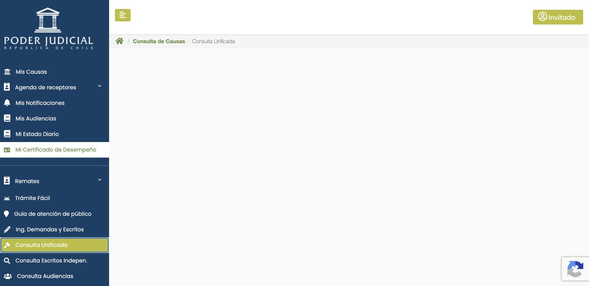
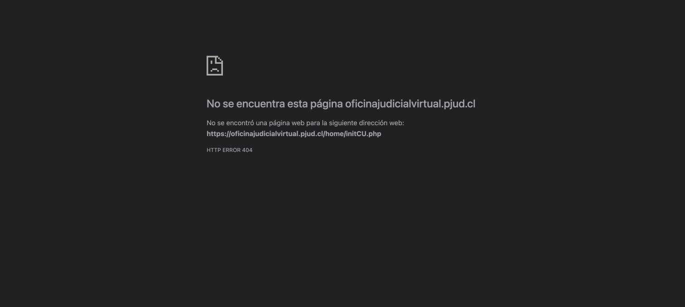

# Validación contra la OJV real — 3 de noviembre de 2026

**Actualización:** una [comprobación posterior mediante los accesos publicados por PJUD](../ojv-accesos-oficiales-2026-11-03/README.md) consiguió consultar el expediente público y abrir el formulario correcto de identificación. Los resultados siguientes describen la sesión anterior.

Base: `main@3675d36ef8de118192f6676e480903d71c02c00a`. Esta comprobación distingue navegación real, resultados de expedientes y pruebas locales del conector.

## Resultado observado en Chrome

| Recorrido oficial | Evidencia | Alcance comprobado |
| --- | --- | --- |
| Inicio → Consulta causas → Consulta Unificada | Se abre `/indexN.php` como Invitado. El menú cambia las migas de navegación, pero el área de consulta permanece vacía: documento completo, cero campos de búsqueda. | Acceso al menú; **sin consulta por RIT/ROL ejecutada**. |
| Todos los servicios → Clave Única | La propia página dirige a `/home/initCU.php`; Chrome muestra **HTTP ERROR 404**. | Fallo de esa entrada oficial antes del formulario de identificación. |
| Ingreso de causas y escritos → Clave Única | Se abre el formulario en `https://accounts.claveunica.gob.cl/accounts/login/`, con el título «Ingreso de causas y escritos». | Formulario del servicio de presentación de escritos; **no acredita acceso a Mis Causas**. |
| Invitado → Mis Causas | El portal solicita identificación con ClaveÚnica; «Ingrese Aquí» vuelve a la portada. | La sesión invitada no habilita Mis Causas. |

La causa elegida para la consulta pública fue **C-876-2022, 3º Juzgado Civil de Santiago**, identificada en una [publicación oficial del Poder Judicial](https://www.pjud.cl/prensa-y-comunicaciones/noticias-del-poder-judicial/147149). No se llegó a introducirla: no había formulario verificable. La insignia invisible de reCAPTCHA no equivale a un desafío presentado al usuario.

Estos resultados describen esta sesión y este recorrido. No demuestran una caída general del portal ni que todos sus accesos estén indisponibles. No se adivinaron rutas alternativas ni se alteró la seguridad del navegador.

## Correcciones del conector

- La disponibilidad de Consulta Unificada exige campos reales; las pestañas y las migas del menú no bastan. Si queda el menú vacío, el error informa que no se inició una búsqueda.
- El diagnóstico público contiene estados y metadatos de campos, sin valores, texto de expedientes, cookies o parámetros de URL. Distingue una insignia invisible de un checkbox o desafío visible.
- El modo de validación manual conserva los avisos, términos y CAPTCHA para el usuario. No lee el almacén de credenciales ni importa causas.
- La espera OIDC se instala antes de abrir ClaveÚnica: cubre ventana emergente inmediata y navegación en la misma pestaña. Las salidas del diagnóstico eliminan consultas, fragmentos, títulos y errores crudos.
- La lectura de una sesión manual devuelve sólo estados y contadores; exige filas nuevas o reemplazadas tras Buscar y rechaza los resultados anteriores, incluso ocultos. Los cambios dentro de una fila anterior quedan inconcluyentes. Una lista vacía permanece sin verificar.

## Comprobaciones locales y límites

`npm run test:pjud:browser` utiliza exclusivamente páginas simuladas, servidas mediante interceptación local de Playwright. Comprueba navegación, formularios tardíos o ausentes, CAPTCHA visible e invisible, ventanas OIDC, redacción y rechazo de tablas anteriores. No demuestra acceso al portal vivo.

Comprobaciones aprobadas sobre los cambios:

- Suite general `npm test` y regresiones finales de ClaveÚnica, selectores y eventos OIDC.
- `npm run test:pjud:browser`, con los nuevos casos de tabla anterior, indicador de carga y tabla nueva separada.
- ESLint y TypeScript sin emisión.
- Compilación de producción `npm run build`.
- Revisión independiente: se corrigió el falso positivo por mutaciones ajenas a los resultados; sin hallazgos pendientes en el diff final.

La nueva prueba de eventos OIDC forma parte de `npm test`; las pruebas de lectura manual forman parte de `test:pjud:browser`. La compilación inicial quedó sin actividad bajo permisos restringidos y se detuvo; la repetición con permisos adecuados terminó correctamente. Estas comprobaciones locales no sustituyen la extracción real pendiente.

No se introdujeron credenciales reales, no se resolvió CAPTCHA, no se aceptaron términos, no se guardó una sesión autenticada ni se modificó la cartera o la base del estudio. **Siguen pendientes la extracción pública real y la lectura autenticada real de Mis Causas.** Para completarlas hace falta que el servicio correspondiente permita llegar al formulario público y al acceso de identificación; después, el usuario debe iniciar sesión en el navegador oficial.
