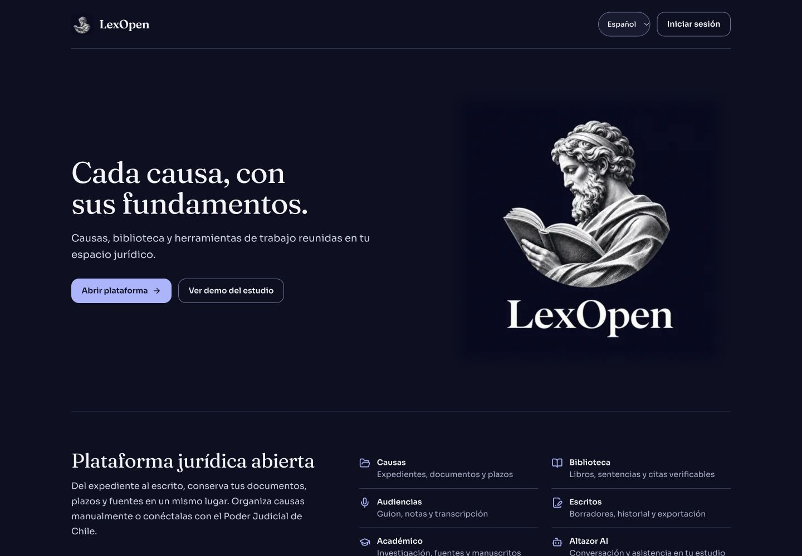

# LexOpen en índigo y plata

Las imágenes de esta carpeta muestran la interfaz real con una base aislada y datos ficticios. La vista bajo el chat muestra el estado del entorno de demostración. No se abrió un escritorio real ni se conectó una cuenta personal en estas capturas.

| Pantalla | Escritorio · 1440 × 1000 | Móvil · 360 × 800 |
| --- | --- | --- |
| Portada | [Ver](portada-escritorio.jpg) | [Ver](portada-movil.jpg) |
| Ingreso | [Ver](ingreso-escritorio.jpg) | [Ver](ingreso-movil.jpg) |
| Chat, avisos y escritorio de Altazor | [Ver](inicio-escritorio.jpg) | [Ver](inicio-movil.jpg) |
| Mesa de revisión académica | [Ver](mesa-revision-escritorio.jpg) | |
| Mis Causas | [Ver](mis-causas-escritorio.jpg) | |
| Carpeta del expediente | [Ver](expediente-escritorio.jpg) | [Ver](expediente-movil.jpg) |

[Tamaños y huellas de las capturas](manifest.json) · [Procedencia del logotipo](../assets/lexopen-icon-provenance.json).

La vista activa se comprobó por separado en Chromium con una respuesta y una imagen sintéticas: aparece debajo de Adjuntar y Enviar, no desborda en móvil y oculta la captura al pasar a control manual. La prueba de integración confirma que observar no crea una sesión ni opera el escritorio y que el alcance personal no descubre el escritorio de una causa.

[Puesto de trabajo](../PLAN-PUESTO-DE-TRABAJO-ALTAZOR.md) · [Guía de escritorio](../ESCRITORIO-ALTAZOR.md) · [IA local](../IA-LOCAL.md).
